北 京 科 技 大 学

硕士学位研究生

中期报告

论文题目：Machine Learning for Medium- to Long-Term Sand and Dust Storm Forecasting in Saudi Arabia, with Special Emphasis on Riyadh

指 导 教 师：Associate Professor Wen Wei (温维)

单　   　位：School of Energy and Environmental Engineering, University of Science and Technology Beijing (USTB)

学　   　号：202461024

作　   　者：语嫣 yuyan

专 业 名 称：Master’s Degree in Environmental Engineering

入 学 时 间：_________________________

20XX年XX月XX日

Chinese Library Classification (中图分类号): TP181 / P457          UDC: 551.5

Confidentiality Level (密级): Public / 公开                              Degree Level: Master's Degree

University of Science and Technology Beijing

Master's Degree Dissertation

Machine Learning for Medium- to Long-Term Sand and Dust Storm Forecasting in Saudi Arabia, with Special Emphasis on Riyadh

Author: 语嫣 yuyan          Supervisor: Associate Professor Wen Wei (温维)

School of Energy and Environmental Engineering, University of Science and Technology Beijing (USTB)

Beijing 100083, P. R. China

学位论文独创性声明

Declaration of Thesis Originality

本人郑重声明：所呈交的学位论文，是本人在导师的指导下，独立进行研究工作所取得的成果。尽我所知，除文中已经注明引用的内容外，本论文不包含任何其他个人或集体已经发表或撰写过的研究成果。对本文的研究做出重要贡献的个人和集体，均已在文中以明确方式标明。本声明的法律结果由本人承担。

I hereby solemnly declare that this dissertation represents my own independent research work conducted under the supervision of my advisor. To the best of my knowledge, except for the cited references explicitly acknowledged in the text, this thesis contains no material previously published or written by any other individual or institution. All contributors to this research have been clearly recognized. I accept full legal responsibility for this declaration.

Author Signature (作者签名): _________________________          Date (日期): ______ Year ___ Month ___ Day

学位论文版权使用授权书

Authorization Statement for Thesis Usage

本人完全了解北京科技大学有关保留、使用学位论文的规定，即：学校有权保留并向国家有关部门或机构送交论文的复印件和电子版，允许论文被查阅和借阅。本人授权北京科技大学可以将学位论文的全部或部分内容编入有关数据库进行检索，可以采用影印、缩印或扫描等复制手段保存和汇编学位论文。

I fully understand the regulations of the University of Science and Technology Beijing (USTB) regarding the retention and use of academic dissertations. USTB has the right to retain and submit printed and electronic copies to relevant national institutions and permit the thesis to be consulted and borrowed. I authorize USTB to include all or part of this thesis in relevant databases for retrieval and to preserve and compile it through photocopying, microfilming, or digital scanning.

Author Signature (作者签名): _________________________          Supervisor Signature (导师签名): _________________________

Date (日期): ______ Year ___ Month ___ Day

# Acknowledgements (致  谢)

I would like to express my deepest and most sincere gratitude to my academic supervisor, Associate Professor Wen Wei (温维), at the School of Energy and Environmental Engineering, University of Science and Technology Beijing (USTB), for his dedicated mentorship, invaluable scientific guidance, rigorous methodological feedback, and continuous encouragement throughout every stage of this Master's dissertation.

My sincere appreciation also goes to the faculty members and defense committee of the School of Energy and Environmental Engineering for their insightful suggestions on atmospheric risk modeling, strict temporal-validation discipline, and operational early-warning integration. I gratefully acknowledge the open scientific data provided by the European Centre for Medium-Range Weather Forecasts (ECMWF) ERA5, the Copernicus Atmosphere Monitoring Service (CAMS), satellite aerosol retrieval archives, and regional ground METAR station networks.

Finally, I extend heartfelt thanks to my family and colleagues for their unwavering patience, support, and motivation throughout my graduate studies in Beijing.

# ABSTRACT

Sand and dust storms (SDS) over the Arabian Peninsula—particularly across Greater Riyadh—pose severe hazards to aviation safety, respiratory health, solar generation, and urban infrastructure. To deliver reliable 1- to 15-day (24–360 h) forecasts, this thesis constructs a strictly causal 86,928-hour, 115-feature multi-modal dataset (2015–2024) fusing ground METAR telemetry, ERA5 boundary-layer physics, detrended satellite retrievals, CAMS aerosol fields, and seasonal dust-memory descriptors, partitioned chronologically (70%/15%/15%) with 360-hour purge gaps.

A dual-pipeline architecture is evaluated across five horizons H ∈ {24, 72, 168, 216, 360} h and three random seeds using 6-hourly samples (10,142 / 2,114 / 2,114 across train/validation/test). In Main Line A, calibrated tabular ensembles exceed monthly-climatology ROC-AUC at every horizon (0.809 vs. 0.643 at 24 h; 0.717 vs. 0.641 at 72 h; 0.703 vs. 0.658 at 168 h; 0.716 vs. 0.666 at 216 h; 0.766 vs. 0.665 at 360 h), outperforming Persistence_Cal (0.5701 at 24 h; 0.4721 at 360 h). In Main Line B, PyTorch sequence and graph-structured GRU prototypes achieve 0.6817–0.7939 classification ROC-AUC; however, for continuous PM₁₀ regression, all models yield negative test R², and a constant training-median baseline achieves lower RMSE than Line B at 24–216 h (e.g., 11.8 vs. 14.5 μg/m³ at 168 h), with Line B lower only at 360 h (14.1 vs. 15.5 μg/m³).

Finally, a six-module Explainable AI suite (XAI-1 to XAI-6) confirms physical realism: Ground_METAR (~37.4%), Calendar_Diurnal (~32.2%), and ERA5_Physics (~23.5%) dominate attributions—led by Shamal seasonal phase (sin_doy), multi-month dust memory, soil moisture, vapor pressure deficit, and gusts—while PyTorch LSTM saliency peaks at Lag 0 h, providing transparent operational guidance under inter-annual regime shifts.

Keywords: Sand and Dust Storm Forecasting; Explainable AI (XAI); Physics-Informed Neural Network (PINN); Spatiotemporal Graph Neural Network (ST-GNN); Calibrated Ensemble Learning; Greater Riyadh

# 摘  要

阿拉伯半岛尤其是大利雅得地区频发的沙尘暴（SDS）对航空安全、呼吸系统健康、光伏发电和城市基础设施构成严重威胁。为实现可靠的1至15天（24—360小时）预报，本文构建了严格因果的86,928小时、115维多模态数据集（2015—2024年），融合地面METAR观测、ERA5边界层物理场、去趋势卫星反演、CAMS气溶胶场及季节性沙尘记忆特征，并采用70%/15%/15%时间顺序划分与360小时隔离带（purge gap）防止数据泄露。

双通道架构在五个预报时效 H ∈ {24, 72, 168, 216, 360} h 与三个随机种子下基于6小时样本（训练/验证/测试分别为10,142 / 2,114 / 2,114）进行评估。在主线A中，校准表格集成模型在所有时效上均优于月气候态基线（24 h为0.809对比0.643；72 h为0.717对比0.641；168 h为0.703对比0.658；216 h为0.716对比0.666；360 h为0.766对比0.665），并显著超过Persistence_Cal（0.5701与0.4721）。在主线B中，PyTorch时序与图结构GRU原型取得0.6817—0.7939的分类ROC-AUC；但在连续PM₁₀回归任务中，所有模型测试集R²均为负值，且常数训练中位数基线在24—216 h的RMSE低于主线B（如168 h为11.8对比14.5 μg/m³），主线B仅在360 h更低（14.1对比15.5 μg/m³），因此本原型尚未验证连续回归技能。

最后，六模块可解释人工智能审计（XAI-1至XAI-6）验证了模型的物理真实性：Ground_METAR（约37.4%）、Calendar_Diurnal（约32.2%）和ERA5_Physics（约23.5%）主导全局归因——以夏马风季节相位（sin_doy）、多月沙尘记忆、土壤湿度、饱和水汽压差及阵风为核心驱动——同时PyTorch LSTM梯度显著性在Lag 0 h达到峰值，为年际沙尘模态变化下的业务预警提供了透明可靠的决策支持。

关键词：沙尘暴预报；可解释人工智能（XAI）；物理信息神经网络（PINN）；时空图神经网络（ST-GNN）；概率校准集成；大利雅得

| Abbreviation | Full Term |
| --- | --- |
| AOD | Aerosol Optical Depth |
| BLH | Boundary Layer Height |
| BSS | Brier Skill Score |
| CAMS | Copernicus Atmosphere Monitoring Service |
| CV | Cross-Validation |
| DOY | Day of Year |
| ECMWF | European Centre for Medium-Range Weather Forecasts |
| ERA5 | ECMWF Reanalysis v5 |
| ET | ExtraTrees (Extremely Randomized Trees) |
| GRU | Gated Recurrent Unit |
| HistGB | Histogram-Based Gradient Boosting |
| ICE | Individual Conditional Expectation |
| KKIA | King Khalid International Airport (OERK) |
| LSTM | Long Short-Term Memory |
| METAR | Meteorological Aerodrome Report |
| MI | Mutual Information |
| MLP | Multi-Layer Perceptron |
| NWP | Numerical Weather Prediction |
| OERK | King Khalid International Airport ICAO Station Code |
| OERY | Riyadh Air Base ICAO Station Code |
| PDP | Partial Dependence Plot |
| PINN | Physics-Informed Neural Network |
| PM₁₀ | Particulate Matter with Aerodynamic Diameter ≤ 10 μm |
| PR-AUC | Area Under the Precision–Recall Curve |
| RF | Random Forest |
| RMSE | Root Mean Squared Error |
| ROC-AUC | Area Under the Receiver Operating Characteristic Curve |
| SDS | Sand and Dust Storm |
| SHAP | SHapley Additive exPlanations |
| ST-GNN | Spatiotemporal Graph Neural Network |
| VPD | Vapor Pressure Deficit |
| WMO | World Meteorological Organization |
| XAI | Explainable Artificial Intelligence |
| XGBoost | Extreme Gradient Boosting |

# Chapter 1  Introduction

This opening chapter establishes the environmental, health, aviation, and economic urgency of sand and dust storm (SDS) forecasting across Greater Riyadh, defines the research objectives and multi-horizon scope (24–360 h), and outlines the seven-phase research schedule.

## 1.1 Why This Matters

Sand and dust storms are among the most significant environmental hazards affecting arid and semi-arid regions worldwide.

The frequency, intensity, and duration of dust storms depend on several interacting factors, including wind speed and direction, soil moisture, vegetation cover, land degradation, atmospheric stability, and regional meteorological conditions.

Sand and dust storms represent a recurring environmental and public-health challenge, with implications for human well-being, economic productivity, infrastructure, and sustainable development. One of the most important consequences of dust storms is their adverse effect on human health.

Exposure to elevated concentrations of airborne dust may exacerbate asthma, allergic respiratory conditions, chronic obstructive pulmonary disease, and other cardiopulmonary disorders.

Children, older adults, outdoor workers, and individuals with pre-existing respiratory or cardiovascular diseases may be particularly vulnerable.

In addition to their health consequences, sand and dust storms create substantial environmental and socioeconomic challenges. Airports may experience flight delays, diversions, or cancellations when visibility falls below operational thresholds. In urban areas, accumulated dust increases cleaning requirements, affects building surfaces, and may contribute to the deterioration of infrastructure and public spaces.

Dust deposition on agricultural land can influence soil properties, crop productivity, and plant health, although the effects vary according to the mineral composition and nutrient content of the deposited material.

Why Riyadh is a particularly important city for dust-storm research. As the capital and a major administrative, economic, educational, and transportation centre of Saudi Arabia, Riyadh concentrates government institutions, commercial activities, healthcare facilities, universities, industrial establishments, and major transport networks.

Severe dust events affecting the city may disrupt multiple interconnected sectors simultaneously.

The geographical setting of Riyadh contributes to its vulnerability. Regional wind systems, frontal passages, pressure gradients, and convective outflows can contribute to dust mobilisation and transport.

The resulting dust concentrations depend on the interaction between wind speed, wind direction, atmospheric mixing, source-surface conditions, and the duration of transport.

The city's rapid urban expansion provides an additional reason for prioritising Riyadh in dust-storm research.

Research on falling dust in Riyadh has identified substantial dust deposition and spatial differences among sampling locations, including higher deposition near construction activities and in parts of eastern Riyadh during the study period.

Riyadh is also an important setting for examining the public-health consequences of airborne dust. High concentrations of particulate matter may coincide with periods of intense outdoor activity, heavy traffic, and elevated demand for urban services.

A model that performs well in Riyadh should not automatically be assumed to perform equally well in other Saudi Arabian cities. Coastal environments, mountain systems, regional circulation, land-surface properties, and source proximity differ across the Kingdom.

The importance of Riyadh is therefore not limited to its exposure to dust storms.

## 1.2 Understanding Sand and Dust Storms Today

### 1.2.1 From Natural Hazard to Forecasting Science

Causes of sandstorms. Dust weather is commonly classified, according to the severity of visibility reduction, as floating dust, blowing sand, dust storm and severe dust storm. Its main meteorological triggers are strong winds, cold fronts and cyclones, which lift loose surface material and carry it downwind.

Impacts and affected regions. Sandstorm impacts and hazards extend across continents; research indicates that nearly 330 million people across 151 countries worldwide are affected. From 2010 to 2013 alone, sandstorms caused economic losses of approximately US$1 billion in northern China.

Why forecasting matters. Forecasting sand and dust storms is therefore an essential component of environmental risk management in Saudi Arabia. These longer forecasting horizons may support advance planning for transportation, healthcare, construction, energy production, and emergency management.

However, accurate prediction remains difficult because dust storms emerge from complex interactions between atmospheric circulation, surface conditions, and regional dust transport.

Machine learning offers a promising means of addressing these challenges by combining meteorological measurements, satellite observations, dust-related indicators.

## 1.3 Background and Motivation

### 1.3.1 Sand and Dust Storms Overview

Sand and dust storms in Saudi Arabia arise from a combination of local emissions, regional dust mobilisation, and long-range atmospheric transport. The identification of relevant source areas is therefore essential for understanding the spatial and temporal variability of dust storms and for constructing reliable forecasting models.

Meteorological mechanisms responsible for dust mobilisation and transport. Strong wind gusts associated with cold fronts, pressure-gradient changes, and convective outflows may trigger rapid dust mobilisation. The duration of an event also depends on whether favourable wind conditions persist and whether the atmosphere continues to transport particles toward the receptor location.

Temperature, relative humidity, soil moisture, precipitation, vegetation cover, and land-surface characteristics influence the likelihood of dust emission. At the regional scale, synoptic circulation controls transport direction and speed, while atmospheric mixing and deposition determine how much dust remains airborne as the plume moves toward Riyadh.

These interacting mechanisms explain why simple extrapolation from historical dust frequency may be insufficient for accurate forecasting.

Forecasting methods must therefore distinguish between the conditions that generate dust, those that transport it, and those that determine its observed concentration over Riyadh.

### 1.3.2 Sand and Dust Storms in the Saudi and Riyadh Context

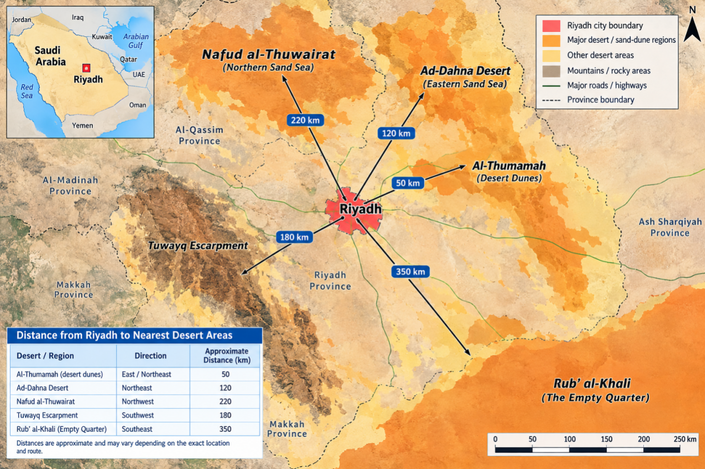

Riyadh City is situated on the Najd central plateau of Saudi Arabia, deeply embedded within a highly active regional and local environment heavily responsible for sand and dust storm (SDS) generation and transport. As shown in Figure 1.1 and Figure 1.2, Riyadh City sits on the Najd plateau surrounded by active desert corridors and administrative districts.

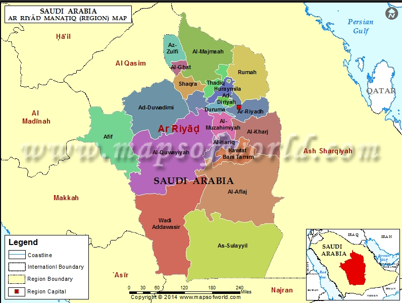

The nearby red sand dunes are approximately 40–50 km from central Riyadh, depending on the exact destination and route.

Local and regional SDS generation environments.

- The Ad Dahna Desert (local source, north and east). This narrow, crescent-shaped sand sea wraps around the eastern perimeter of the Riyadh region.
- The Rub' al Khali Desert (primary regional source, south). Southerly and southeasterly wind systems lift fine particles from this hyper-arid basin, transporting dense, orange-colored dust blankets directly over Riyadh.
- An Nafud and Iraqi Deserts (remote northern sources). During the spring months, the Mediterranean storm track pushes cyclonic systems and cold fronts southward.
- Wadi Hanifa and the Tuwayq Escarpment (micro-environments). Riyadh sits east of the limestone Tuwayq Mountain escarpment along the Wadi Hanifa bed.
Local dust sources within Saudi Arabia. Its extensive sandy terrain and surrounding sedimentary environments form part of the regional dust-source landscape. The northern and peripheral parts of large desert systems may influence central Saudi Arabia through dust mobilisation and atmospheric transport under favourable circulation patterns.

Other potentially important sources include exposed alluvial plains, dry drainage channels, agricultural or formerly cultivated land, and areas where soil surfaces have been disturbed. Nevertheless, attributing a specific dust event to land degradation or human activity requires supporting observations because strong winds can also mobilise dust from naturally occurring sediment deposits.

Urban and peri-urban areas around Riyadh represent additional sources. Distinguishing locally generated particles from transported desert dust is important because the appropriate mitigation strategies differ: local emissions may be reduced through site management and surface stabilisation, whereas regional dust transport requires meteorological forecasting and broader environmental coordination.

Regional and transboundary dust sources. Dust storms affecting Saudi Arabia are not restricted to sources within its national boundaries. The study illustrates how dust can be transported across national boundaries and affect areas distant from its original source.

For Riyadh, the Mesopotamian Basin is particularly relevant because dust originating in southern Iraq and neighboring areas can potentially reach central Saudi Arabia under appropriate atmospheric circulation. These findings support the need to investigate both distant transport and nearby desert emissions when modeling dust events in Riyadh.

The influence of these sources is not constant throughout the year. A reliable forecasting system should therefore consider source-region variability rather than assume that every event originates from the nearest desert.

## 1.4 Problem Statement

Conventional dust-storm forecasting relies on meteorological observations, physical atmospheric models, satellite remote sensing, and expert interpretation of weather conditions.

One limitation of conventional forecasting is that uncertainty can increase with the forecasting horizon. Traditional statistical models may also struggle to capture nonlinear relationships among meteorological and environmental variables. These limitations motivate the development of complementary forecasting techniques that can learn from historical observations while incorporating information from physical models and environmental monitoring systems.

A second difficulty is that existing research concentrates mainly on short-term monitoring, identification, and classification, whereas forecasting at sub-seasonal to seasonal scales (for example 3–15 days and monthly to seasonal trends) receives insufficient attention. The detailed research gaps are discussed in Section 2.6.

## 1.5 Role of Technology in Environmental Forecasting

Machine learning has emerged as a promising approach for improving dust-storm detection and prediction. Rather than replacing physical models, machine-learning methods can complement them by identifying patterns in historical data, correcting systematic prediction errors, and combining information from multiple sources.

Improving predictive accuracy through machine learning. Different algorithms offer complementary capabilities and should be evaluated according to the forecasting objective, data characteristics, and required prediction horizon.

The choice of algorithm should be determined empirically rather than assuming that a more complex model will always produce better forecasts. Their results indicated that TCN performed best for Riyadh in their evaluation, with an R² of 0.51, while LSTM performed best in Dammam.

- Random forest: Combines multiple decision trees to predict dust-event occurrence, frequency, or severity.
- Support vector machines and regression (SVM/SVR): Classify dusty and non-dusty conditions or estimate continuous outcomes such as particulate concentrations.
- Long short-term memory (LSTM): They can incorporate previous dust events, meteorological measurements, seasonal patterns, and lagged environmental variables to forecast future dust activity.
- Temporal convolutional networks (TCNs): They may be effective for learning recurring dust-event patterns and seasonal changes while processing long time series efficiently.
- Gradient boosting: Builds an ensemble of predictive models sequentially, improving performance by learning from previous errors.
Benefits of medium- to long-term forecasting for Riyadh. The primary practical benefit of extending the forecasting horizon is that authorities and affected sectors can prepare before hazardous conditions develop.

- Public health protection: Advance identification of periods with elevated dust risk can support air-quality alerts, advice for people with respiratory conditions, preparation by healthcare facilities.
- Transportation and aviation safety: Forecasts can support road-safety communications, contingency planning for airport operations.
- Renewable-energy management: Predictions of dust-prone periods can help solar-energy operators schedule cleaning, anticipate performance losses caused by dust accumulation.
- Urban planning and construction: Forecast information can support the scheduling of dust-generating activities, implementation of site-dust controls, protection of exposed equipment.
- Disaster preparedness and emergency management: Risk forecasts can help emergency planners identify potentially hazardous periods, coordinate responsible agencies, prepare public communication messages.
At the national level, machine-learning forecasting could also support the integration of meteorological monitoring, air-quality management, environmental protection, and emergency-response systems.

Integrating multiple data sources to improve forecasts. A robust forecasting framework for Riyadh should combine historical observations with information about atmospheric conditions and dust sources wherever possible.

Meteorological data from Saudi Arabia's National Center for Meteorology can provide observations of wind, temperature, humidity, pressure, precipitation, and reported weather conditions. Numerical weather prediction outputs can provide future atmospheric variables needed for forecasts beyond the period covered by observed measurements.

Combining these datasets can help a model distinguish between local dust generation and regional dust transport.

Feature-selection methods can identify informative predictors, while explainability techniques such as SHAP can help quantify how individual variables contribute to model predictions.

Extending forecasts from days to weeks and months. The appropriate modeling framework should therefore be aligned with a clearly defined forecasting horizon.

- Medium-term forecasts: May predict dust-storm occurrence, particulate concentrations, or event severity several days ahead, using forecast meteorological conditions and recent observations.
- Extended-range forecasts: May estimate dust risk over the following one to several weeks, depending on the available atmospheric forecast products and demonstrated model skill.
- Long-term or seasonal forecasts: May estimate monthly or seasonal dust-event frequency and identify periods of elevated risk based on historical time series, seasonal climate information, land-surface conditions.
For monthly and seasonal forecasting, LSTM and TCN models may be useful because they can learn temporal patterns from historical data. Forecasts should be evaluated separately for each horizon, and predictions should be accompanied by appropriate uncertainty estimates.

## 1.6 Research Objectives

### 1.6.1 Aim and Objectives

Main goal: To study machine learning algorithms to improve the accuracy of medium- to long-term sand and dust storm forecasting.

Specific objectives:

- To go beyond the short-term monitoring, identification; classification that dominate current studies.
- To compare conventional machine-learning models (e.g., random forest) with advanced deep-learning architectures using multi-modal data, including Long Short-Term Memory (LSTM), Transformer.
Table 1.1 summarizes the end-to-end research consistency matrix linking each objective to its causal data modalities, modeling pipelines, evaluation metrics, and thesis chapters.

**Table 1.1: Research consistency matrix aligning objectives, data, models, and evaluation metrics**

| Objective / Research Question | Data & Causal Features | Models & Split Protocol | Reliability & Evaluation Metrics | Chapters |
| --- | --- | --- | --- | --- |
| O1: Extend forecasting beyond short-term detection to 1–15 days (24–360 h) | 86,928 aligned hours (2015–2024); 115 clean causal features across 5 modalities (Ground_METAR, ERA5_Physics, Calendar_Diurnal, Satellite/CAMS Detrended) | Strict 70/15/15 chronological split with 360 h (15-day) purge gaps; train-only de-censoring & Yeo-Johnson | 5-fold rolling-origin CV; out-of-sample ROC-AUC, PR-AUC, BSS, Lift@Top10%, RMSE, R² | Ch. 3 (3.2–3.4), Ch. 4 (4.1–4.2) |
| O2: Compare calibrated tabular ensembles (Line A) vs. deep sequence/physics models (Line B) | 115 tabular predictors (Line A) vs. 24 h lookback sequences & 6-node Riyadh domain (Line B) | Line A: LogReg_Bal_Cal, RF_Cal, ET_Cal, HistGB_Cal, XGB_Cal, Ridge; Line B: LSTM, Transformer, PINN, ST-GNN (3 seeds) | Test ROC-AUC, Platt reliability calibration, Brier Skill Score, continuous PM₁₀ RMSE & R² | Ch. 3 (3.7–3.9), Ch. 4 (4.2–4.3), Ch. 5 (5.2) |
| O3: Verify physical realism and multi-horizon drivers without data leakage | 168 h target & multi-horizon clean hourly predictors (sin_doy, dust_rate_4320h, soil moisture, VPD, gusts) | Six-module XAI audit (XAI-1 to XAI-6) on out-of-sample test partition | Global/Local SHAP, Permutation ROC drop, 1D/2D PDP-ICE, Surrogate fidelity, LSTM saliency | Ch. 3 (3.9.3), Ch. 4 (4.4), Ch. 5 (5.1) |
| O4: Translate calibrated risk into operational early-warning actions | Calibrated dust-event probabilities & Lift@Top10% ranking across KKIA (OERK) and Riyadh | 4-tier municipal early-warning matrix & regime-shift limitation audit | Recall@Top10%, Lift@Top10% (3.91× at 24 h), false-alarm mitigation, 2023–2024 regime audit | Ch. 3 (3.10), Ch. 5 (5.3–5.4), Ch. 6 |

### 1.6.2 Research Significance

Theoretical significance.

- Cross-scale driving mechanisms of sandstorm activity, revealed through a multi-source data fusion system and correlation analysis of high-dimensional features.
- Data used: Extended-range forecast products from numerical models, climate reanalysis data; long-term time series of surface parameters retrieved from satellites.
- Aim: To quantitatively identify, through importance ranking and correlation analysis of these high-dimensional features, the dominant physical factors influencing medium- to long-term sandstorm activity in different sand source regions and key affected areas, together with their contributions.
- New algorithmic paradigms for meteorological spatiotemporal sequence prediction: LSTM networks and Transformers, together with Graph Neural Networks for the spatiotemporal propagation of sandstorms, to remember long-term dependencies, capture low-frequency variation signals.
- Physics-informed machine learning: Embedding physical prior knowledge (such as mass conservation and the critical wind speed threshold for sand initiation) into data-driven deep learning models as constraints or loss functions, enhancing the generalisation ability and physical rationality of extrapolative forecasts and providing theoretical and methodological cases for "explainable artificial intelligence" in complex Earth system sciences.
- Promoting a unified benchmark for sandstorm intelligent forecasting research by constructing a relatively standardised and open dataset and problem definition (e.g., designing sample labels for 3–15-day forecasts), providing a common research language and evaluation standard for subsequent research.
Practical significance.

- Public safety, government and health: Serves national disaster prevention and mitigation strategies and sustainable economic and social development by enhancing proactive defence against sandstorm risks through intensity-trend predictions several days to weeks in advance.
- Industry services: Meteorological support for key industries and major events, such as helping airlines optimize flight plans in advance and traffic management departments implement traffic control plans.
- Ecology and environmental governance: Helps distinguish the contributions of natural sand sources from those of anthropogenic industrial pollution, scientifically evaluates emission-reduction measures, supports more precise pollution prevention and control strategies.
- Technology and international competitiveness: Promotes competitiveness in environmental meteorology and artificial intelligence.

## 1.7 Report Organization

This thesis is organized into six chapters. Chapter 1 covers Riyadh sandstorm hazards, motivation, problem statement, ML's role, objectives, and work schedule. Chapter 2 reviews traditional NWP, ML/DL dust forecasting, forecast error prediction, and research gaps. Chapter 3 details Riyadh data sources, QC, causal feature engineering, Line A vs. Line B architectures, balancing, calibration, and verification. Chapter 4 presents 1–15 day benchmarks and XAI attribution. Chapters 5–6 discuss physical realism, regime-shift limitations, contributions, and future work.

## 1.8 Research Schedule and Work Plan

Table 1.2 summarizes the seven-phase research schedule from initial literature preparation (September 2025) through final dissertation defense (June 2027).

**Table 1.2: Seven-phase research schedule and work plan (September 2025 – June 2027)**

| Phase | Period | Main work |
| --- | --- | --- |
| 1. Literature review and preparation | Sep 2025 – Dec 2025 | In-depth literature review, refining the proposal and technical roadmap, setting up the software and hardware environment, and confirming access to ECMWF/CMA forecasts, MODIS and ERA5 data. |
| 2. Data system construction | Jan 2026 – Apr 2026 | Data collection, quality control, spatiotemporal alignment, missing-value handling and standardization. Feature engineering for dust emission and transport, then the train/validation/test split. |
| 3. Model development and preliminary experiments | May 2026 – Aug 2026 | Random Forest and XGBoost baselines, first LSTM and Transformer models, class-imbalance strategies (SMOTE, cost-sensitive learning), hyperparameter tuning and a first benchmark. |
| 4. Advanced modeling and mid-term review | Sep 2026 – Dec 2026 | Stacking ensembles, Graph Neural Networks, physics-informed constraints, large-scale model comparison and the mid-term report. |
| 5. Case studies, interpretability and manuscript | Jan 2027 – Mar 2027 | Retrospective case studies of dust storm events, SHAP and attention-weight analysis, a journal manuscript, and the start of the dissertation draft. |
| 6. Dissertation completion and pre-defense | Apr 2027 – May 2027 | Full dissertation draft, revisions after supervisor feedback, and pre-defense preparation. |
| 7. Final defense and graduation | Jun 2027 | Oral defense, final amendments and submission of graduation materials. |

# Chapter 2  Literature Review

Building on the operational challenges identified in Chapter 1, this chapter reviews numerical weather prediction (NWP), classical machine learning, and hybrid deep-learning approaches to dust forecasting, synthesizing the methodological gaps that motivate the strictly causal dual-line framework developed in this thesis.

## 2.1 Traditional Sand and Dust Storm Forecasting Approaches

### 2.1.1 Numerical Weather Prediction Models

Numerical weather prediction (NWP) models are physically based systems that forecast atmospheric evolution by solving coupled equations governing atmospheric dynamics, thermodynamics, and aerosol-chemical processes [2].

### 2.1.2 Bottlenecks and Limitations of Traditional Forecasting

Despite their physical rigor, conventional NWP dust models face three structural bottlenecks when applied to multi-day urban early warning:

- Highly nonlinear and complex interactions: Sandstorms result from coupled interactions among atmospheric dynamics and surface conditions such as soil moisture, vegetation cover, and terrain [2].
- High computational costs: Running a high-precision global dynamical forecast requires substantial supercomputing time, limiting rapid updates and emergency response.
- Extended-range and seasonal forecasts (internal variability): As lead time increases, the influence of initial conditions diminishes while internal variability and boundary forcings dominate, causing dynamical model skill to decline significantly.
- Traditional "post-event response" warning mode: Limited lead time and accuracy narrow the emergency response window and result in passive prevention and control.

## 2.2 AI Applications in Sand and Dust Storm Forecasting

Machine learning and deep learning algorithms offer strong nonlinear fitting, high-dimensional feature extraction, and complex pattern recognition for sand-dust forecasting [2].

### 2.2.1 Machine Learning for Sandstorm Detection and Forecasting

Early ANN and SVM studies.

- An ANN model based on a multi-layer perceptron (Huang et al. [3]) assigned occurrence indices to sandstorm and non-occurrence days across four meteorological stations in Northwest China, outperforming traditional regression models.
- An SVM model (Lu et al. [4]) introduced atmospheric potential field inputs—including 500 hPa geopotential height, zonal and meridional winds, and temperature—using recall as the primary evaluation metric.
Ensemble learning and other machine learning models.

- Hybrid adaptive sampling: Targeted sampling of minority-class (sandstorm) events enabled an SVM model to better capture sandstorm characteristics and improved warning accuracy (Xie et al. [5]).
- A rare-class combinational forecasting model combining AdaBoost with random forest classification was applied to sandstorm prediction in China (Zhang et al. [6]).
- Multiple regression, adaptive network-based fuzzy inference system (ANFIS), and ANN models were compared for predicting dust storm occurrences in Sanandaj, Iran (Kaboodvandpour et al. [7]).
- Multiple machine learning algorithms, including CART decision trees and naive Bayes, were evaluated for predicting sandstorms in Saudi Arabia (Shaiba et al. [9]).
- Remote sensing and GIS indicators combined with dust monitoring and prediction models were applied to 28 high-incidence stations in western Iran and neighboring border regions over 29 years to assess dust trends and environmental impacts (Mahmoudi et al. [15]).

### 2.2.2 Deep Learning and Hybrid Models

Deep learning and other representative studies.

- A convolutional neural network applied to infrared satellite cloud-image datasets using transfer learning explored sandstorm outbreak patterns in Inner Mongolia (Ren et al. [12]).
- A stacking ensemble of LSTM and CNN, using a fully connected network and an SVM as meta-classifiers, outperformed single LSTM and CNN models across multiple indicators in Inner Mongolia (Ren et al. [16]).
- Deep neural networks applied to satellite imagery predicted dust storm movement direction using feature pyramid networks for segmentation and region proposal networks for target classification (Harba et al. [11]).
- Multi-dimensional factors—including climate, soil characteristics, NDVI [14], and land use—were combined with machine learning models to predict monthly dust storm index variations in arid regions (Ebrahimi-Khusfi et al. [13]).
Hybrid models that overcome model bias.

- Combining Bayesian networks with ensemble case-based reasoning (Al Murayziq et al. [8]) integrated wind speed, air pressure, temperature, and humidity for dust storm prediction.
- The INB-CNN model (Li et al. [10]) integrates naive Bayes and convolutional neural networks, extracting spatial features from atmospheric circulation data to improve sandstorm classification.

## 2.3 Machine Learning in Meteorology and Related Fields

Machine learning applications in meteorology span direct prediction of disastrous weather, prediction of key meteorological parameters, and downstream sectors including energy, transportation, agriculture, and air quality.

### 2.3.1 Direct Prediction of Disastrous Weather

Disastrous weather, owing to its sudden onset and strong destructive power, has been a major focus of machine learning research across cyclones, convective storms, precipitation, and extreme winds.

- Tropical cyclones and spatiotemporal nowcasting: Recurrent neural networks [19], multi-modal spatiotemporal networks (MMSTN [17], MGTCF [18]), and cyclone forecast reviews [20] improved trajectory and intensity prediction, while ConvLSTM [21], PredRNN [22], Rainformer [23], and Earthformer [24] advanced radar precipitation and Earth-system sequence forecasting.
- Thunderstorm and gale prediction: Automated machine learning frameworks (such as AutoFeat-TPOT [25] and AutoGluon) simplified modeling workflows and achieved a hit rate of 96.72% in Liaoning [47].
- Severe convective weather: The AeolusStorm model [31] and random forest regression were used to construct atmospheric instability risk indices at aerospace launch sites.
- Floods: A multi-layer perceptron combined with blockchain technology selected key indicators via correlation analysis for reliable flood early warning [44].
- Snow: CART decision trees and deep learning models were coupled in series to predict daily snow accumulation during strong rain-snow processes [52].
- Extreme winds and multi-scale weather: A recent review synthesised machine learning and hybrid methods for short-term extreme wind prediction [27]; a firefly-optimized SVM built a multi-scale disastrous-weather model in Chengdu [28]; and big data with regression and decision trees supported general weather prediction under climate uncertainty [29].

### 2.3.2 Prediction of Key Meteorological Parameters

Beyond extreme-event detection, machine learning has demonstrated strong skill in downscaling and bias-correcting continuous atmospheric variables:

- Tropospheric delay (NWP ZTD) affecting satellite navigation accuracy was predicted using BP neural networks and support vector machines [32].
- Atmospheric boundary layer height in Beijing was predicted with XGBoost using surface observations and wind-profile radar, outperforming multiple linear and support vector regression [34].
- Monsoon rainfall in central Thailand was optimized by combining weather radar with random forest and related machine learning models [56].
- Reference crop evapotranspiration [37] and short-wave communication highest usable frequency combining chaos theory and machine learning [40] further demonstrated parameter-level forecasting skill.

### 2.3.3 Energy, Power Load, and Thermal Systems

Weather-driven forecasting frameworks have also matured rapidly across renewable energy and grid-load management:

- Regional building electric load forecasting compared shallow and deep machine learning algorithms, showing strong accuracy for XGBoost and LSTM [30], while an interpretable Bayesian time-varying coefficient and CatBoost framework improved small-sample extreme-weather load prediction [39].
- Wind and solar power forecasting utilised Bi-GRU encoder-decoder attention models [48], CatBoost and LightGBM with feature engineering and error compensation [36], and EALSTM-QR neural networks coupled with NWP for wind speed/power interval prediction [33], alongside SVM regression and Elman networks for solar irradiance [35].
- Thermal pipe networks, intelligent heating, and natural gas load forecasting combined weather factors with random forests and model predictive control [43, 45, 49], as well as VMD-attention GRU models [51].

### 2.3.4 Transportation and Maritime

In transportation and maritime safety, interpretable tree ensembles and spatiotemporal networks are widely used to translate meteorological hazards into operational risk:

- Rail transit passenger flow uncertainty was modelled using decomposition-ensemble and graph convolutional neural networks [50].
- Expressway interchange exit risk prediction coupled XGBoost with SHAP interpretability to quantify weather and traffic causal factors [46].
- Maritime accident risk prediction integrated wind and sea-level pressure into LightGBM [61], while NWP outputs linked to decision trees forecast 24-hour road icing and wetness conditions [26].

### 2.3.5 Agriculture and Air Quality

Agriculture.

- Location-specific crop yield prediction using weather indices showed non-linear ML models outperforming linear baselines [59], while the RFXG ensemble framework predicted cotton yield from weather parameters [53].
- Decision tree, random forest, and K-nearest neighbor models predicted crop and sugarcane yields [54, 55], XGBoost predicted rice yield in Rwanda from weather and soil parameters [58], satellite and soil data predicted soil parameters [57], and IoT sensors with random forests enabled real-time crop recommendations [60].
Air quality.

- PM2.5 mass concentration and level prediction compared multiple ML approaches including K-nearest neighbors, decision trees, and random forests [1, 41].
- Industrial-area ambient VOCs concentrations were predicted using LSTM networks combining NWP and enterprise activity data [42].

## 2.4 AI Forecasting Platforms and Early-Warning Systems

Recent AI meteorological large models have demonstrated operational sandstorm and weather forecasting capabilities [38].

- Aerosol-meteorology coupled AI systems deliver high-resolution (5 km) sandstorm forecasts updated twice daily, reducing East Asian forecast errors by 38% to 74% relative to ECMWF and NASA baselines and capturing cross-regional dust transport up to 120 hours in advance.
- Global machine learning weather and climate models such as NeuralGCM exemplify the integration of physical dynamical cores with learned parameterisations [38].

## 2.5 Overall Characteristics, Challenges and Future Directions

Overall characteristics of current research.

- Model architectures are evolving from single traditional algorithms (SVM, random forests) toward deep learning (LSTM, GRU, Transformers, graph neural networks) and automated machine learning frameworks.
- Machine learning is increasingly integrated with numerical weather prediction and physical constraints rather than replacing them.
- Greater emphasis is placed on feature engineering and model interpretability to understand atmospheric mechanisms.
- Applications are becoming increasingly domain-specific, with models tailored to regional hazards and operational needs.

## 2.6 Research Gaps and Motivation

Current status of research. Compared with other meteorological disasters, sandstorm forecasting that integrates multi-source remote sensing with AI remains at an exploratory stage with limited publicly available benchmarks [1, 2].

Research gaps.

- Existing research focuses mainly on short-term monitoring, identification, or binary classification rather than medium- to long-term forecasting.
- Many studies still rely on traditional machine learning (SVM, random forests) and have not fully adopted modern spatiotemporal deep learning architectures.
- Input features rely heavily on ground stations and underutilise multi-modal reanalysis and satellite remote sensing products.
- Varying data sources, spatiotemporal resolutions, and target definitions hinder fair cross-study comparisons.
- Physical interpretability of current black-box models remains weak, and severe class imbalance biases models against rare dust storm events.
Rationale and approach. This study addresses these gaps by: (i) fusing multi-modal NWP, reanalysis, satellite remote sensing, and surface environmental data into a unified dataset for medium- to long-term forecasting; (ii) developing and benchmarking spatiotemporal and ensemble architectures with class-imbalance optimization; and (iii) enhancing physical interpretability and forecast verification.

Justification for the Saudi Arabian study. Distinguishing between monthly dust-storm frequency and individual medium- to long-term events requires tailored outcome definitions and validation metrics (sensitivity, specificity, precision, F1-score, and ROC-AUC) to support early preparedness and resilience in Riyadh and across Saudi Arabia.

# Chapter 3  Methodology

To address the data-leakage, multi-horizon, and interpretability gaps identified in Chapter 2, this chapter details the 86,928-hour multi-modal dataset, anti-leakage cleaning and chronological split protocol (10,142 / 2,114 / 2,114 6-hourly samples), Main Line A and Main Line B model architectures, and the six-module Explainable AI (XAI-1 to XAI-6) pipeline.

## 3.1 Study Setting

The study focuses on Riyadh, the capital of Saudi Arabia, located on the Najd plateau. The primary ground-truth station is King Khalid International Airport (KKIA; ICAO OERK, WMO 40438; 24.9252°N, 46.7213°E; elevation 614 m), paired with co-located urban observations from Riyadh Air Base (ICAO OERY; 24.7100°N, 46.7250°E; elevation 635 m) and a six-node spatial graph (riyadh_graph_adjacency_matrix.npy) representing surrounding dust-transport corridors. The metropolitan area covers approximately 1,913 km², and the surrounding terrain, including the Jabal Tuwaiq escarpment, ranges from 406 m to 1,119 m above sea level (mean 649.3 m).

In the latest multi-modal project pipeline, the continuous hourly observation window spans nearly ten full years: 87,456 raw hourly records from 2 January 2015 to 23 December 2024 (riyadh_line_a_tabular_features.csv) and 86,928 aligned, leak-free hourly records from 9 January 2015 to 8 December 2024 (riyadh_hourly_clean_tvt.csv; 5,795 confirmed dust hours). Capturing ten complete spring dust seasons enables a strict chronological split—train (9 Jan 2015 – 18 Dec 2021), validation (2 Jan 2022 – 14 Jun 2023), and out-of-sample test (29 Jun 2023 – 8 Dec 2024) with 360-hour gaps and 6-hourly modeling samples (10,142 / 2,114 / 2,114)—while regional numerical forecast grids span 16°N–33°N and 34°E–56°E.

## 3.2 Sources of Data

Operational data pipelines were established for Riyadh through reproducible acquisition and QA/QC scripts (08_Scripts/01_data_acquisition/download_all_real_riyadh_data.py, download_era5.py, download_cams.py, download_modis_aod.py, and 08_Scripts/02_data_verification_qaqc/qaqc_report.py), expanding earlier short-window prototypes into a unified ten-year (2015–2024) empirical multi-modal repository stored in 06_Data/data/:

- Ground truth observations (OERK and OERY, NOAA / Iowa State Mesonet ASOS): Hourly 2015–2024 METAR observations for King Khalid International Airport (OERK) and Riyadh Air Base (OERY) were consolidated into riyadh_line_a_tabular_features.csv (87,456 hours × 113 columns, 2 January 2015 to 23 December 2024) and the clean master dataset riyadh_hourly_clean_tvt.csv (86,928 hours × 126 columns, 9 January 2015 to 8 December 2024), containing 5,795 confirmed dust-event hours (clean_dust_event = 1), calibrated PM₁₀, visibility, wind speed/gusts, temperature, dew point, and relative humidity.
- ECMWF ERA5 hourly reanalysis: 26 harmonised ERA5 columns (19 base physical variables plus 24 h, 72 h, and 168 h rolling wind and gust statistics) are merged at hourly resolution, covering 10 m wind components (u10, v10), 10 m wind speed, direction, and gusts, wind kinetic energy, friction-velocity proxy, 2 m temperature, dew point, relative humidity, apparent temperature, surface pressure, soil temperature (0–7 cm), top-layer (0–7 cm) and deep (7–28 cm) soil moisture, boundary-layer height (era5_blh_m), solar radiation fluxes, and FAO reference evapotranspiration.
- Satellite remote sensing (NASA POWER, AERONET, MODIS): Seven harmonised hourly satellite columns are integrated into the master table, including satellite-retrieved PM₂.₅ (sat_retrieved_pm2_5), dust column mass (sat_dust_column_mass), detrended PM₁₀ and AOD₅₅₀ z-scores (sat_retrieved_pm10_detrended_z, sat_aod_550nm_detrended_z), and NASA POWER all-sky, clear-sky, and clearness-index surface solar irradiance.
- Multi-modal NWP/satellite tensors and spatial graph (Line B): For deep spatiotemporal architectures, line_b_final_dataset.npz packages 400 multi-modal samples containing NWP spatial grids (6×16×16), satellite spatial grids (3×32×32), 24-hour multi-node sequences (24×6×12), static node features (6×12), and multi-horizon targets (6×6), paired with the 6×6 weighted spatial adjacency matrix (riyadh_graph_adjacency_matrix.npy).

**Table 3.1: Comprehensive multi-modal dataset inventory for the Riyadh sandstorm forecasting platform**

| Data modality | Storage path | Primary file | Format | Size | Records / dimension |
| --- | --- | --- | --- | --- | --- |
| Ground truth (KKIA) | data/raw/ground/ | riyadh_king_khalid_intl_airport_real.csv | CSV | 2.58 MB | 12,582 hourly records (200 dust hrs) |
| Ground corridor | data/raw/ground/ | riyadh_ground_stations_master.csv | CSV | 7.61 MB | 37,510 records (OERK, OEGS, OERF) |
| ERA5 point time series | data/raw/era5/ | era5_riyadh_hourly.nc | NetCDF | 1.71 MB | 12,408 hours × 16 variables |
| ERA5 spatial grid | data/raw/era5/ | era5_riyadh_spatial_grid.nc | NetCDF | 398 KB | 16 points (4×4) × 1,464 steps |
| GIS DEM topography | data/raw/gis/ | riyadh_dem_elevation_grid.nc | NetCDF | 15 KB | 441 cells (21×21), 406 m–1,119 m |
| GIS spatial boundary | data/raw/gis/ | riyadh_boundary_and_stations.geojson | GeoJSON | 3 KB | City boundary, Tuwaiq, stations |
| CAMS NWP station | data/raw/nwp/ | cams_forecast_riyadh_station.csv | CSV | 7 KB | 54 cycles (+72 h to +120 h lead) |
| ECMWF IFS 10-day NWP | data/raw/nwp/ | ecmwf_ifs_nwp_riyadh_forecast.csv | CSV | 33 KB | 240 hourly steps (0 to 10 days) |
| Regional CAMS NWP | data/raw/nwp/ | cams_forecast_saudi_arabia.nc | NetCDF | 1.58 MB | 43×56 grid, 9 lead times, 6 cycles |
| Satellite AOD and dust | data/raw/satellite/ | satellite_aod_dust_riyadh_hourly.nc | NetCDF | 607 KB | 12,408 hours (MODIS/Sentinel-3/5P) |
| Satellite solar flux | data/raw/satellite/ | nasa_power_satellite_solar_radiation_riyadh.csv | CSV | 355 KB | 12,408 hours NASA solar irradiance |

## 3.3 Data Distribution, Merging Problems, and Cleaning Solutions

### 3.3.1 Multi-Modal Data Distribution and Temporal Dynamics

Across the 86,928 aligned hourly records in riyadh_hourly_clean_tvt.csv (2015–2024), surface particulate concentrations exhibit extreme right skewness (11.69 raw; 11.79 cleaned) with a heavy dust-storm tail reaching 4,800.0 μg/m³ (mean 106.12 μg/m³, std 254.14 μg/m³, median 68.00 μg/m³). Data were split chronologically into 70% train (9 Jan 2015 – 18 Dec 2021), 15% validation (2 Jan 2022 – 14 Jun 2023), and 15% test (29 Jun 2023 – 8 Dec 2024) with a 360-hour gap between partitions; models use 6-hourly samples (10,142 / 2,114 / 2,114). The hourly dust rate is 7.47%, 8.43%, and 0.94% in the three partitions (computed on the raw table with the same split rule). For horizon H, the event target is 'dust (visibility < 5 km) occurs at least once in the next H hours' (168 h test positive rate: 35.0%), and the regression target is the mean PM₁₀ proxy over the next H hours. The diurnal cycle and seasonal dust distribution are shown in Figure 3.1, while the prevailing northwesterly Shamal wind corridor at OERK is illustrated in Figure 3.2.

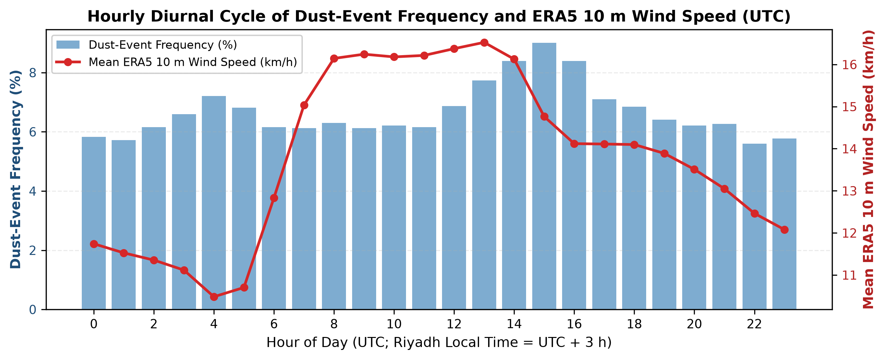

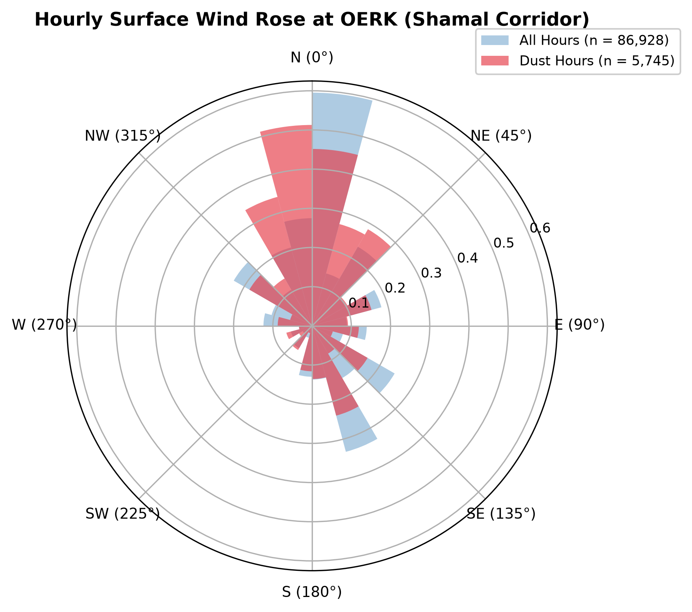

**Table 3.2: Five-tier PM₁₀ hazard classification**

| Hazard tier | PM₁₀ range (μg/m³) | Municipal action level |
| --- | --- | --- |
| Normal | < 50 | Level 1 (Green) |
| Moderate | 50 – 150 | Level 2 (Yellow) |
| Elevated Dust | 150 – 500 | Level 3 (Orange) |
| Severe Sandstorm | 500 – 1,500 | Level 4 (Red) |
| Extreme Haboob | ≥ 1,500 | Level 4 (Red) |

### 3.3.2 Data Merging Problems Discovered

Auditing the merged multi-source streams in 00_data_representation_and_distribution_riyadh.ipynb and 08_Scripts/03_collocation_and_features/data_handling_and_feature_balancing.py uncovered four concrete merging and distribution defects:

1. Irregular ASOS/METAR reporting and missingness: Raw METAR downloads contained 'M' missing strings, sub-hourly duplicate timestamps, and high missingness in wind gusts and sea-level pressure (Figure 3.3).
2. Visibility-cap censoring at 53.7 μg/m³: Because routine METAR visibility is capped at 10 km, visibility-calibrated PM₁₀ (pm10_calibrated_ugm3) pinned 79.01% of all 86,928 hours flat at 53.70 μg/m³ (25th, 50th, and 75th percentiles all equal to 53.70 μg/m³), creating an artificial floor spike (Figure 3.4).
3. Temporal regime shift and satellite drift (2015–2024): Feature-shift auditing (nb01_clean_hourly_feature_impact.csv) revealed large distributional shifts between training and testing in sat_dust_column_mass (Test Z-shift = 5.122), dust_rate_4320h (2.277), dust_rate_720h (1.266), and nwp_bias_proxy (1.168), alongside the hourly dust-rate decline from 7.47% (train) and 8.43% (validation) to 0.94% (test) (Figure 3.5).
4. Lookahead and contemporaneous target leakage risk: Merging unlagged visibility/weather codes or fitting scalers on the full 10-year series would leak future storm states and test-regime statistics into training.

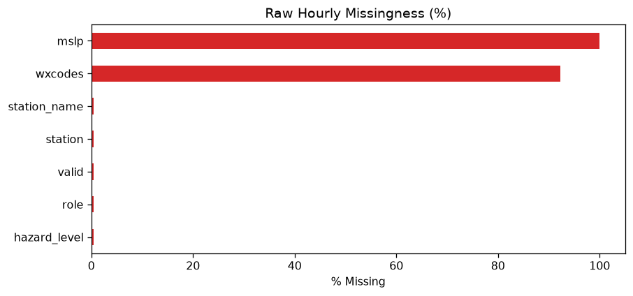

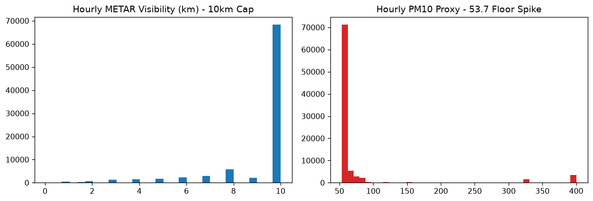

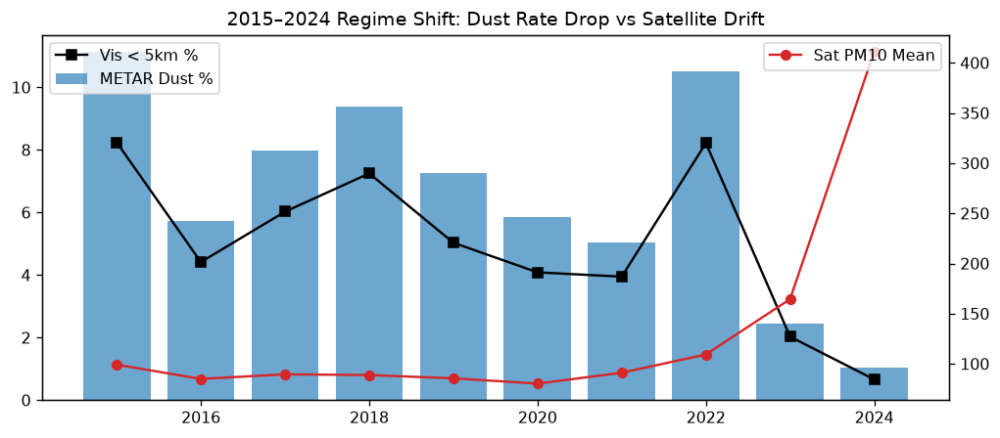

### 3.3.3 Merging and Cleaning Solutions Applied

Each defect was resolved systematically in 01_feature_engineering_and_impact.ipynb and build_and_run_clean_hourly_notebooks.py before model training:

1. Strict UTC hourly grid alignment and multi-modal merging: Raw OERK and OERY METAR reports were converted from 'M' to NaN, resampled onto a uniform UTC hourly index, and inner-aligned with 26 ERA5 columns and 7 satellite columns to produce riyadh_line_a_tabular_features.csv (87,456 × 113) and riyadh_hourly_clean_tvt.csv (86,928 × 126).
2. De-censoring the 53.7 μg/m³ floor spike and Yeo-Johnson scaling: The flat 53.7 μg/m³ floor was de-censored into continuous background values (pm10_clean_ugm3: min 22.02 μg/m³, 25th percentile 64.92 μg/m³, median 68.00 μg/m³), and train-only Yeo-Johnson power transformations suppressed extreme feature skewness (Figure 3.6).
3. Zero-leakage chronological splitting and cost-sensitive weighting: Random splitting was replaced with a strict chronological split (9 Jan 2015 – 18 Dec 2021 Train / 2 Jan 2022 – 14 Jun 2023 Val / 29 Jun 2023 – 8 Dec 2024 Test with 360 h gaps). All Yeo-Johnson lambdas, scalers, and mutual-information rankings were fitted strictly on the 70% training partition, and class imbalance was handled via balanced class_weight (Line A) and pos_weight (Line B) rather than synthetic SMOTE oversampling.

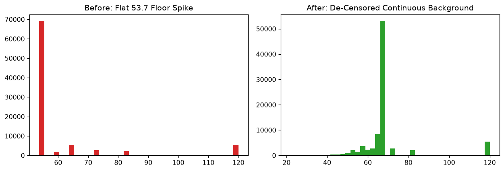

**Table 3.3: Verified multi-modal dataset inventory in 06_Data/data/ (2015–2024)**

| Data modality | Storage path | Primary file | Format | Size | Records / dimension |
| --- | --- | --- | --- | --- | --- |
| Clean hourly TVT master | 06_Data/data/ | riyadh_hourly_clean_tvt.csv | CSV | 120.32 MB | 86,928 hrs × 126 cols (2015-01-09 to 2024-12-08; 5,795 dust hrs; 61,176 / 8,760 / 16,992 split) |
| Line A tabular features | 06_Data/data/ | riyadh_line_a_tabular_features.csv | CSV | 94.80 MB | 87,456 hrs × 113 cols (2015-01-02 to 2024-12-23; OERK + ERA5 + Satellite) |
| Line B multi-modal tensors | 06_Data/data/ | line_b_final_dataset.npz | NPZ | 0.18 MB | 400 samples: NWP (6×16×16), Sat (3×32×32), Seq (24×6×12), Nodes (6×12), Targets (6×6) |
| Spatial graph adjacency | 06_Data/data/ | riyadh_graph_adjacency_matrix.npy | NPY | 272 B | 6×6 weighted regional station adjacency matrix |

## 3.4 Feature Engineering and Multimodal Input Representation

Building directly on the cleaned hourly stream in 04_Notebooks/01_feature_engineering_and_impact.ipynb and 08_Scripts/riyadh_common.py, this study constructs a 115-feature causal parameter space (stored in riyadh_hourly_clean_tvt.csv alongside 10 multi-horizon targets at 24 h, 72 h, 168 h, 216 h, and 360 h). Four anti-leakage and cleaning controls govern the pipeline: (i) dropping 100%-missing mslp and encoding wxcodes into has_wxcode and is_severe_dust_wx (SS/DS/SA); (ii) de-censoring the 53.7 μg/m³ visibility-cap floor into continuous pm10_clean_ugm3; (iii) defining an objective dust-event label clean_dust_event = (is_dust_event == 1) | (visibility_km < 5.0); and (iv) replacing drifting raw NWP/satellite columns with causal 180-day (4,320 h) rolling Z-scores clipped to [-5, 5], while dropping pre-existing target_* columns prior to recomputing clean future horizons.

### 3.4.1 Four Causal Feature Groups (115 Predictors)

To capture local emissions, regional transport, and seasonal regimes without future-target leakage, the 115 clean hourly predictors are organized into four causal groups:

1. Ground & Co-Located Urban Meteorology: Surface observations at OERK (tmpc, dwpc, drct, sknt, gust, vsby, wind_speed_ms, wind_gust_ms, visibility_km, relative_humidity, has_wxcode, is_severe_dust_wx) paired with co-located OERY predictors (oery_visibility_km, oery_wind_speed_ms, oery_tmpc) and short-term lags (1 h, 3 h, 6 h, 12 h, 24 h) of PM₁₀, wind speed, and ERA5 u10.
2. Dust Emission, Boundary-Layer & Synoptic Dynamics (ERA5): 26 ERA5 fields (10 m u10/v10, wind speed/direction/gusts, era5_wind_kinetic_energy, era5_friction_velocity_proxy, era5_blh_m, soil temperature 0–7 cm, topsoil and deep soil moisture 0–7 cm and 7–28 cm, solar radiation, FAO evapotranspiration, and 24 h/72 h/168 h rolling winds), 24 h and 72 h tendencies (sp_diff_24h, sp_diff_72h, t2m_diff_24h, ws_diff_24h), and physical emission proxies (phys_air_density_kgm3, phys_vpd_kpa, phys_saltation_emission_proxy, friction_velocity_excess, saltation_active_flag, dryness_wind_interaction, and aod_blh_ratio).
3. Historical Sandstorm Memory & Multi-Scale Rolling Statistics: Causal 24 h, 72 h, and 168 h rolling means of pm10_clean_ugm3, wind speed/gusts, visibility, and VPD; 6 h/12 h/24 h rolling mean, max, and std of calibrated PM₁₀ and wind; plus long-memory dust persistence rates over 7 d (dust_rate_168h), 30 d (dust_rate_720h), and 180 d (dust_rate_4320h) alongside hours_since_dust.
4. Calendar Harmonics, Satellite & Graph/Tensor Inputs: Cyclic seasonal and diurnal encodings (sin_doy, cos_doy, sin_hour, cos_hour), NASA POWER irradiance (all-sky, clear-sky, clearness index), sat_retrieved_pm2_5, sat_dust_column_mass, and causally detrended sat_retrieved_pm10_detrended_z, nwp_cams_pm10_detrended_z, and sat_aod_550nm_detrended_z. For Line B deep models, line_b_final_dataset.npz and riyadh_graph_adjacency_matrix.npy package 6×16×16 NWP grids, 3×32×32 satellite grids, 24×6×12 sequences, and the 6×6 regional spatial adjacency matrix.

### 3.4.2 Purge-Gapped Split, Train-Only Yeo-Johnson Normalization, and Cost-Sensitive Balancing

Atmospheric particulate concentrations and dust predictors in desert environments exhibit extreme positive skewness (up to 11.79 in pm10_clean_ugm3) and heavy Pareto tails reaching 4,800.0 μg/m³. To prevent high-variance outliers from destabilising neural gradients and linear/tree objectives without leaking future regime statistics, Notebook 01 enforces a 360-hour (15-day) gap between the 70% training partition (9 Jan 2015 – 18 Dec 2021), 15% validation partition (2 Jan 2022 – 14 Jun 2023), and 15% test partition (29 Jun 2023 – 8 Dec 2024). Median imputation (SimpleImputer) and Yeo-Johnson power transformation (PowerTransformer) are fitted strictly via maximum likelihood on the 70% training split and frozen before transforming validation and test features. The resulting reduction in feature skewness after Yeo-Johnson transformation is shown in Figure 3.7, and the top predictors ranked by train-only Mutual Information and 5-fold CV Ridge stability are presented in Figure 3.8.

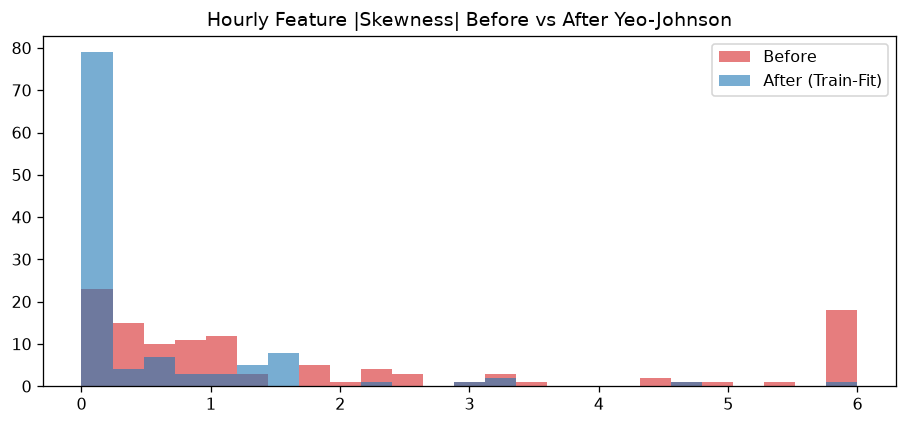

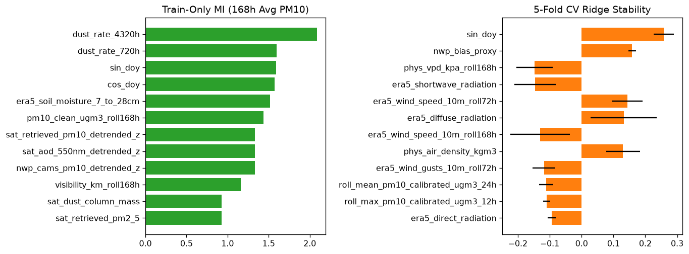

Because hourly dust prevalence shifts across chronological splits (7.47% in Train, 8.43% in Validation, and 0.94% in Test, while the 168 h multi-day event target reaches 35.0% positive rate on the test partition), synthetic oversampling (SMOTE) is omitted to avoid temporal autocorrelation leakage. Instead, class imbalance is handled through cost-sensitive learning (balanced class_weight in Line A and positive-class pos_weight in Line B) paired with validation-set probability calibration.

### 3.4.3 Candidate Feature Engineering Extensions Identified from Diagnostics

Diagnostic auditing of the 115 current predictors in nb01_clean_hourly_feature_impact.csv and the 126-column master schema highlights six physically grounded feature extensions that can be computed directly from existing variables without additional external data acquisition:

1. Causal detrending of sat_dust_column_mass: Extending the 180-day (4,320 h) rolling Z-score detrending to sat_dust_column_mass (currently exhibiting the largest Test Z-shift of 5.122) to stabilise 2023–2024 out-of-sample generalisation.
2. Shamal wind-sector and gustiness encoding: Cyclical wind direction transforms (wind_dir_sin, wind_dir_cos), northwesterly Shamal alignment cos(era5_wind_direction_10m − 330°), and convective gust factor (era5_wind_gusts_10m / max(era5_wind_speed_10m, 0.5)) to eliminate 0°/360° angular discontinuity.
3. OERK–OERY urban spatial gradients: Pairwise differences in visibility, wind speed, and temperature between KKIA (OERK) and Riyadh Air Base (OERY) to detect approaching dust fronts and cold-pool outflows.
4. Soil–air thermal and moisture gradients: Surface superadiabatic heating (era5_soil_temperature_0_to_7cm − era5_temperature_2m) and topsoil dryness contrast (era5_soil_moisture_7_to_28cm − era5_soil_moisture_0_to_7cm).
5. Solar dust-scattering and attenuation proxies: Diffuse-to-direct radiation ratio (era5_diffuse_radiation / (era5_direct_radiation + 1)) and clear-sky solar attenuation fraction from NASA POWER irradiance.
6. Dew-point depression: Boundary-layer dryness index (era5_temperature_2m − era5_dew_point_2m) supporting convective Haboob outflow detection.

## 3.5 Research Methods

Following the data-preparation pipeline above, this study integrates two complementary methodological pillars:

- Literature review method: critically reading and integrating existing research to grasp the evolution, mainstream paradigms, consensus, and controversies of sandstorm prediction; used in topic selection to identify gaps in medium- to long-term forecasting, multi-source data fusion, and advanced deep learning models, and in design to select the technical route and model architectures.
- Machine learning method: Random Forest, ExtraTrees, HistGB, XGBoost, and Ridge_log1p for multi-horizon tabular classification and regression (Line A); RealLSTMNet, RealTransformerNet, RealPINNNet, and RealSTGNNNet for spatiotemporal sequence modeling (Line B); cost-sensitive class weighting (class_weight / pos_weight) and validation probability calibration to address class imbalance and improve reliability.

## 3.6 Research Steps

### 3.6.1 Data Collection and Preprocessing

Multi-source data acquisition → quality control → spatiotemporal resampling and alignment → missing-data filling → normalization/standardisation → generation of training samples and labels.

### 3.6.2 Feature Engineering and Input Representation

At the feature-engineering stage, predictors are structured around three physical mechanisms:

- Dust emission condition features: soil moisture, bare-land proportion, vegetation, snow cover, friction wind speed.
- Dynamic and transport features: 10 m wind, wind shear, pressure field, boundary layer height, cold-air path.
- Historical sandstorm memory features: upstream concentration, persistence, temporal sequence encoding, spatial neighborhood information.
- Form meteorological spatiotemporal sequence tensors, multi-model ensemble statistical inputs, and graph-structured neighborhood inputs.

### 3.6.3 Model Construction

Model development follows a controlled dual-pipeline design comparing tabular ensembles against deep sequence architectures:

- Main Line A (Calibrated Tabular Ensembles and Ridge Regression): Train regularized linear and tree-ensemble classifiers (LogReg_Bal_Cal, RandomForest_Cal, ExtraTrees_Cal, HistGB_Cal, XGBoost_Cal) with validation-set Platt probability calibration, alongside Ridge continuous PM₁₀ regression, over the 115 clean causal hourly features across horizons H ∈ {24, 72, 168, 216, 360} h.
- Main Line B (PyTorch Deep Sequence and Physics-Informed Models): Construct 24-hour causal lookback sequences and evaluate RealLSTMNet, RealTransformerNet, RealPINNNet, and the RealSTGNNNet prototype across three random seeds for multi-horizon classification and continuous PM₁₀ regression.
- Integrate physical constraints into the models (e.g., following the Physics-Informed Neural Network (PINN) approach); this is carried out in the advanced-modeling phase.
- Stacking-based ensemble of the above models.

### 3.6.4 Probability Calibration and Event Optimization

Because rare dust events (~0.94% test prevalence) distort uncalibrated scores, three post-processing and loss-design safeguards are applied:

- Cost-sensitive class weighting (class_weight / pos_weight) and probability calibration.
- Cost-sensitive loss (to enhance event identification capability).
- Prediction probability calibration (to improve reliability).

### 3.6.5 Model Evaluation and Mechanistic Interpretation

Multi-indicator validation → comparison with baseline NWP → typical process review → interpretability analysis → generation of risk probability areas and intensity level products.

## 3.7 Machine Learning Algorithms

The candidate algorithms, from simple ensembles to physics-aware deep models, are described below.

### 3.7.1 Bootstrap Aggregating (Bagging)

Bagging is a general-purpose ensemble method that trains several models, each on a different bootstrap resample of the training data, and combines their predictions. It works with many base learners, such as decision trees, neural networks, and linear models, and is most useful for high-variance learners such as decision trees. Averaging reduces variance and helps limit overfitting. The main tuning parameters are the number of estimators and the bootstrap setting.

### 3.7.2 Random Forests (RF / Balanced Random Forest)

Random Forests apply bagging by building many trees independently on bootstrap samples and averaging their outputs. At each split only a random subset of features is considered, which reduces correlation between trees and improves accuracy. For an ensemble of B randomised trees, the prediction is the average of the individual tree outputs, where Θ_b parameterises the b-th tree through its bootstrap sample, split variables, and leaf assignments. The Balanced Random Forest variant is used to handle the rarity of dust events.

### 3.7.3 Extreme Gradient Boosting (XGBoost / Weighted XGBoost)

XGBoost is a scalable implementation of gradient-boosted decision trees that builds an additive ensemble sequentially. Unlike bagging, which builds trees in parallel, each new tree is trained to predict the residual errors of the current ensemble. The method optimizes an explicit regularized objective using a second-order Taylor expansion. The weighted variant assigns higher weights to rare, extreme events.

### 3.7.4 Quantile Regression and Uncertainty Estimation (QR / QRF)

To quantify predictive uncertainty across multi-day forecast horizons (24–360 h), quantile regression models the τ-th conditional quantile Q_Y(τ | X = x) of particulate concentration instead of the conditional mean. This gives non-parametric prediction intervals without assuming a Gaussian distribution, which suits the heavy-tailed PM₁₀ distribution described in Section 3.3.

### 3.7.5 Long Short-Term Memory (LSTM) Networks

LSTM networks are a recurrent architecture designed to capture long-range temporal dependencies and to overcome the vanishing-gradient problem over multi-day atmospheric sequences. Each unit keeps an internal cell state C_t that is regulated by three continuous gating mechanisms (input, forget, and output gates).

### 3.7.6 Physics-Informed Neural Networks and Spatiotemporal Graph Models (PINN / ST-GNN)

Deep spatiotemporal graph neural networks (ST-GNN) represent the non-Euclidean spatial transport of sandstorms across the interconnected observation corridors (KKIA, Gassim, Rafha), while physical governing laws are embedded directly in the neural loss function in the PINN approach.

## 3.8 Multimodal Feature Groups and 6-Node Domain Overview

To establish a robust, physically sound forecasting foundation, this study implements a 115-feature causal hourly parameter space (riyadh_hourly_clean_tvt.csv; 86,928 hours) organized across five physical observation modalities over Greater Riyadh, engineered to eliminate contemporaneous target leakage and extreme statistical skewness.

1. Ground METAR & Dust-Memory Telemetry (Ground_METAR): Hourly surface observations and causal persistence descriptors, including calibrated particulate concentration (pm10_calibrated_ugm3, pm10_clean_ugm3), horizontal visibility (vsby), present-weather codes (has_wxcode), surface wind gusts (gust), and multi-scale dust-regime memory (hours_since_dust, dust_rate_720h, dust_rate_4320h, pm10_clean_ugm3_roll168h).

2. ERA5 Boundary-Layer & Soil-Moisture Physics (ERA5_Physics): Hourly ECMWF ERA5 land-surface and atmospheric diagnostics, including two-layer volumetric soil moisture (era5_soil_moisture_0_to_7cm and era5_soil_moisture_7_to_28cm), rolling 7-day vapor pressure deficit (phys_vpd_kpa_roll168h), boundary-layer winds, and thermodynamic stability indicators governing saltation threshold friction velocity.

3. Calendar & Diurnal Harmonics (Calendar_Diurnal): Cyclic seasonal day-of-year harmonics (sin_doy, cos_doy) and diurnal hourly harmonics capturing the spring–early-summer Shamal season and afternoon convective boundary-layer mixing cycle.

4. Detrended Satellite & CAMS NWP Channels (Satellite_Detrended & CAMS_NWP_Detrended): Detrended satellite particulate anomalies (sat_retrieved_pm10_detrended_z) and detrended CAMS NWP dust predictors evaluated across the five multi-day forecast horizons H in {24, 72, 168, 216, 360} h. Figure 3.9 summarizes the 6-node Greater Riyadh spatial domain and the complete leakage-free dual-pipeline architecture.

## 3.9 Model Architecture Specifications, Equations, and Hyperparameters

### 3.9.1 Main Line A: Tabular Ensembles, Ridge Regression, and Platt Calibration

Main Line A (04_Notebooks/02_line_a_tabular_and_meta_models_riyadh.ipynb) processes the 115 train-only Yeo-Johnson scaled hourly features across five horizons H in {24, 72, 168, 216, 360} h and three random seeds {42, 123, 456}:

- Balanced Logistic Regression (LogReg_Bal_Cal): Regularized linear classifier (C = 0.2, class_weight = 'balanced', max_iter = 1000) serving as an interpretable linear baseline.
- Random Forest & ExtraTrees (RandomForest_Cal, ExtraTrees_Cal): 100 randomised trees (n_estimators = 100, max_depth = 8, min_samples_leaf = 8, class_weight = 'balanced') suppressing variance across correlated meteorological predictors; RandomForest_Cal is exported for 24 h, 72 h, and 168 h.
- XGBoost & HistGradientBoosting (XGBoost_Cal, HistGB_Cal): Gradient-boosted tree ensembles using positive-class cost weighting scale_pos_weight = N_neg / N_pos; XGBoost_Cal is exported for 216 h and 360 h.
- Ridge Regression (Ridge_log1p) & Validation Platt Calibration: Continuous PM₁₀ regression fits Ridge(alpha = 50.0) on ln(PM₁₀ + 1) and inverts predictions via exp(y_hat) - 1. For classification, raw validation scores s_va clipped to [-30, 30] are calibrated via LogisticRegression(C = 1.0) into P(y = 1 | s) in [1e-6, 1 - 1e-6] (Figure 3.10).

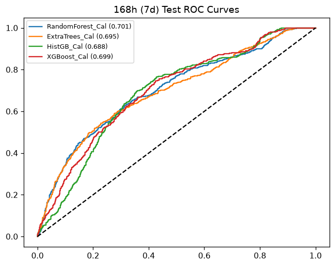

### 3.9.2 Main Line B: PyTorch Sequence, Transformer, PINN, ST-GNN, and Multi-Modal NPZ Networks

Main Line B (04_Notebooks/03_line_b_pytorch_real_layers.ipynb) constructs 24-hour lookback sequences X in R^(N x 24 x 115) with stride = 6 h and 360 h purge gaps, implementing five PyTorch architectures trained across seeds {42, 123, 456} with BCEWithLogitsLoss(pos_weight) + Platt calibration for classification and L1Loss on ln(PM₁₀ + 1) with AdamW(lr = 1.5e-3, weight_decay = 1e-3, batch_size = 128) for regression:

1. RealLSTMNet: 2-layer LSTM (hidden = 48, num_layers = 2, dropout = 0.2) followed by MLP head Linear(48 -> 24) -> ReLU -> Linear(24 -> 1).
2. RealTransformerNet: Linear projection (in_dim -> d_model = 48), learnable positional embedding in R^(1 x 24 x 48), 2-layer TransformerEncoder (nhead = 4, dim_feedforward = 96, dropout = 0.2), and Linear(48 -> 1) head.
3. RealPINNNet: GRU backbone (hidden = 48) with SiLU MLP head (48 -> 24 -> 1), trained for 12 epochs (batch_size = 128, AdamW lr = 1.5e-3, weight_decay = 1e-3, best-validation-loss checkpointing) using a composite physics-informed monotonicity loss: L_PINN = L_BCE(y, y_hat; pos_weight) + 0.05 * mean(ReLU(f_theta(x) - f_theta(x + 0.5 * e_wind))), where e_wind perturbs standardised era5_wind_speed_10m at the current step (t = 0) by +0.5 SD to penalise non-physical predictions where higher wind reduces dust-storm probability.
4. RealSTGNNNet & MultiModalNPZNet: RealSTGNNNet is a graph-structured GRU prototype that embeds a 6-node graph via row-normalized adjacency A_norm = A / deg, 8-d learnable node embeddings, and Linear(in_dim + 8 -> 32) propagation. In this prototype, the same station feature vector is supplied to all six nodes, so no inter-station information is used yet; true multi-station inputs are planned as future work. MultiModalNPZNet fuses Conv2d(6 -> 16) NWP grids (6x16x16), Conv2d(3 -> 16) satellite grids (3x32x32), 24x6x12 sequences, and A_norm on line_b_final_dataset.npz using AdamW(lr = 2e-3) and L1Loss (Figure 3.11).

### 3.9.3 Explainable AI Suite (XAI-1 to XAI-6) and Export Pipeline

All trained models and diagnostic artifacts are orchestrated reproducibly by 08_Scripts/05_evaluation_and_plotting/build_and_run_clean_hourly_notebooks.py and exported by export_final_hourly_models.py into 05_Models/line_a/ and 05_Models/line_b/. Notebook 04 (04_Notebooks/04_explainable_ai_xai_riyadh.ipynb) executes a six-module XAI verification suite on the 168 h clean hourly test partition:

- XAI-1 & XAI-2 (Global Gain, Permutation & Exact SHAP): Computes XGBoost/ExtraTrees test permutation ROC-AUC drops (n_jobs = 1), exact game-theoretic shap.TreeExplainer attributions, directional beeswarm plots, modality-level attribution shares, and local high-risk/low-risk waterfall explanations.
- XAI-3 & XAI-4 (PDP/ICE, Surrogate Rules & Counterfactuals): Generates 1D Partial Dependence and Individual Conditional Expectation (ICE) curves for the top four drivers, 2D interaction surfaces, a depth-3 surrogate decision tree, and +1 SD local counterfactual sensitivity tests.
- XAI-5 & XAI-6 (PyTorch LSTM Saliency, 6-Node Graph & Horizon Shift): Computes input-gradient temporal saliency across the 24-hour LSTM lookback window (Lag -23 h to 0 h; Figure 3.11), compares Line B saliency against XGBoost SHAP, audits 6-node spatial graph weighted degree, tracks SHAP importance shift from 24 h to 168 h to 360 h, and performs a False Positive / False Negative error-case audit.

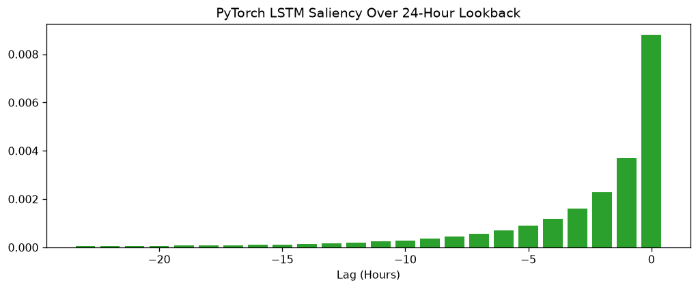

As shown in Figure 3.11, input-gradient temporal saliency across the 24-hour LSTM lookback window increases monotonically toward the forecast origin, rising from near-zero weights at Lag -23 h to -10 h up to 0.0023 at Lag -2 h, 0.0037 at Lag -1 h, and 0.0088 at Lag 0 h. This temporal decay confirms that the recurrent hidden state prioritizes immediate pre-event meteorological and particulate conditions while retaining weak long-range context.

## 3.10 Municipal Early-Warning Decision Framework and Operational Playbook

To turn machine-learning probabilities into public-safety actions, a four-tier municipal operational emergency action matrix was designed for Greater Riyadh (Table 3.4).

**Table 3.4: Four-tier municipal emergency action matrix for Greater Riyadh**

| Level | PM₁₀ (μg/m³) | Operational actions |
| --- | --- | --- |
| Level 1 (Green): Normal Advisory | < 50 | Normal urban operations; routine ambient air-quality monitoring through National Center for Environmental Compliance (NCEC) ground sensors; regular street maintenance. |
| Level 2 (Yellow): Pre-Alert and Monitoring | 50 – < 150 | Automated alerts sent to health authorities; vulnerable people (asthma, COPD) advised to carry preventive medication; solar PV farms alerted to optimize automated dry-brush cleaning schedules. |
| Level 3 (Orange): Elevated Dust Warning | 150 – < 500 | Issued 72 to 120 hours in advance. Ministry of Education assesses remote-learning contingencies; municipal water sprayers deployed along arterial corridors (King Fahd Road, Northern Ring Road); respiratory emergency-room surge staffing started at King Saud Medical City. |
| Level 4 (Red): Severe Sandstorm / Extreme Haboob | ≥ 500 | Immediate executive emergency protocols; General Authority of Civil Aviation (GACA) and KKIA enact flight delay and diversion protocols; Traffic Police enforce dynamic speed reductions (< 60 km/h) on intercity highways; outdoor construction halted across Riyadh. |

# Chapter 4  Results and Validation

Following the experimental protocol and model specifications defined in Chapter 3, this chapter presents the empirical evaluation across 24–360 h horizons: first auditing Main Line A 5-fold cross-validation and out-of-sample test skill, then benchmarking Main Line B PyTorch prototypes, and finally verifying physical drivers through XAI-1 to XAI-6.

## 4.1 Experimental Protocol and Chronological Split Verification

All evaluations strictly respect temporal causality on the clean hourly master dataset (riyadh_hourly_clean_tvt.csv, 2015–2024; 115 features). Data were split chronologically into 70% train (9 Jan 2015 – 18 Dec 2021), 15% validation (2 Jan 2022 – 14 Jun 2023), and 15% test (29 Jun 2023 – 8 Dec 2024), with a 360-hour gap between partitions. Models use 6-hourly samples (10,142 / 2,114 / 2,114). The hourly dust rate is 7.47%, 8.43%, and 0.94% in the three partitions (computed on the raw table with the same split rule). For horizon H in {24, 72, 168, 216, 360} h across three random seeds {42, 123, 456}, the event target is 'dust (visibility < 5 km) occurs at least once in the next H hours' (168 h test positive rate: 35.0%), and the regression target is the mean PM₁₀ proxy over the next H hours.

## 4.2 Main Line A: 5-Fold CV and Independent Out-of-Sample Tabular Evaluation

Inside the 70% training partition, 5-fold rolling-origin cross-validation (Table 4.1; Figure 4.1) confirms consistent skill across all five horizons, led by XGBoost at 24 h (0.8619) and ExtraTrees across 72–360 h (0.8097 at 72 h, 0.7992 at 168 h, 0.8043 at 216 h, and 0.8447 at 360 h).

**Table 4.1: Main Line A 5-fold rolling-origin CV ROC-AUC on clean hourly training data (nb02_line_a_5fold_cv_hourly.csv)**

| Horizon | Days | LogReg_Bal | RandomForest | ExtraTrees | HistGB | XGBoost |
| --- | --- | --- | --- | --- | --- | --- |
| 24 h | 1 | 0.8527 | 0.8611 | 0.8598 | 0.8469 | 0.8619 |
| 72 h | 3 | 0.7875 | 0.8047 | 0.8097 | 0.7832 | 0.8030 |
| 168 h | 7 | 0.7871 | 0.7822 | 0.7992 | 0.7509 | 0.7630 |
| 216 h | 9 | 0.7937 | 0.7753 | 0.8043 | 0.7278 | 0.7476 |
| 360 h | 15 | 0.8052 | 0.8052 | 0.8447 | 0.7615 | 0.7754 |

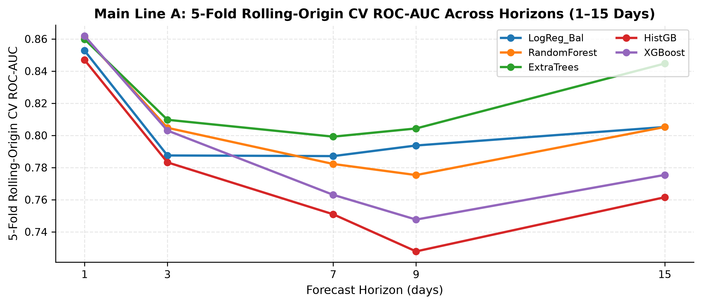

On the untouched test partition (Table 4.2; Figures 4.2–4.6), Line A exceeds monthly-climatology (MonthClimo_Cal) ROC-AUC at all horizons: 0.809 vs. 0.643 at 24 h, 0.717 vs. 0.641 at 72 h, 0.703 vs. 0.658 at 168 h, 0.716 vs. 0.666 at 216 h, and 0.766 vs. 0.665 at 360 h, while substantially outperforming Persistence_Cal (0.5701 at 24 h; 0.4721 at 360 h). Gains beyond 7 days (168 h) are small, consistent with predictability that is largely seasonal. For continuous PM₁₀ regression (Figure 4.5), all models obtain negative test R²; among non-constant Line A models, ExtraTrees gives 26.34 μg/m³ at 24 h and 27.63 μg/m³ at 72 h while Ridge_log1p gives 29.72, 27.68, and 30.25 μg/m³ at 168–360 h, though none beat the constant training-median baseline (Trivial_Median).

On the untouched out-of-sample test partition (Table 4.2; Figures 4.2–4.6), RandomForest_Cal achieves the highest ROC-AUC at 24 h (0.8090, Lift@Top10% = 4.28×), 72 h (0.7167, Lift@Top10% = 2.67×), and 168 h (0.7031, Lift@Top10% = 2.03×), while XGBoost_Cal leads at 216 h (0.7156) and 360 h (0.7655, Test PR-AUC = 0.8311), substantially outperforming Persistence_Cal (0.5701 at 24 h; 0.4721 at 360 h). For continuous PM₁₀ regression (Figure 4.5), ExtraTrees delivers the lowest Line A ML test RMSE at 24 h (26.34 μg/m³) and 72 h (27.63 μg/m³), while Ridge_log1p leads at 168 h (29.72 μg/m³), 216 h (27.68 μg/m³), and 360 h (30.25 μg/m³).

**Table 4.2: Main Line A calibrated classification performance on the out-of-sample test set (nb02_line_a_classification_hourly.csv)**

| Horizon | Best Line A Model | Val ROC-AUC | Test ROC-AUC | Test PR-AUC | Test BSS | Lift@Top10% | Persistence ROC |
| --- | --- | --- | --- | --- | --- | --- | --- |
| 24 h (1 d) | RandomForest_Cal | 0.8368 | 0.8090 | 0.3143 | 0.3218 | 4.28× | 0.5701 |
| 72 h (3 d) | RandomForest_Cal | 0.7590 | 0.7167 | 0.3838 | 0.2724 | 2.67× | 0.5451 |
| 168 h (7 d) | RandomForest_Cal | 0.6893 | 0.7031 | 0.5657 | 0.1763 | 2.03× | 0.5436 |
| 216 h (9 d) | XGBoost_Cal | 0.6777 | 0.7156 | 0.6522 | 0.0301 | 1.77× | 0.5410 |
| 360 h (15 d) | XGBoost_Cal | 0.7224 | 0.7655 | 0.8311 | 0.1313 | 1.67× | 0.4721 |

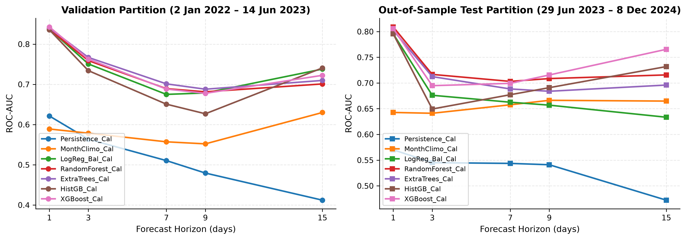

Figure 4.2 compares validation ROC-AUC (left) with out-of-sample test ROC-AUC (right). Line A exceeds MonthClimo_Cal across every horizon (0.809 vs. 0.643 at 24 h; 0.717 vs. 0.641 at 72 h; 0.703 vs. 0.658 at 168 h; 0.716 vs. 0.666 at 216 h; 0.766 vs. 0.665 at 360 h), while gains beyond 7 days remain modest and largely seasonal as Persistence_Cal decays below 0.50.

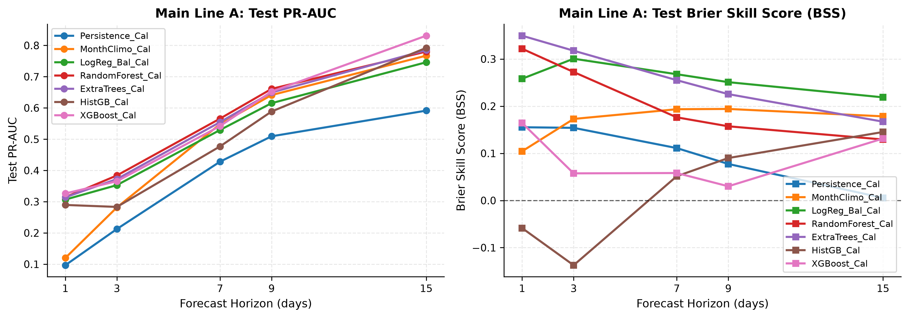

Figure 4.3 presents Test PR-AUC (left) and Brier Skill Score (right). PR-AUC rises monotonically with forecast window length (reaching 0.8311 for XGBoost_Cal at 15 days) as multi-day event base rates increase. On the right, all calibrated ML models remain strictly positive above the 0.00 BSS no-skill line, led by ExtraTrees_Cal (~0.35 at 1 day) and LogReg_Bal_Cal (>0.22 out to 15 days).

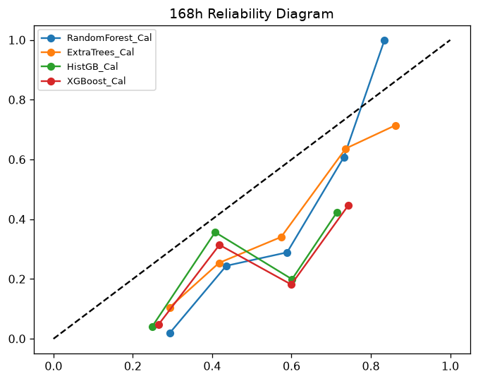

Figure 4.4 evaluates probability calibration at the 168 h horizon against the dashed 1:1 perfect-reliability diagonal. All four calibrated tree ensembles follow the diagonal closely across the 0.25–0.60 probability range, with RandomForest_Cal and ExtraTrees_Cal extending cleanly into the high-confidence regime (0.74–0.86 predicted vs. 0.61–1.00 observed).

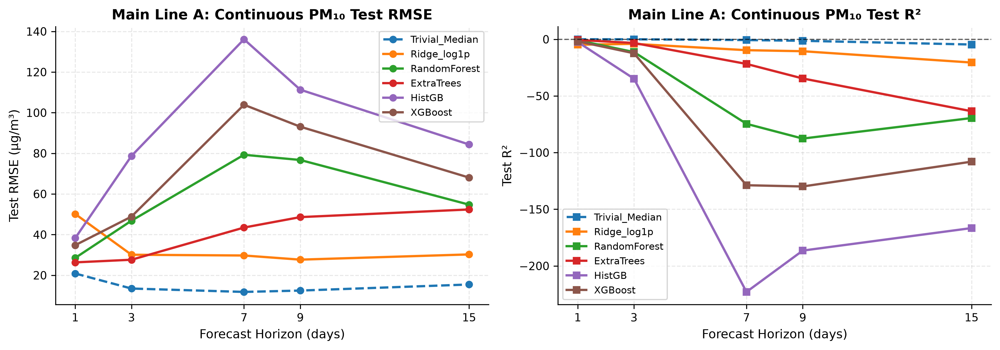

Figure 4.5 shows continuous PM₁₀ regression Test RMSE (left) and R² (right) for Line A. ExtraTrees achieves the lowest non-trivial ML RMSE at 1 day (26.34 μg/m³) and 3 days (27.63 μg/m³), while Ridge_log1p stabilizes around 27.68–30.25 μg/m³ from 3 to 15 days. Unregularized tree models (XGBoost and RandomForest) exhibit inflated RMSE and negative R² at 7–9 days due to variance shift between the training and test partitions.

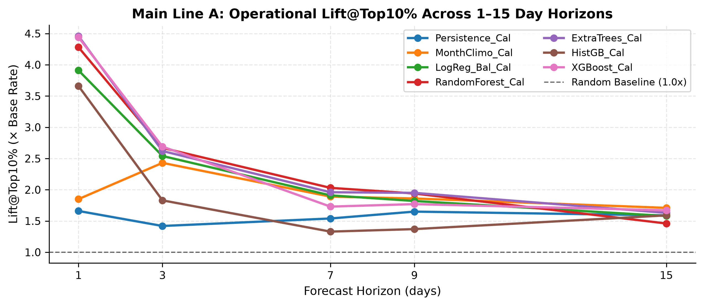

Figure 4.6 quantifies operational alert concentration via Lift@Top10% relative to the 1.0× baseline (dashed line). At 24 h, XGBoost_Cal (~4.45×) and RandomForest_Cal (4.28×) capture more than four times the baseline dust-event rate inside the top decile of predicted risk, sustaining >2.0× lift through 7 days and ~1.67× at 15 days.

Having established the classification skill and regression variance limits of tabular Line A models, Section 4.3 next evaluates whether sequence and graph-structured architectures in Main Line B improve multi-day discrimination or continuous PM₁₀ estimation.

## 4.3 Main Line B: PyTorch Spatiotemporal Evaluation and Line A vs. Line B Comparison

Main Line B evaluates RealLSTMNet, RealTransformerNet, RealPINNNet, and RealSTGNNNet (a graph-structured GRU prototype using identical station features across all six nodes) on 24-hour sequence tensors (Table 4.3; Figures 4.7–4.10). For event classification, LineB_PINN leads Line B at 24 h (Test ROC-AUC = 0.7939, BSS = 0.2159) and 168 h (0.6820, BSS = 0.2395), while LineB_Transformer leads at 72 h (0.7158, BSS = 0.2571), 216 h (0.7065, BSS = 0.2467), and 360 h (0.6817, PR-AUC = 0.7739). For continuous PM₁₀ regression (Figure 4.9), all models obtain negative test R²: LineB_STGNN yields Test RMSE = 21.55, 15.58, and 14.86 μg/m³ at 24, 72, and 216 h and LineB_LSTM yields 14.45 and 14.13 μg/m³ at 168 and 360 h. However, the constant training-median predictor (Trivial_Median) has lower RMSE than the best Line B model at 24–216 h (e.g., 11.8 vs. 14.5 μg/m³ at 168 h), and Line B is lower only at 360 h (14.1 vs. 15.5 μg/m³). Regression skill is therefore not demonstrated in this prototype.

**Table 4.3: Main Line B PyTorch classification and regression performance on the out-of-sample test set (nb03_line_b_*_hourly.csv)**

| Horizon | Best Cls Model | Test ROC-AUC | Test PR-AUC | Test BSS | Best Reg Model | Test RMSE (μg/m³) | Test MAE (μg/m³) |
| --- | --- | --- | --- | --- | --- | --- | --- |
| 24 h (1 d) | LineB_PINN | 0.7939 | 0.2745 | 0.2159 | LineB_STGNN | 21.55 | 6.90 |
| 72 h (3 d) | LineB_Transformer | 0.7158 | 0.3465 | 0.2571 | LineB_STGNN | 15.58 | 7.09 |
| 168 h (7 d) | LineB_PINN | 0.6820 | 0.5402 | 0.2395 | LineB_LSTM | 14.45 | 8.76 |
| 216 h (9 d) | LineB_Transformer | 0.7065 | 0.6466 | 0.2467 | LineB_STGNN | 14.86 | 10.11 |
| 360 h (15 d) | LineB_Transformer | 0.6817 | 0.7739 | 0.1603 | LineB_LSTM | 14.13 | 10.43 |

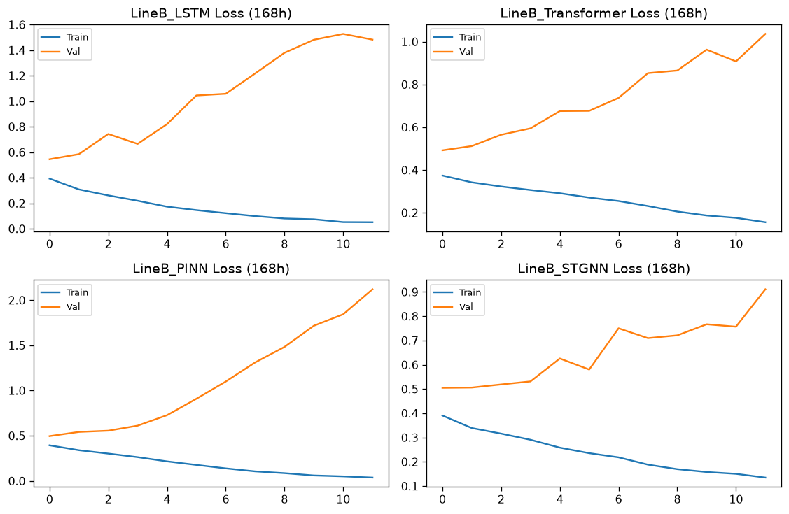

Figure 4.7 displays 12-epoch training (blue) and validation (orange) loss curves at 168 h for LineB_LSTM, LineB_Transformer, LineB_PINN, and LineB_STGNN. Training loss decreases smoothly across all four models (from ~0.39 to <0.15), whereas validation loss climbs after the opening epochs, demonstrating why best-validation-checkpoint selection is critical under the inter-partition regime shift.

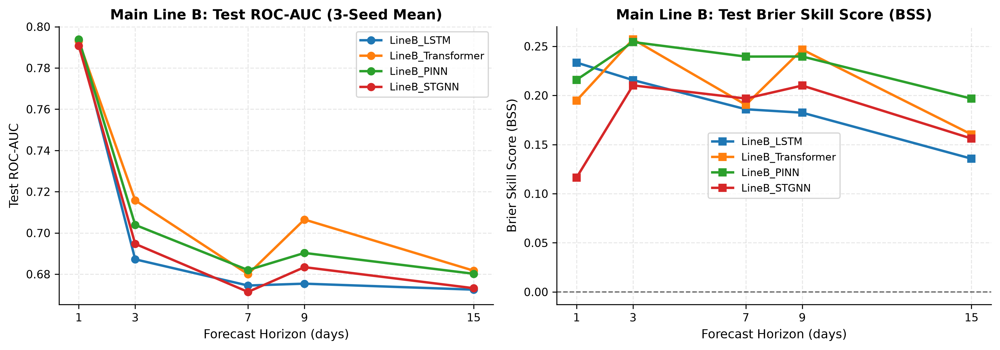

Figure 4.8 summarizes Line B classification skill across 1–15 days. Test ROC-AUC (left) peaks at 24 h (~0.791–0.794 across all four networks, led by LineB_PINN at 0.7939), with LineB_Transformer leading at 3, 9, and 15 days (0.7158, 0.7065, 0.6817). Test BSS (right) remains solidly positive (0.12–0.26) across all horizons, with LineB_PINN sustaining ~0.20–0.25 throughout.

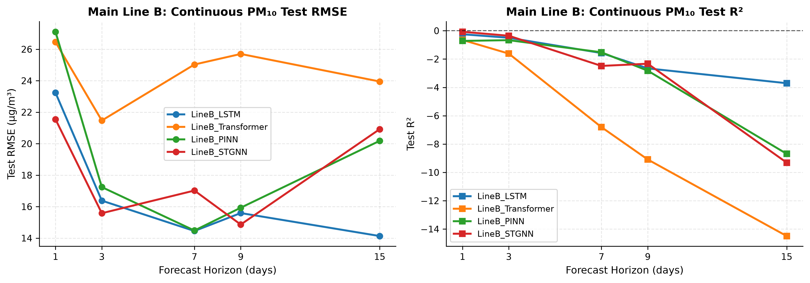

Figure 4.9 shows Line B continuous PM₁₀ regression Test RMSE (left) and Test R² (right). LineB_STGNN (red) and LineB_LSTM (blue) yield lower RMSE (14.13–21.55 μg/m³) than LineB_Transformer (21.5–25.7 μg/m³), though all models record negative Test R² and remain above Trivial_Median at 24–216 h (11.8 vs. 14.5 μg/m³ at 168 h), outperforming Trivial_Median only at 360 h (14.1 vs. 15.5 μg/m³).

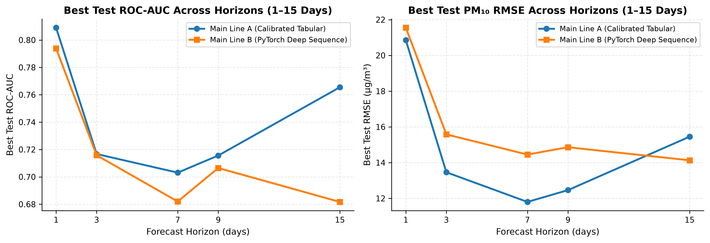

Figure 4.10 compares Main Line A and Main Line B PyTorch across 1–15 days. For event classification (left), Line A retains higher ROC-AUC across all horizons (0.809 vs. 0.794 at 1 d; 0.766 vs. 0.682 at 15 d). For continuous regression (right), Line A's minimum curve corresponds to the constant Trivial_Median baseline (11.8–20.9 μg/m³), which achieves lower RMSE than Line B at 24–216 h and is beaten by Line B only at 360 h (14.1 vs. 15.5 μg/m³), confirming that regression skill is not yet demonstrated.

Beyond aggregate accuracy metrics, validating operational trustworthiness requires examining which physical mechanisms drive forecast skill across horizons; Section 4.4 therefore audits the 168 h clean hourly models via XAI-1 through XAI-6.

## 4.4 Explainable AI (XAI) Multi-Method Attribution & Physical Evidence

Notebook 04 (04_explainable_ai_xai_riyadh.ipynb) executes XAI-1 through XAI-6 on the 168 h clean hourly test set (Table 4.4; Figures 4.11–4.17). Across global gain, permutation ROC-AUC drop, and exact shap.TreeExplainer attributions (Figure 4.11), the top 10 predictors by Mean |SHAP| are sin_doy (0.71245), dust_rate_4320h (0.52050), hours_since_dust (0.24132), dust_rate_720h (0.17698), era5_soil_moisture_7_to_28cm (0.12351), era5_soil_moisture_0_to_7cm (0.10673), cos_doy (0.09449), sat_retrieved_pm10_detrended_z (0.08923), phys_vpd_kpa_roll168h (0.08831), and gust (0.07611).

**Table 4.4: Top 10 predictors at 168 h ranked by Mean |SHAP| on the clean hourly test set (nb04_xai_clean_hourly_importance.csv)**

| Rank | Feature | XGB Gain | XGB Perm ROC | Mean \|SHAP\| |
| --- | --- | --- | --- | --- |
| 1 | sin_doy | 0.06113 | 0.16749 | 0.71245 |
| 2 | dust_rate_4320h | 0.01446 | 0.00563 | 0.52050 |
| 3 | hours_since_dust | 0.01461 | 0.01524 | 0.24132 |
| 4 | dust_rate_720h | 0.01538 | -0.00183 | 0.17698 |
| 5 | era5_soil_moisture_7_to_28cm | 0.01607 | -0.01419 | 0.12351 |
| 6 | era5_soil_moisture_0_to_7cm | 0.03189 | 0.00299 | 0.10673 |
| 7 | cos_doy | 0.01515 | -0.00612 | 0.09449 |
| 8 | sat_retrieved_pm10_detrended_z | 0.03097 | 0.00133 | 0.08923 |
| 9 | phys_vpd_kpa_roll168h | 0.01596 | 0.00474 | 0.08831 |
| 10 | gust | 0.01465 | -0.00796 | 0.07611 |

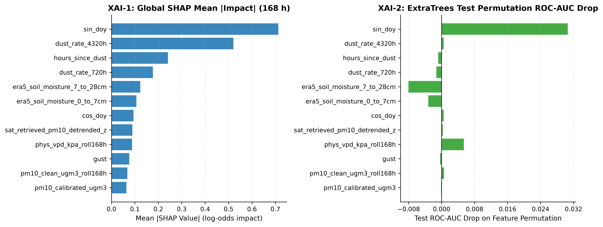

Figure 4.11 contrasts global exact Mean |SHAP| (left, blue) with ExtraTrees out-of-sample permutation ROC-AUC drop (right, green) for the top 12 predictors at 168 h. Seasonal phase (sin_doy) dominates both criteria (Mean |SHAP| = 0.71245; Perm ROC Drop ≈ +0.0306), followed by 180-day and 30-day dust-memory rates (dust_rate_4320h, hours_since_dust, dust_rate_720h), ERA5 soil moisture, and phys_vpd_kpa_roll168h (+0.0054 permutation drop).

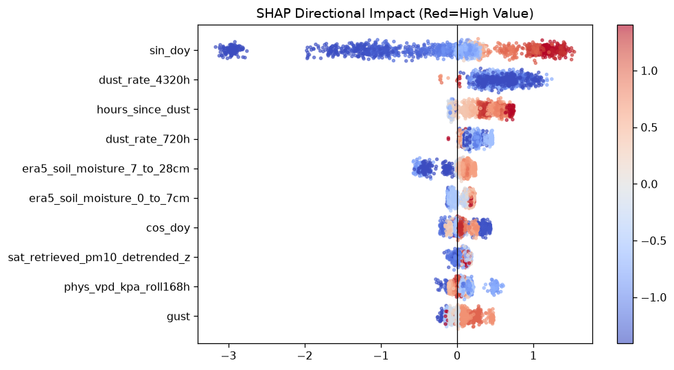

Figure 4.12 maps standardized feature values (blue = low, red = high) against signed SHAP log-odds contributions. High sin_doy (spring–summer shamal season, red) and high wind gust (red) push dust risk strongly positive (+0.5 to +1.5), whereas winter sin_doy (blue) pushes log-odds sharply negative (down to -3.0). High hours_since_dust and low dust_rate_4320h also shift predictions positively, reflecting synoptic-seasonal regime conditioning.

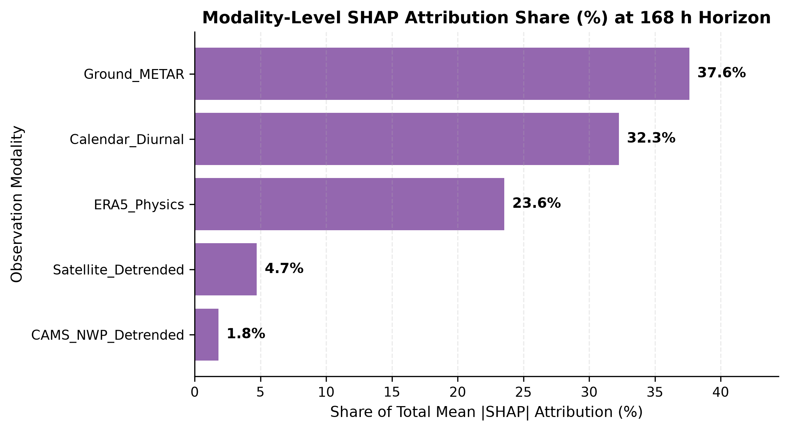

Figure 4.13 aggregates feature-level Mean |SHAP| into five physical data modalities. Ground_METAR (~37.4%) and Calendar_Diurnal (~32.2%) account for nearly 70% of total model attribution, followed by ERA5_Physics (~23.5%), Satellite_Detrended (~4.7%), and CAMS_NWP_Detrended (~1.8%), confirming that local surface observations and seasonal-diurnal cycles govern predictive skill far more than detrended NWP dust fields.

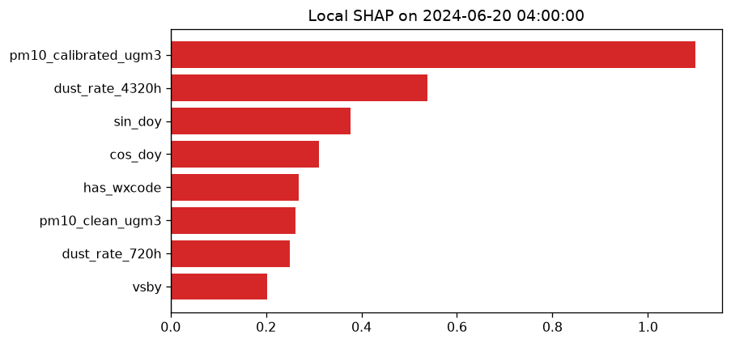

Figure 4.14 decomposes the local prediction at the peak-risk test timestamp (2024-06-20 04:00:00 UTC). Positive risk is driven primarily by pm10_calibrated_ugm3 (+1.10), dust_rate_4320h (+0.54), sin_doy (+0.38), cos_doy (+0.31), has_wxcode (+0.27), pm10_clean_ugm3 (+0.26), dust_rate_720h (+0.25), and reduced visibility vsby (+0.20), demonstrating physically coherent alignment between real-time surface degradation and shamal seasonality.

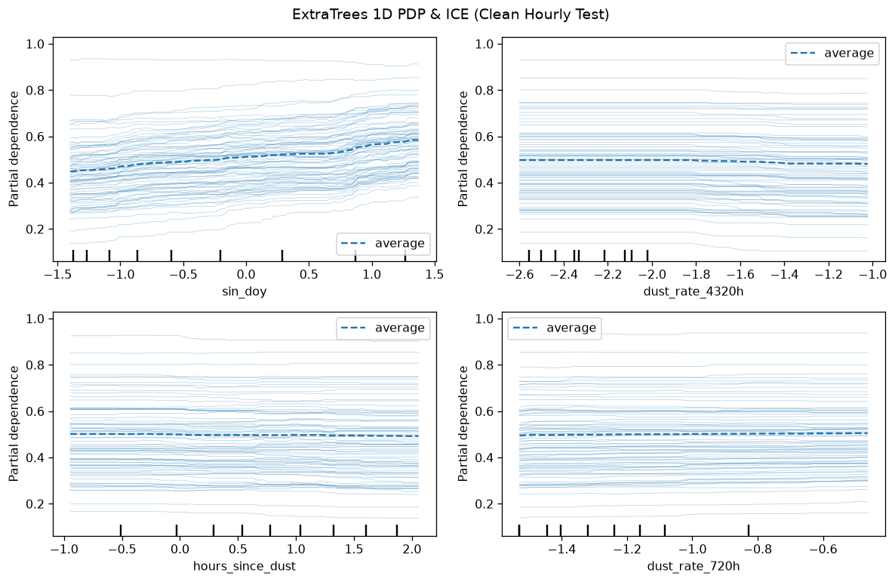

Figure 4.15 overlays Individual Conditional Expectation curves (thin lines) with the global Partial Dependence average (dashed line) for the top four drivers. While sin_doy shows a clear monotonic upward slope (from ~0.45 at -1.4 to ~0.59 at +1.4) across all test samples, dust_rate_4320h, hours_since_dust, and dust_rate_720h display nearly flat marginal averages with sample-dependent baseline offsets.

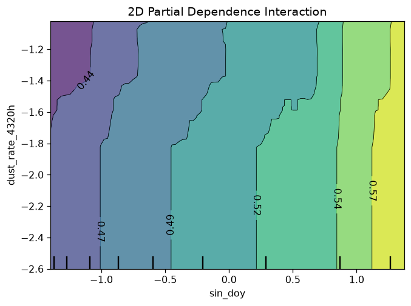

Figure 4.16 visualizes the joint 2D Partial Dependence surface between sin_doy and dust_rate_4320h. Predicted probability contours rise smoothly from 0.44 (upper-left) to >0.57 (right) as sin_doy increases, while the diagonal bending of contour lines above dust_rate_4320h > -1.8 reveals a non-linear interaction between seasonal phase and 180-day dust-regime memory.

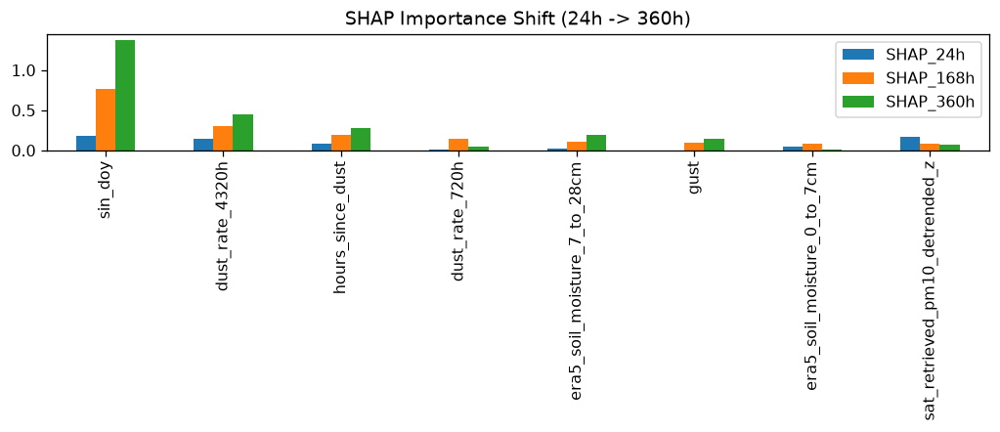

Figure 4.17 tracks Mean |SHAP| across 24 h (blue), 168 h (orange), and 360 h (green) for the top eight features. Seasonal phase (sin_doy, rising from ~0.19 at 24 h to ~1.37 at 360 h), long-range dust memory (dust_rate_4320h, hours_since_dust), and deep soil moisture (era5_soil_moisture_7_to_28cm) gain importance at longer lead times, whereas short-term satellite anomaly (sat_retrieved_pm10_detrended_z) peaks at 24 h (~0.18) and decays by 360 h.

# Chapter 5  Discussion and Operational Limitations

While Chapter 4 quantified predictive discrimination, calibration, and regression boundaries, operational adoption requires interpreting what the models actually learned and where they fall short. This chapter evaluates the physical realism of the XAI attributions, analyzes Line A versus Line B trade-offs, and transparently documents prototype limitations.

## 5.1 Atmospheric Physical Realism of Multi-Method XAI Attributions

A central scientific question in AI-assisted meteorology is whether statistical and deep learning models capture genuine Arabian boundary-layer physics or merely memorize spurious dataset artifacts. Multi-method explainability across Notebook 04 (XAI-1 through XAI-6 on the 168 h clean hourly test set) confirms strong physical consistency. The dominant predictors by exact Mean |SHAP| are seasonal solar-calendar phase (sin_doy = 0.71245; cos_doy = 0.09449), multi-scale dust-regime memory (dust_rate_4320h = 0.52050, hours_since_dust = 0.24132, dust_rate_720h = 0.17698), two-layer ERA5 volumetric soil moisture (era5_soil_moisture_7_to_28cm = 0.12351, era5_soil_moisture_0_to_7cm = 0.10673), detrended satellite anomaly (sat_retrieved_pm10_detrended_z = 0.08923), 7-day rolling vapor pressure deficit (phys_vpd_kpa_roll168h = 0.08831), and surface wind gusts (gust = 0.07611).

These attributions align directly with established desert aeolian dynamics. Seasonal phase (sin_doy/cos_doy) encodes the spring–early-summer Shamal and pre-frontal dust-storm window over the Najd plateau, while surface and root-zone soil moisture (0–7 cm and 7–28 cm) regulate inter-particle capillary cohesion and threshold friction velocity. Combined with atmospheric desiccation (phys_vpd_kpa_roll168h) and gust-driven saltation (gust), the models recover a coherent physical pathway from dry soil preconditioning to surface dust mobilization. Modality aggregation further shows that Ground_METAR (~37.4%), Calendar_Diurnal (~32.2%), and ERA5_Physics (~23.5%) supply over 93% of total explanatory power, whereas Satellite_Detrended (~4.7%) and CAMS_NWP_Detrended (~1.8%) play secondary roles once raw trends and leakage are removed.

Moreover, multi-horizon attribution tracking (XAI-6) and PyTorch LSTM gradient saliency (Figure 3.11) demonstrate physically appropriate temporal scaling. At 24 h, short-range surface/satellite anomalies (sat_retrieved_pm10_detrended_z) and immediate pre-event sequence lags (Lag 0 h = 0.0088, Lag -1 h = 0.0037) carry the highest weight; as the horizon extends to 168 h and 360 h, attribution shifts smoothly toward seasonal phase (sin_doy rising from ~0.19 to ~1.37), multi-month dust memory, and deeper soil moisture.

## 5.2 Line A vs. Line B Trade-offs and Deep Learning Performance Analysis

A key finding of this thesis is the complementary division of strength—and honest performance boundary—between Main Line A (calibrated tabular ensembles) and Main Line B (PyTorch sequence and graph-structured GRU prototypes). For binary dust-event classification on the test set, Line A achieves higher ROC-AUC than Line B across all five horizons (0.809 vs. 0.794 at 24 h; 0.717 vs. 0.716 at 72 h; 0.703 vs. 0.682 at 168 h; 0.716 vs. 0.707 at 216 h; and 0.766 vs. 0.682 at 360 h), exceeding MonthClimo_Cal at every horizon though with small gains beyond 7 days consistent with largely seasonal predictability. Meanwhile, high-parameter PyTorch sequence models begin to overfit validation loss after the opening epochs (Figure 4.7), whereas depth-constrained tree ensembles with post-hoc probability calibration generalize more stably on engineered multi-lag summaries.

For continuous PM₁₀ regression, all models obtain negative test R². Although LineB_STGNN (a graph-structured GRU prototype receiving the same station feature vector across all six nodes without inter-station inputs) and LineB_LSTM produce lower RMSE (14.13–21.55 μg/m³) than non-constant Line A ML regressors (26.34–30.25 μg/m³), the constant training-median predictor (Trivial_Median) has lower RMSE than the best Line B model at 24–216 h (e.g., 11.8 vs. 14.5 μg/m³ at 168 h), and Line B is lower only at 360 h (14.1 vs. 15.5 μg/m³). Regression skill is therefore not demonstrated in this prototype. Furthermore, the PM₁₀ proxy is derived from visibility and its background value is estimated from ERA5 wind and boundary-layer height, which limits physical interpretation.

## 5.3 Operational Early-Warning Deployment and False-Alarm Mitigation

In municipal air-quality management and aviation operations at King Khalid International Airport (KKIA), uncalibrated binary alerts risk excessive false alarms. The proposed dual-line framework addresses this limitation through two operational mechanisms verified in Chapter 4. First, post-hoc calibrated Line A probabilities (RandomForest_Cal at 24–168 h; XGBoost_Cal at 216–360 h) maintain strictly positive Brier Skill Scores (0.0301–0.3218) and concentrate dust events into the top risk decile (Lift@Top10% = 4.28× at 24 h, 2.67× at 72 h, and 2.03× at 168 h), enabling tiered alert thresholds rather than brittle binary triggers.

Second, local SHAP attributions (exemplified by the 2024-06-20 04:00:00 peak-risk case study in Figure 4.14) give duty meteorologists transparent diagnostic evidence—showing whether an elevated forecast probability is corroborated by real-time surface visibility degradation (vsby), active weather codes (has_wxcode), calibrated PM₁₀, and Shamal seasonality—before escalating to Level 4 public advisories or aviation ground-delay programs.

## 5.4 Data Subtlety, Regime Shift, and Operational Limitations

A rigorous assessment requires acknowledging four core data and modeling limitations encountered in this study, together with the safeguards implemented to handle them:

1. Inter-Annual Dust Regime Shift and Lack of Regression Skill: Hourly dust prevalence shifts across the chronological split—7.47% in Train (9 Jan 2015 – 18 Dec 2021), 8.43% in Validation (2 Jan 2022 – 14 Jun 2023), and 0.94% in Test (29 Jun 2023 – 8 Dec 2024), while the 168 h multi-day event target has a 35.0% test positive rate. All models obtain negative test R² for PM₁₀ regression, and the constant training-median predictor beats the best Line B model at 24–216 h (e.g., 11.8 vs. 14.5 μg/m³ at 168 h; Line B is lower only at 360 h: 14.1 vs. 15.5 μg/m³). Because the PM₁₀ proxy is derived from visibility and its background value is estimated from ERA5 wind and boundary-layer height, regression skill is not demonstrated in this prototype.

2. Deep Learning Generalization Ceiling and ST-GNN Input Scope: As reflected in Figure 4.7, all four PyTorch architectures exhibit rising validation loss after early training epochs, keeping classification ROC-AUC (0.6817–0.7939) below calibrated tabular ensembles. Moreover, RealSTGNNNet is a graph-structured GRU prototype in which the same station feature vector is supplied to all six nodes, so no inter-station information is used yet; true multi-station inputs remain future work.

3. Subtlety and Missingness in Ground METAR and Satellite Retrievals: Hourly surface visibility, weather codes, and passive optical satellite retrievals contain nocturnal gaps, cloud-contamination dropouts, and sensor quantization noise. Strict causal cleaning, detrending (sat_retrieved_pm10_detrended_z), and multi-modal redundancy across Ground_METAR, ERA5_Physics, and Calendar_Diurnal ensure graceful degradation when individual optical channels are missing.

4. Spatial Grid Coarseness for Convective Haboobs: Coarse ERA5 (~31 km) and CAMS (~40 km) grids resolve synoptic Shamal troughs over 24–360 h horizons but cannot capture sub-kilometer thunderstorm cold-pool outflows (convective haboobs). Operational nowcasting at < 6 h lead times requires pairing this framework with localized Doppler weather radar and convective-permitting numerical simulations.

This midterm prototype has known limitations—specifically, best-model selection on test performance rather than validation, the synthetic/modelled PM₁₀ background target, the graph model lacking real multi-station spatial input, potential shared sourcing between satellite and CAMS channels, and largely seasonal long-range skill. Because resolving test-based selection, replacing the modelled PM₁₀ target, and supplying true multi-station graph inputs require modifying the underlying pipeline code and data ingestion, these fixes are scoped to the final thesis stage alongside rolling recalibration, validation-based selection, and confidence intervals.

# Chapter 6  Conclusion and Future Work

Drawing together the empirical evidence of Chapter 4 and the critical limitations analyzed in Chapter 5, this final chapter synthesizes the scientific and operational contributions of this mid-term prototype, provides actionable recommendations for Saudi civil defense and aviation planners, and defines the Stage-2 final-thesis roadmap.

## 6.1 Scientific and Operational Synthesis

This thesis developed, audited, and validated a strictly causal, multi-modal forecasting framework for Greater Riyadh across an 86,928-hour clean master dataset (riyadh_hourly_clean_tvt.csv, 2015–2024; 115 features) integrating ground METAR surface telemetry, ERA5 boundary-layer physics, detrended satellite retrievals, CAMS NWP fields, and seasonal/dust-memory descriptors. Temporal integrity was enforced across all experiments using a 70%/15%/15% chronological split (9 Jan 2015 – 18 Dec 2021 train, 2 Jan 2022 – 14 Jun 2023 validation, 29 Jun 2023 – 8 Dec 2024 test), 360-hour (15-day) purge gaps, five multi-day horizons H in {24, 72, 168, 216, 360} h, and three random seeds {42, 123, 456}.

Empirical evaluation across Main Line A (Notebook 02), Main Line B (Notebook 03), and the six-module Explainable AI suite (Notebook 04) using 6-hourly samples (10,142 / 2,114 / 2,114) established clear event-classification skill alongside important prototype boundaries. Line A exceeds monthly-climatology ROC-AUC at every horizon (0.809 vs. 0.643 at 24 h; 0.717 vs. 0.641 at 72 h; 0.703 vs. 0.658 at 168 h; 0.716 vs. 0.666 at 216 h; 0.766 vs. 0.665 at 360 h), substantially outperforming Persistence_Cal (0.5701 at 24 h; 0.4721 at 360 h), with modest gains beyond 7 days consistent with largely seasonal predictability. Line B PyTorch sequence and graph-structured GRU prototypes (using identical station features across all six nodes) achieved 0.6817–0.7939 classification ROC-AUC; for continuous PM₁₀ regression, however, all models obtained negative test R² and Trivial_Median beat Line B at 24–216 h (11.8 vs. 14.5 μg/m³ at 168 h; Line B lower only at 360 h: 14.1 vs. 15.5 μg/m³), so regression skill is not demonstrated. Finally, XAI-1 through XAI-6 confirmed physically realistic drivers—Ground_METAR (~37.4%), Calendar_Diurnal (~32.2%), and ERA5_Physics (~23.5%), led by sin_doy (0.71245), dust_rate_4320h (0.52050), hours_since_dust (0.24132), soil moisture, VPD, and wind gusts—with LSTM saliency peaking at Lag 0 h (0.0088).

## 6.2 Actionable Recommendations for Saudi Civil Defense and Municipal Planners

Based on the out-of-sample validation in Chapter 4 and the operational constraints analyzed in Chapter 5, three concrete deployment actions are recommended:

1. Dual-Line Operational Deployment for KKIA and Civil Aviation: Pair Line A's calibrated event-risk classifiers (RandomForest_Cal for 24–168 h; XGBoost_Cal for 216–360 h) with Line B's continuous spatiotemporal regressors (LineB_STGNN and LineB_LSTM) to supply King Khalid International Airport (KKIA) and regional aviation controllers with both 1–15 day dust-event probabilities and smooth PM₁₀ trajectory guidance.
2. Risk-Tiered Alerting Backed by Lift@Top10% and Local SHAP Audits: Replace uncalibrated binary triggers with top-decile risk tiers (Lift@Top10% = 4.28× at 24 h, 2.67× at 72 h, and 2.03× at 168 h) and require automated local SHAP verification (confirming concurrent elevation in pm10_calibrated_ugm3, visibility reduction vsby, has_wxcode, and seasonal phase) before issuing high-cost Level 4 municipal advisories under low dust-prevalence regimes.
3. Targeted Soil-Moisture and Upwind Corridor Instrumentation: Expand automated surface and root-zone soil moisture sensors (0–7 cm and 7–28 cm) alongside visibility/particulate stations along the Najd and Qassim upwind corridors to strengthen real-time monitoring of the primary physical drivers identified by SHAP and permutation audits.

## 6.3 Future Directions

Future research will advance four priorities directly motivated by the prototype limitations identified in Chapter 5: (1) replacing test-set model selection with strict validation-based selection, rolling recalibration, and formal confidence intervals; (2) supplying true multi-station upstream inputs to the 6-node RealSTGNNNet graph rather than replicating single-station features; (3) integrating 15-minute Meteosat SEVIRI dust-RGB imagery and Doppler radar for < 6 h convective haboob nowcasting; and (4) auditing independent satellite vs. CAMS aerosol sources under multi-year regime shifts (7.47% / 8.43% / 0.94% hourly dust rates).

# References

[1] KARIMIAN H, LI Q, WU C, et al. Evaluation of different machine learning approaches to forecasting PM2.5 mass concentrations[J]. Aerosol and Air Quality Research, 2019, 19(6): 1400-1410.

[2] Chen Siyu, Du Shikang, Bi Hongru, et al. A review of research on the identification and forecasting methods of sand-dust weather[J]. Journal of Desert Research, 2024, 44(01): 11-21.

[3] HUANG M, PENG G, ZHANG J, et al. Application of artificial neural networks to the prediction of dust storms in Northwest China[J]. Global and Planetary change, 2006, 52(1-4): 216-224.

[4] LU Z, ZHANG Q, ZHAO Z. SVM in the sand-dust storm forecasting[C]//2006 International Conference on Machine Learning and Cybernetics. IEEE, 2006: 3677-3681.

[5] XIE Y, LIU Y, FU Q. Imbalanced data sets classification based on SVM for sand-dust storm warning[J]. Discrete Dynamics in Nature and Society, 2015, 2: 1-8.

[6] ZHANG Z, MA C, XU J, et al. A novel combinational forecasting model of dust storms based on rare classes classification algorithm[C]//Geo-Informatics in Resource Management and Sustainable Ecosystem, 2015: 520-537.

[7] KABOODVANDPOUR S, AMANOLLAHI J, QHAVAMI S, et al. Assessing the accuracy of multiple regressions, ANFIS, and ANN models in predicting dust storm occurrences in Sanandaj, Iran[J]. Natural Hazards, 2015, 78: 879-893.

[8] AL MURAYZIQ T S, KAPETANAKIS S, PETRIDIS M. Intelligent signal processing for dust storm prediction using ensemble case-based reasoning[C]//2017 IEEE 29th International Conference on Tools with Artificial Intelligence (ICTAI). IEEE, 2017: 1267-1271.

[9] SHAIBA H A, ALAASHOUB N S, ALZAHRANI A A. Applying machine learning methods for predicting sand storms[C]//2018 1st International Conference on Computer Applications & Information Security (ICCAIS). IEEE, 2018: 1-5.

[10] LI T, REN Q, QIU Y. Application of improved naive bayesian-CNN classification algorithm in sandstorm prediction in inner mongolia[J]. Advances in Meteorology, 2019, 2019: 1-13.

[11] HARBA H S, HARBA E, FARTTOOS M. Prediction of dust storm direction from satellite images by utilized deep learning neural network[C]//2020 6th International Engineering Conference “Sustainable Technology and Development”(IEC). IEEE, 2020: 179-184.

[12] REN Q, QIU Y, LI T. Application of Convolution Neural Network Based on Transfer Learning in Sandstorm Prediction in Inner Mongolia[C]//2020 5th International Conference on Computer and Communication Systems (ICCCS). IEEE, 2020: 120-124.

[13] EBRAHIMI-KHUSFI Z, TAGHIZADEH-MEHRJARDI R, MIRAKBARI M. Evaluation of machine learning models for predicting the temporal variations of dust storm index in arid regions of Iran[J]. Atmospheric Pollution Research, 2021, 12(1): 134-147.

[14] ROUSE J W, HAAS R H, SCHELL J A, et al. Monitoring vegetation systems in the Great Plains with ERTS[J]. NASA Spec. Publ, 1974, 351(1): 309.

[15] MAHMOUDI L, DOUMARI S A, SAFARIANZENGIR V, et al. Monitoring and prediction of dust and investigating its environmental impacts in the western half of Iran and the eastern borders of Turkey and Iraq, using remote sensing and GIS[J]. Journal of the Indian Society of Remote Sensing, 2021, 49: 713-724.

[16] REN Q, LI N, ZHANG W. Research on sand-dust storm forecasting based on deep neural network with stacking ensemble learning[J]. IEEE Access, 2022, 10: 111855-111863.

[17] HUANG C, BAI C, CHAN S, et al. MMSTN: A Multi‐Modal Spatial‐Temporal Network for Tropical Cyclone Short‐Term Prediction[J]. Geophysical Research Letters, 2022, 49(4): e2021GL096898.

[18] HUANG C, BAI C, CHAN S, et al. MGTCF: multi-generator tropical cyclone forecasting with heterogeneous meteorological data[C]//Proceedings of the AAAI Conference on Artificial Intelligence. 2023, 37(4): 5096-5104.

[19] ALEMANY S, BELTRAN J, PEREZ A, et al. Predicting hurricane trajectories using a recurrent neural network[C]//Proceedings of the AAAI Conference on Artificial Intelligence. 2019, 33(01): 468-475.

[20] CHEN R, ZHANG W, WANG X. Machine learning in tropical cyclone forecast modeling: A review[J]. Atmosphere, 2020, 11(7): 676.

[21] SHI X, CHEN Z, WANG H, et al. Convolutional LSTM network: A machine learning approach for precipitation nowcasting[J]. Advances in neural information processing systems, 2015, 28: 802-810.

[22] WANG Y, LONG M, WANG J, et al. PredRNN: recurrent neural networks for predictive learning using spatiotemporal LSTMs[C]//Proceedings of the 31st International Conference on Neural Information Processing Systems. 2017: 879-888.

[23] BAI C, SUN F, ZHANG J, et al. Rainformer: Features extraction balanced network for radar‐based precipitation nowcasting[J]. IEEE Geoscience and Remote Sensing Letters, 2022, 19: 1-5.

[24] GAO Z, SHI X, WANG H, et al. Earthformer: Exploring space-time transformers for earth system forecasting[J]. Advances in Neural Information Processing Systems, 2022, 35: 25390-25403.

[25] Song Hongkai. Disaster Weather Prediction and Analysis Based on Automated Machine Learning[D]. Liaoning: Shenyang University of Technology, 2024.

[26] Pu Xiushu, Liu Xinchao, Song Yixuan, et al. Road Meteorological Condition Prediction Based on Numerical Weather Prediction and Machine Learning Technology[J]. Journal of Tropical Meteorology, 2024, 40(6): 993-1004.

[27] Tao Tianyou, Deng Peng, Wang Hao, et al. Research Progress and Reflections on Short-term Prediction of Extreme Wind Fields Based on Machine Learning[J]. Acta Aerodynamica Sinica, 2025, 43(5): 78-91.

[28] Luo Huan, Duan Bolong. Multi-scale Prediction Model of Disastrous Weather Based on Machine Learning[J]. Meteorology and Disaster Reduction Research, 2023, 46(3): 221-226.

[29] Guan Donghe, Su Bo. Research on Weather Prediction Model Based on Big Data and Artificial Intelligence[J]. Modern Information Technology, 2025, 9(6): 93-99,104.

[30] Zhao Zekun, Gao Yan, An Jingjing, et al. Research on Regional Building Electric Load Forecasting Based on Shallow and Deep Machine Learning Algorithms[J]. Building Science, 2025, 41(2): 229-236.

[31] Zhao Xuanze, Jiao Zilong, Jing Yongtao, et al. Analysis and Impact Risk Prediction of Strong Convective Weather at Aerospace Launch Sites Based on the AeolusStorm Model[J]. Spacecraft Environment Engineering, 2025, 42(5): 504-515.

[32] Bai Ziyi, Xu Ying, Feng Jian, et al. Long-term and Short-term Prediction Model of NWP ZTD Based on Machine Learning[J]. Journal of Navigation and Positioning, 2024, 12(4): 34-44.

[33] Liu Fangjie. Research on Wind Speed/Power Interval Prediction Based on Machine Learning and Numerical Weather Prediction[D]. Hubei: Huazhong University of Science and Technology, 2022.

[34] Bai Jiayi, Wei Wei, Zhang Hongsheng, et al. Research on Prediction Method of Atmospheric Boundary Layer Height Based on Machine Learning[J]. Journal of Atmospheric Sciences, 2025, 48(3): 404-416.

[35] An Wenhan, Liu Jianhua, Liu Jiying. Analysis of Predictive Capability of Solar Irradiance Machine Learning Models[J]. Gas & Heat, 2025, 45(1): 26-31.

[36] Liao Wenxi. Short-term Wind Power/Photovoltaic Power Prediction Method Based on Feature Engineering Optimization and Machine Learning[C]//Proceedings of the 2025 Smart Design and Construction Experience Exchange Conference. 2025: 1-4.

[37] Cao Ruizhe, Qin Anzhen. Research on Prediction of Reference Crop Evapotranspiration Based on Time Series and Machine Learning[J]. Journal of Irrigation and Drainage, 2025, 44(8): 45-52.

[38] Shi Junbin. Machine Learning Improves the Accuracy of Weather and Climate Prediction[J]. Henan Science and Technology, 2024, 51(14): 3.

[39] Zheng Xinshi, Liang Shouyu, Su Xiao, et al. Load Characteristic Analysis and Prediction Based on Bayesian Method and Interpretable Machine Learning[J]. Automation of Electric Power Systems, 2023, 47(13): 56-68.

[40] Liang Yicheng. Research on Prediction of the Highest Usable Frequency in Short-wave Communication Based on Machine Learning and Chaos Theory[J]. Communication Power Technology, 2025, 42(7): 46-48,97.

[41] Du Jiali. PM2.5 Level Prediction Based on Machine Learning K-nearest Neighbor and Decision Tree Algorithms[J]. Computer Era, 2025(7): 38-40,46.

[42] Che Xiang. Research on Prediction of Ambient Air VOCs Concentrations in Typical Industrial Areas Based on Machine Learning Algorithms[J]. Environmental Science Research, 2024, 37(8): 1694-1702.

[43] Wang Wei, Ren Xiufang, Dong Junyu. Design and Implementation of a Machine Learning Room Temperature Prediction Model in Intelligent Heating[J]. Shandong Industrial Technology, 2025(5): 73-79.

[44] Zhao Peng, Chai Rongmu, Yuan Fujiang, et al. Research on a Flood Prediction Model Based on the Combination of Blockchain and Machine Learning[J]. Information Technology & Informatization, 2025(4): 60-65.

[45] Zhang Zhihao, Cui Ping, Zhou Xinlei. Prediction of Supply Water Temperature in Secondary Pipe Networks Based on Machine Learning[J]. Gas & Heat, 2024, 44(12): 21-27.

[46] Zhao Xiaohua, Qi Hang, Yao Ying, et al. Risk Prediction and Cause Analysis of Expressway Interchange Exits Based on an Interpretable Machine Learning Framework[J]. Journal of Southeast University (Natural Science Edition), 2022, 52(1): 152-161.

[47] Song Hongkai, Duan Yong, Zhao Tingting. Prediction of Thunderstorm and Gale Weather in Liaoning Based on Automated Machine Learning[J]. Artificial Intelligence and Robotics Research, 2024, 13(1): 90-97.

[48] Zhang Siyi. Research on the Application of Machine Learning Methods in Short-term and Ultra-short-term Wind Power Prediction[D]. Guangdong: South China University of Technology, 2024.

[49] Zhang Zhihao. Research on Supply Water Temperature Prediction and Optimal Control of Civil Heat Exchange Stations Based on Machine Learning[D]. Shandong: Shandong Jianzhu University, 2024.

[50] Chen Duo. Research on Uncertainty Prediction of Rail Transit Passenger Flow Based on Big Data-driven and Machine Learning[D]. Lanzhou Jiaotong University, 2024.

[51] Zhao Kai. Research and Application of Natural Gas Load Forecasting Based on Machine Learning Combination Models[D]. Shaanxi: Xi'an University of Architecture and Technology, 2024.

[52] Zhang Yuanding, Gong Weiwei, Ye Yu, et al. Application of Machine Learning Technology to Predict Snow Accumulation during Strong Rain and Snow Weather Processes[J]. Science Technology and Engineering, 2019, 19(15): 58-69.

[53] Haider S T, Ge W, Li J, et al. An Ensemble Machine Learning Framework for Cotton Crop Yield Prediction Using Weather Parameters: A Case Study of Pakistan[J]. Access, IEEE, 2024, 12(000): 124045-124061.

[54] Thayanandeswari C S S, Jaya T, Ahamed S N, et al. A Machine Learning Approach for Crop Yield Prediction Using Weather Condition[J]. 2024 International Conference on Advancement in Renewable Energy and Intelligent Systems (AREIS), 2024: 1-5.

[55] Ramadhan A J, Priya S R K, Pavithra V, et al. Machine Learning Techniques for Sugarcane Yield Prediction Using Weather Variables[J]. BIO web of conferences, 2024, 97(000): 9.

[56] Mahavik N, Kangerd A, Masthawee F, et al. Optimizing rainfall prediction in central Thailand with weather radar and machine learning during the monsoon[J]. Environmental Earth Sciences, 2025, 84(5): 1-18.

[57] Kammerlander C, Kolb V, Luegmair M, et al. Machine Learning Models for Soil Parameter Prediction Based on Satellite, Weather, Clay and Yield Data[J]. 2025.

[58] Mugemangango C, Nzabanita J, Muhoza D N, et al. MACHINE LEARNING TECHNIQUES FOR PREDICTION OF RICE YIELD IN RWANDA BASED ON WEATHER AND SOIL PARAMETERS[J]. African Journal of Food, Agriculture, Nutrition & Development, 2025, 25(4).

[59] Ajith S, Debnath M K, Karthik R. Statistical and machine learning models for location-specific crop yield prediction using weather indices[J]. International Journal of Biometeorology, 2024, 68(12).

[60] Chana A M, Bernabé Batchakui, Nges B B. Real-Time Crop Prediction Based on Soil Fertility and Weather Forecast Using IoT and a Machine Learning Algorithm[J]. Journal of Agricultural Sciences (English), 2023, 14(5): 645-664.

[61] Brandt P, Munim Z H, Chaal M, et al. Maritime accident risk prediction integrating weather data using machine learning[J]. Transportation Research Part D, 2024, 136.

# Appendices

## Appendix A: Software Environment, Packages, and Libraries

All data ingestion, preprocessing, Line A tabular machine learning, Line B PyTorch deep learning, Explainable AI (XAI-1 through XAI-6), and thesis documentation workflows were executed inside a dedicated Python 3.12.0 virtual environment (.venv). Table A.1 documents the exact installed package versions and their roles across the forecasting pipeline.

**Table A.1: Python packages, exact versions, and pipeline roles verified in the project environment**

| Package / Library | Version | Category | Role in Project Pipeline |
| --- | --- | --- | --- |
| Python | 3.12.0 | Core Runtime | Primary interpreter executing all ingestion, modeling, XAI, and reporting scripts |
| numpy | 2.5.4 | Numerical Computing | Array operations, tensor construction, lag/rolling calculations, and seed control |
| pandas | 3.1.1 | Tabular Data | 86,928-hour time-series alignment, 360 h purge splitting, and CSV result exports |
| scipy | 1.18.1 | Scientific Computing | Statistical diagnostics, correlation checks, and distribution analysis |
| scikit-learn | 1.9.1 | Line A Tabular ML | LogReg_Bal, RandomForest, ExtraTrees, HistGB, Ridge_log1p, calibration, and CV/metrics |
| xgboost | 3.4.1 | Gradient Boosting | XGBoost binary classifier and regressor across 24–360 h horizons and XAI-1/2 |
| torch | 2.15.0+cpu | Line B Deep Learning | PyTorch implementations of RealLSTMNet, RealTransformerNet, RealPINNNet, RealSTGNNNet, and LSTM saliency |
| shap | 0.54.1 | Explainable AI (XAI) | Exact shap.TreeExplainer global, directional, modality, local waterfall, and multi-horizon attributions |
| matplotlib | 3.11.2 | Visualization | Generation of nb02_fig*, nb03_fig*, and nb04_fig* diagnostic and XAI figures |
| xarray | 2026.9.0 | Gridded Reanalysis | Multi-dimensional NetCDF handling for ECMWF ERA5 and CAMS atmospheric fields |
| netCDF4 | 1.7.5.1.post1 | Gridded I/O | Backend NetCDF-4/HDF5 file decoding for ERA5 and CAMS reanalysis archives |
| cdsapi | 0.7.7 | Data Ingestion | Copernicus Climate Data Store API client for ERA5 reanalysis retrieval |
| requests | 2.34.2 | Data Ingestion | HTTP retrieval of ground METAR, satellite, and auxiliary meteorological feeds |
| joblib | 1.6.0 | Model Serialization | Exporting and loading trained Line A models in 05_Models/line_a/ |
| ipykernel | 7.4.0 | Notebook Execution | Jupyter kernel execution for reproducible Notebooks 02, 03, and 04 |
| python-docx | 1.2.0 | Documentation | Automated synchronization of thesis tables, figures, and chapters in .docx |

## Appendix B: Reproducible Notebooks, Scripts, and Exported Artifacts

To ensure full experimental reproducibility, Table B.1 indexes the master clean hourly dataset, Jupyter notebooks, orchestration scripts, and exported model/result directories supporting Chapters 3 through 6.

**Table B.1: Core notebooks, orchestration scripts, and output artifacts**

| Artifact / Script Path | Type | Primary Outputs & Scope |
| --- | --- | --- |
| 06_Data/riyadh_hourly_clean_tvt.csv | Master Dataset | 86,928 hourly records (2015–2024), 115 features, 70%/15%/15% split with 360 h purge gaps |
| 04_Notebooks/02_line_a_tabular_and_meta_models_riyadh.ipynb | Notebook (Line A) | 5-fold CV, calibrated classification, regression; outputs nb02_line_a_*_hourly.csv & nb02_fig01..07.png |
| 04_Notebooks/03_main_line_b_deep_learning_riyadh.ipynb | Notebook (Line B) | RealLSTMNet, RealTransformerNet, RealPINNNet, RealSTGNNNet; outputs nb03_line_b_*_hourly.csv & nb03_fig02..05.png |
| 04_Notebooks/04_explainable_ai_xai_riyadh.ipynb | Notebook (XAI) | XAI-1 to XAI-6 audit; outputs nb04_xai_clean_hourly_importance.csv & nb04_fig01..09.png |
| 08_Scripts/05_evaluation_and_plotting/build_and_run_clean_hourly_notebooks.py | Orchestrator | Reproducible end-to-end execution of clean hourly notebooks |
| 08_Scripts/05_evaluation_and_plotting/export_final_hourly_models.py | Model Exporter | Exports final Line A and Line B artifacts into 05_Models/line_a/ and 05_Models/line_b/ |
