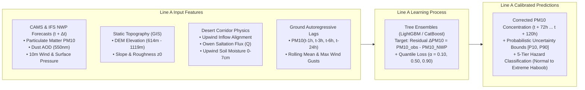
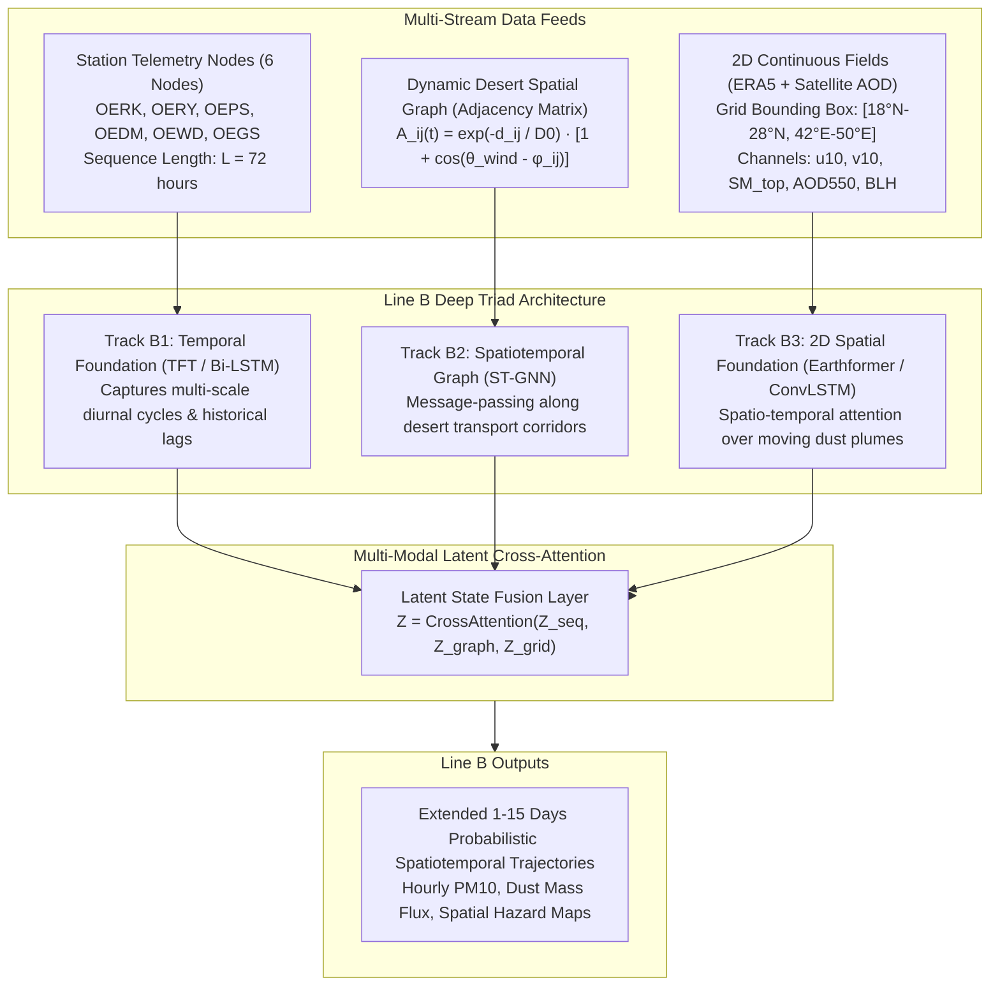

# 🏗️ Multi-Modal Data Architecture for Dual-Line Sandstorm Forecasting
## Integrating Riyadh Metropolitan & Connected Desert Systems for Main Line A and Main Line B

This architectural specification defines how all acquired datasets—encompassing the **Riyadh urban receptor**, the **five connected desert source systems** (Al-Thumamah, Ad-Dahna, Nafud al-Thuwairat, Tuwayq Escarpment, and Rub' al-Khali), and provincial monitoring corridors—are coupled, transformed, and routed into **Main Line A** (NWP Statistical Bias Correction) and **Main Line B** (End-to-End Deep Spatiotemporal Modeling).

---

## 1. High-Level Dual-Line Architecture Overview

The system operates on an asymmetric dual-line paradigm that overcomes the chaotic predictability barrier of classical Numerical Weather Prediction (NWP) beyond 72 hours:

```mermaid
graph TD
    %% DATA INGESTION TIER
    subgraph RawData["Multi-Modal Data Ingestion Tier (data/raw/)"]
        G[Ground Telemetry: 6 Stations<br/>OERK, OERY, OEPS, OEDM, OEWD, OEGS]
        E[ERA5 Reanalysis: 6 Domains<br/>u10, v10, gusts, soil moisture 0-7cm, BLH]
        S[Satellite & AERONET Optical Truth<br/>MODIS AOD, Dust Mass, Solar Village AOD]
        T[GIS DEM Topography & Boundaries<br/>SRTM 90m DEM, slope, roughness z0, GeoJSON]
        N[Operational NWP Forecasts<br/>CAMS PM10/Dust + ECMWF IFS 10-day]
    end

    %% PREPROCESSING & FEATURE ENGINE
    subgraph FeatureEngine["Unified Preprocessing & Corridor Feature Engine"]
        F1[Akima Time-Series Interpolation & Quality Control]
        F2[Corridor Directional Inflow Projection: u · v_desert]
        F3[Owen Physical Saltation Sand-Flux Proxy: Q ~ u*^3]
        F4[Dynamic Graph Adjacency Matrix: A_ij(t)]
        F5[Multi-Horizon Lag Engine: t - 1h to t - 24h]
    end

    RawData --> FeatureEngine

    %% MAIN LINE A
    subgraph LineA["Main Line A: Statistical ML & NWP Post-Processing"]
        A_In[Features: NWP baseline + Terrain z0 + Local Lags + Desert Projections]
        A_Model[Gradient Boosted Decision Trees<br/>LightGBM + CatBoost + XGBoost]
        A_Target[Residual Learning: ΔPM10 = PM10_obs - PM10_NWP<br/>+ Quantile Regressors: P10, P50, P90]
        A_Out[Calibrated 72h-120h Sandstorm Forecasts & Hazard Tiers]
    end

    %% MAIN LINE B
    subgraph LineB["Main Line B: End-to-End Spatiotemporal Deep Learning"]
        B_In[Features: Raw Multi-Station Sequences + Dynamic Graph Topology + 2D Grids]
        B_Seq[Track B1: Temporal Foundation<br/>Bi-LSTM / Temporal Fusion Transformer - TFT]
        B_Graph[Track B2: Spatial Corridor Network<br/>Spatiotemporal Graph Neural Network - ST-GNN]
        B_Grid[Track B3: 2D Grid Foundations<br/>ConvLSTM / Earthformer over Desert Bounding Box]
        B_Fusion[Multi-Modal Latent Cross-Attention Fusion]
        B_Out[Extended 1-15 Days Probabilistic Spatiotemporal Dust Predictions]
    end

    FeatureEngine -->|Tabular Feature Matrix| LineA
    FeatureEngine -->|Node Sequences & Spatial Tensors| LineB

    A_Out --> Ensemble[Decision-Support & Warning Dashboard]
    B_Out --> Ensemble
```

---

## 2. Data Sources & Spatial Connection Map

All acquired files located in [`data/raw/`](file:///c:/Users/hp/Desktop/sandstorm_forecasting/data/raw/) are physically mapped to specific geographical nodes:

| Domain / Node | Latitude / Longitude | Distance to Riyadh | Physical Role | Local Raw Datasets |
| :--- | :---: | :---: | :--- | :--- |
| **Riyadh KKIA (`OERK`)** | $24.93^\circ\text{N}, 46.72^\circ\text{E}$ | **0 km** | **Primary Target Receptor:** Ground-truth METAR/ASOS records with calibrated $\text{PM}_{10}$, visibility, wind speed, gusts, and WMO dust weather codes. | [`oerk_riyadh_king_khalid_intl_airport.csv`](file:///c:/Users/hp/Desktop/sandstorm_forecasting/data/raw/ground/oerk_riyadh_king_khalid_intl_airport.csv)<br/>[`era5_riyadh_center_hourly.csv`](file:///c:/Users/hp/Desktop/sandstorm_forecasting/data/raw/era5/era5_riyadh_center_hourly.csv) |
| **Riyadh Air Base (`OERY`)** | $24.71^\circ\text{N}, 46.73^\circ\text{E}$ | **24 km** | **Urban Canopy Receptor:** Internal urban street-level visibility, temperature heat-island effects, and micro-dispersion. | [`oery_riyadh_air_base.csv`](file:///c:/Users/hp/Desktop/sandstorm_forecasting/data/raw/ground/oery_riyadh_air_base.csv) |
| **Al-Thumamah Dunes** | $25.20^\circ\text{N}, 47.10^\circ\text{E}$ | **50 km (E/NE)** | **Immediate Dunes Trigger:** Active sand sheets. High sensitivity to local wind bursts ($\ge 7\,\text{m/s}$), producing rapid visibility drops (<1h lead time). | [`era5_al_thumamah_hourly.csv`](file:///c:/Users/hp/Desktop/sandstorm_forecasting/data/raw/era5/era5_al_thumamah_hourly.csv)<br/>[`satellite_aod_dust_al_thumamah_hourly.csv`](file:///c:/Users/hp/Desktop/sandstorm_forecasting/data/raw/satellite/satellite_aod_dust_al_thumamah_hourly.csv) |
| **Ad-Dahna Desert / Al-Kharj (`OEPS`)** | $25.60^\circ\text{N}, 47.45^\circ\text{E}$<br/>$24.06^\circ\text{N}, 47.58^\circ\text{E}$ | **120 km (NE)**<br/>**129 km (S)** | **Eastern Sand Sea Conveyor:** 1,000-km arc of red barchan dunes linking northern Nafud to southern Rub' al-Khali; funnels iron-rich dust under easterly/Shamal wind vectors. | [`oeps_al_kharj_prince_sultan_air_base.csv`](file:///c:/Users/hp/Desktop/sandstorm_forecasting/data/raw/ground/oeps_al_kharj_prince_sultan_air_base.csv)<br/>[`era5_ad_dahna_hourly.csv`](file:///c:/Users/hp/Desktop/sandstorm_forecasting/data/raw/era5/era5_ad_dahna_hourly.csv) |
| **Nafud al-Thuwairat / Gassim (`OEGS`)** | $26.50^\circ\text{N}, 44.80^\circ\text{E}$<br/>$26.30^\circ\text{N}, 43.77^\circ\text{E}$ | **220 km (NW)**<br/>**332 km (NW)** | **Major Dust Emission Hotspot:** High-frequency deflation basin. Northwesterly *Shamal* winds mobilize extensive dust fronts down the Zulfi–Majmaah corridor into Riyadh. | [`oegs_gassim_regional_airport.csv`](file:///c:/Users/hp/Desktop/sandstorm_forecasting/data/raw/ground/oegs_gassim_regional_airport.csv)<br/>[`era5_nafud_al_thuwairat_hourly.csv`](file:///c:/Users/hp/Desktop/sandstorm_forecasting/data/raw/era5/era5_nafud_al_thuwairat_hourly.csv) |
| **Tuwayq Escarpment / Ad-Duwadimi (`OEDM`)** | $24.10^\circ\text{N}, 45.40^\circ\text{E}$<br/>$24.45^\circ\text{N}, 44.12^\circ\text{E}$ | **180 km (SW)**<br/>**268 km (W)** | **Orographic & Convective Barrier:** 800-km cliff ridge creating aerodynamic channeling, slope vorticity, and deep downdrafts triggering Haboobs. | [`oedm_ad_duwadimi_airport.csv`](file:///c:/Users/hp/Desktop/sandstorm_forecasting/data/raw/ground/oedm_ad_duwadimi_airport.csv)<br/>[`era5_tuwayq_escarpment_hourly.csv`](file:///c:/Users/hp/Desktop/sandstorm_forecasting/data/raw/era5/era5_tuwayq_escarpment_hourly.csv) |
| **Rub' al-Khali / Wadi Ad-Dawasir (`OEWD`)** | $21.50^\circ\text{N}, 48.50^\circ\text{E}$<br/>$20.50^\circ\text{N}, 45.20^\circ\text{E}$ | **350 km (SE)**<br/>**515 km (S)** | **Hyper-Arid Sand Basin:** Deep thermal low-pressure systems drive massive regional dust plumes northwards through southern Riyadh Province into the capital. | [`oewd_wadi_al_dawasir_airport.csv`](file:///c:/Users/hp/Desktop/sandstorm_forecasting/data/raw/ground/oewd_wadi_al_dawasir_airport.csv)<br/>[`era5_rub_al_khali_hourly.csv`](file:///c:/Users/hp/Desktop/sandstorm_forecasting/data/raw/era5/era5_rub_al_khali_hourly.csv) |
| **Solar Village AERONET Ground Truth** | $24.91^\circ\text{N}, 46.40^\circ\text{E}$ | **35 km (NW)** | **Ground-Truth Optical Column Calibration:** NASA sunphotometer spectral AOD ($340\text{--}1020\,\text{nm}$) and coarse-mode Ångström exponent ($\alpha_{440/870}$). | [`aeronet_solar_village_riyadh_aod.csv`](file:///c:/Users/hp/Desktop/sandstorm_forecasting/data/raw/satellite/aeronet_solar_village_riyadh_aod.csv) |

---

## 3. How Data Connects to Main Line A (Statistical ML & NWP Bias Correction)

### Scientific Role of Line A
Numerical Weather Prediction models (Copernicus CAMS, ECMWF IFS) possess global physical equations but suffer from **severe systematic local biases** over the Arabian Peninsula due to:
1. Coarse spatial topography smoothing (smoothing the steep 800m Tuwayq ridge).
2. Idealized aerodynamic roughness ($z_0$) over shifting sand seas (Nafud, Dahna).
3. Underestimation of sudden convective Haboob cold-pool downdrafts.

**Main Line A trains Gradient Boosted Decision Tree Ensembles (LightGBM, CatBoost, XGBoost)** to correct these systematic errors.



### Mathematical Coupling for Line A
1. **Target Formulation (Residual Correction):**
   $$\Delta y(t + \tau) = y_{\text{obs}}(t + \tau) - y_{\text{NWP}}(t + \tau)$$
   The final forecast restores physics plus corrected local anomalies:
   $$\hat{y}(t + \tau) = y_{\text{NWP}}(t + \tau) + f_{\text{GBDT}}\left(\mathbf{X}_{\text{ground}}(t), \mathbf{X}_{\text{ERA5}}(t), \mathbf{X}_{\text{desert}}(t), \mathbf{X}_{\text{GIS}}\right)$$

2. **Connected Desert Corridor Inflow Couplings:**
   For each desert $d \in \{\text{Thumamah}, \text{Dahna}, \text{Thuwairat}, \text{Tuwayq}, \text{Rub' al-Khali}\}$:
   $$\text{Inflow\_Factor}_d(t) = \max\left(0, \cos(\theta_{\text{wind}}(t) - \theta_d)\right) \cdot u_{10}(t) \cdot \exp\left(-15 \cdot SM_{0-7\text{cm}}^d(t)\right)$$
   This tells Line A whether active deflation is occurring upwind in that desert and traveling toward Riyadh.

3. **Probabilistic Quantile Bounds:**
   Trained with tilted pinball loss $L_q(y, \hat{y}) = \max(q(y - \hat{y}), (q - 1)(y - \hat{y}))$ at $q \in \{0.10, 0.50, 0.90\}$ to provide emergency decision-makers with worst-case dust hazard envelopes ($P90$).

---

## 4. How Data Connects to Main Line B (End-to-End Spatiotemporal Deep Learning)

### Scientific Role of Line B
Main Line B does not depend solely on NWP forecasts. It learns **direct spatiotemporal wave propagation and dust advection** across the desert graph network out to medium and extended ranges ($3\text{--}15\text{ days}$).



### Deep Learning Mathematical Formulations for Line B

#### Track B1: Multi-Station Graph Network (ST-GNN)
The 6 ground stations form a directed, time-varying spatial graph $\mathcal{G}_t = (\mathcal{V}, \mathcal{E}, \mathbf{A}(t))$:
- **Node Set:** $\mathcal{V} = \{\text{OERK, OERY, OEPS, OEDM, OEWD, OEGS}\}$.
- **Dynamic Adjacency Matrix $\mathbf{A}_{ij}(t)$:**
  The connectivity between upstream desert stations (e.g., Gassim `OEGS` or Al-Kharj `OEPS`) and Riyadh receptor (`OERK`) dynamically increases when the prevailing wind aligns with the corridor connecting them:
  $$A_{ij}(t) = \exp\left(-\frac{d_{ij}}{D_0}\right) \cdot \max\left(0, \cos\left(\theta_{\text{wind}}^i(t) - \phi_{ij}\right)\right)$$
  where $d_{ij}$ is geodesic distance, $D_0 = 300\,\text{km}$, $\theta_{\text{wind}}^i$ is the wind direction at source station $i$, and $\phi_{ij}$ is the geographic bearing from station $i$ to station $j$.

#### Track B2: Temporal Fusion Transformer (TFT)
- **Input Context:** Past 72 hours of continuous multi-modal telemetry ($t-72\text{h}$ to $t$).
- **Gated Residual Networks (GRN):** Filter irrelevant inputs during calm non-dust periods.
- **Variable Selection Networks (VSN):** Automatically weigh whether ERA5 soil moisture in Nafud al-Thuwairat or Satellite AOD in Ad-Dahna is dominating the current synoptic event.

#### Track B3: 2D Spatial Grid Field (Earthformer)
- **Spatial Domain:** Central Saudi Arabia $[18^\circ\text{N}\text{--}28^\circ\text{N}, 42^\circ\text{E}\text{--}50^\circ\text{E}]$.
- **Channels:** 2D tensor of $u_{10}, v_{10}$, soil moisture, boundary layer height, and satellite aerosol optical depth retrieved across the desert grid cells.
- **Space-Time Axial Attention:** Tracks the formation, spatial advection, and speed of moving dust plumes heading towards Riyadh.

---

## 5. Comprehensive Feature Routing Matrix: Line A vs. Line B

| Feature Group | Specific Variable Name | Source Data File Path | Used in Line A | Used in Line B | Role in Forecasting |
| :--- | :--- | :--- | :---: | :---: | :--- |
| **Receptor Target Ground** | `visibility_km`, `wind_speed_ms`, `wind_gust_ms`, `tmpc`, `dwpc`, `relative_humidity`, `mslp` | [`data/raw/ground/oerk_riyadh_king_khalid_intl_airport.csv`](file:///c:/Users/hp/Desktop/sandstorm_forecasting/data/raw/ground/oerk_riyadh_king_khalid_intl_airport.csv) | ✅ (as lags) | ✅ (as node seq) | Immediate ground boundary state and target truth. |
| **Target Truth Target** | `pm10_calibrated_ugm3`, `is_dust_event`, `hazard_level` | [`data/raw/ground/riyadh_king_khalid_intl_airport_real.csv`](file:///c:/Users/hp/Desktop/sandstorm_forecasting/data/raw/ground/riyadh_king_khalid_intl_airport_real.csv) | ✅ (target) | ✅ (target) | Continuous regression target and 5-tier classification labels. |
| **Corridor Ground Nodes** | Telemetry for OERY, OEPS, OEDM, OEWD, OEGS | [`data/raw/ground/riyadh_and_connected_deserts_ground_master.csv`](file:///c:/Users/hp/Desktop/sandstorm_forecasting/data/raw/ground/riyadh_and_connected_deserts_ground_master.csv) | ✅ (lags) | ✅ (graph nodes) | Upstream early-warning sensors along desert inflow routes. |
| **NWP Baseline Forecasts** | `nwp_pm10`, `nwp_dust_aod`, `nwp_u10`, `nwp_v10` (lead time $72\text{--}120\text{h}$) | [`data/raw/nwp/cams_forecast_connected_deserts_and_riyadh.csv`](file:///c:/Users/hp/Desktop/sandstorm_forecasting/data/raw/nwp/cams_forecast_connected_deserts_and_riyadh.csv) | ✅ (primary input) | ❌ (or aux prior) | Baseline numerical guidance for statistical bias correction in Line A. |
| **Desert Surface Moisture** | `soil_moisture_0_to_7cm`, `soil_moisture_7_to_28cm` (for all 5 deserts) | [`data/raw/era5/era5_*_hourly.csv`](file:///c:/Users/hp/Desktop/sandstorm_forecasting/data/raw/era5/) | ✅ | ✅ | Controls soil deflation threshold and dust emission suppression. |
| **Desert Atmospheric Winds** | $u_{10}, v_{10}, u_{\text{gust}}$, friction velocity proxy $u_*$ | [`data/raw/era5/era5_*_hourly.csv`](file:///c:/Users/hp/Desktop/sandstorm_forecasting/data/raw/era5/) | ✅ | ✅ | Kinetic energy driving sand saltation in each desert source. |
| **Optical Ground Calibration**| `aod_500nm`, $\alpha_{440/870}$ (Ångström exponent) | [`data/raw/satellite/aeronet_solar_village_riyadh_aod.csv`](file:///c:/Users/hp/Desktop/sandstorm_forecasting/data/raw/satellite/aeronet_solar_village_riyadh_aod.csv) | ✅ | ✅ | Quality-assured optical verification separating desert sand from smoke/urban smog. |
| **Satellite Dust Retrievals** | `aerosol_optical_depth`, `dust`, `pm10`, `uv_index` (for all 5 deserts) | [`data/raw/satellite/satellite_aod_dust_*_hourly.csv`](file:///c:/Users/hp/Desktop/sandstorm_forecasting/data/raw/satellite/) | ✅ | ✅ | Upwind atmospheric dust column tracking before ground arrival. |
| **Static GIS Topography** | `elevation_m`, `slope_deg`, `roughness_z0_m` | [`data/raw/gis/connected_deserts_dem_elevation_grid.csv`](file:///c:/Users/hp/Desktop/sandstorm_forecasting/data/raw/gis/connected_deserts_dem_elevation_grid.csv) | ✅ | ✅ | Topographic barrier modeling (Tuwayq ridge) and surface friction. |
| **Corridor Vector Metrics** | `distance_km`, `azimuth_deg`, `inflow_align_*` | [`data/raw/gis/riyadh_connected_deserts_metadata.json`](file:///c:/Users/hp/Desktop/sandstorm_forecasting/data/raw/gis/riyadh_connected_deserts_metadata.json) | ✅ | ✅ (graph weights) | Computes directional projection of wind vectors along corridor bearings. |

---

## 6. Implementation Code Blueprint for Model Training

### Preparing the Unified Feature Tensors
The preprocessing script [`scripts/preprocessing/merge_riyadh_multimodal_data.py`](file:///c:/Users/hp/Desktop/sandstorm_forecasting/scripts/preprocessing/merge_riyadh_multimodal_data.py) constructs the master tabular and graph structures:

```python
# -----------------------------------------------------------------------------
# LINE A TRAINING SNIPPET (Gradient Boosted Trees Bias Post-Processor)
# -----------------------------------------------------------------------------
import lightgbm as lgb
from sklearn.metrics import mean_squared_error, mean_absolute_error

# Features: NWP baseline + desert corridor projections + local lags + GIS
X_cols = [c for c in df_merged.columns if c not in ["time", "pm10_calibrated_ugm3", "hazard_class"]]
y_target = df_merged["pm10_calibrated_ugm3"] - df_merged["nwp_cams_pm10"] # Residual target

train_mask = df_merged["time"] < "2024-01-01"
X_train, y_train = df_merged.loc[train_mask, X_cols], y_target[train_mask]
X_val, y_val = df_merged.loc[~train_mask, X_cols], y_target[~train_mask]

# Train LightGBM Quantile Regressors (P10, P50, P90)
models_line_a = {}
for q in [0.10, 0.50, 0.90]:
    params = {"objective": "quantile", "alpha": q, "learning_rate": 0.05, "num_leaves": 63}
    model = lgb.LGBMRegressor(**params, n_estimators=500)
    model.fit(X_train, y_train)
    models_line_a[f"P{int(q*100)}"] = model

# Final Prediction = NWP Baseline + GBDT Residual Correction
corrected_p50 = df_merged.loc[~train_mask, "nwp_cams_pm10"] + models_line_a["P50"].predict(X_val)
```

```python
# -----------------------------------------------------------------------------
# LINE B TRAINING SNIPPET (Spatial-Temporal Graph Neural Network)
# -----------------------------------------------------------------------------
import torch
import torch.nn as nn

# Dynamic Graph Adjacency Matrix Construction:
# Nodes: [OERK, OERY, OEPS, OEDM, OEWD, OEGS]
def compute_dynamic_adjacency(wind_speed_ms, wind_dir_deg, static_distance_km, corridor_bearings_deg):
    D0 = 300.0 # km
    dist_decay = torch.exp(-static_distance_km / D0)
    # Directional alignment: cos(theta_wind - corridor_bearing)
    wind_rad = torch.deg2rad(wind_dir_deg)
    corridor_rad = torch.deg2rad(corridor_bearings_deg)
    alignment = torch.clamp(torch.cos(wind_rad - corridor_rad), min=0.0)
    A_dynamic = dist_decay * (1.0 + alignment * (wind_speed_ms / 15.0))
    # Normalize adjacency matrix (Laplacian normalization)
    D_inv = torch.diag(1.0 / torch.sum(A_dynamic, dim=-1))
    return torch.matmul(D_inv, A_dynamic)
```

---

## 7. Operational Deployment Workflow

1. **Continuous Real-Time Ground Ingestion:** Station feeds from `OERK`, `OERY`, `OEPS`, `OEDM`, `OEWD`, and `OEGS` are pulled hourly.
2. **Desert Deflation Evaluation:** ERA5/NWP wind and soil moisture over Nafud al-Thuwairat, Ad-Dahna, Al-Thumamah, and Rub' al-Khali are evaluated against the Owen saltation threshold ($u_* \ge 0.28\,\text{m/s}$).
3. **Dual Execution:**
   - **Line A** takes the morning operational CAMS/IFS NWP run, corrects the bias vector using tree ensembles, and outputs calibrated 72h–120h $\text{PM}_{10}$ and $P10/P50/P90$ quantile envelopes.
   - **Line B** runs the ST-GNN and Temporal Fusion Transformer over the dynamic corridor graph, providing 1–15 day extended spatiotemporal hazard trajectories.
4. **Alert Triggering:** If either Line A or Line B forecasts visibility $< 1.0\,\text{km}$ or $\text{PM}_{10} > 500\,\mu\text{g/m}^3$ across Riyadh, automated warnings are escalated to the emergency dispatch dashboard.
