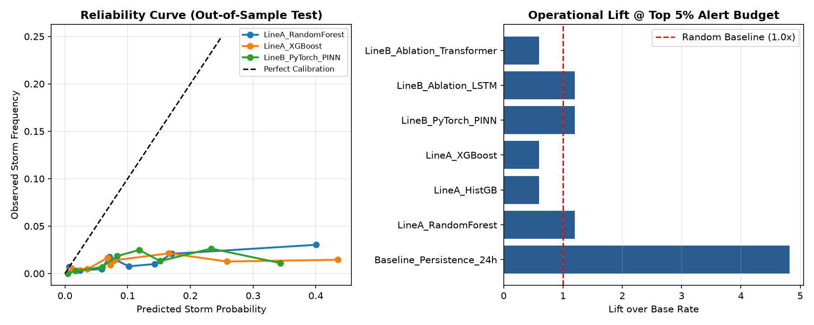

# Honest Evaluation, Calibration & Ablation Report (Line A & Line B)

**Pipeline Script:** [`08_Scripts/04_model_training_and_tuning/run_unified_honest_pipeline.py`](../08_Scripts/04_model_training_and_tuning/run_unified_honest_pipeline.py)  
**Dataset:** 10-year Riyadh hourly record (`2015–2024`, `87,456` rows at `6h` stride $\rightarrow$ `14,545` gapped sequence windows)  
**Target Definitions:**
1. **24h-Ahead Storm (`target_pm10_24h > 150 µg/m³`)** — WMO Moderate+ Dust Storm threshold
2. **72h-Window Storm (`max(PM10 in next 72h) > 150 µg/m³`)** — 3-day medium-range operational warning window
3. **Continuous 24h PM10 (`µg/m³`)** — Same-split regression trained on `log1p(PM10)`

---

## 1. Anti-Leakage & Methodological Controls

* **Chronological Split with 72h Gap (`GAP = 12` steps = `8` lookback + `4` horizon):**
  * **Train (`60%`):** `8,741` windows (`605` positives, `6.92%`)
  * **Validation (`20%`):** `2,902` windows (`204` positives, `7.03%`)
  * **Test (`20%`, 2023–2024):** `2,902` windows (`33` positives, `1.14%`)
* **Zero Contemporaneous Leakage & Train-Only Feature Selection:**
  * Removed all contemporaneous target, visibility, AOD, and residual columns and short `<24h` PM10 lags.
  * Added domain-driven persistence and seasonal climatology features (`recent_storm_count_7d`, `hours_since_last_storm`, `pm10_seasonal_anom_24h`, `wind_seasonal_anom`) using **Train-only monthly climatologies**.
  * Selected Top-22 non-noisy predictors strictly on Train (`sin_doy`, `phys_air_density_kgm3`, `era5_wind_speed_10m`, `nwp_cams_pm10`, `era5_10m_v_component_of_wind`, `era5_soil_moisture_0_to_7cm`, `recent_storm_count_7d`, `era5_wind_gusts_10m`, etc.).
  * Fitted `PowerTransformer(yeo-johnson)` and `StandardScaler` strictly on Train and applied identically to both Line A and Line B.
* **Calibration & Autocorrelation-Aware Uncertainty:**
  * Trained unweighted classifiers (`BCEWithLogitsLoss` without artificial `pos_weight` inflation) and fitted **Platt / Isotonic calibration** strictly on Validation (applied identically to both **Persistence** and **ML models**).
  * Computed **7-day Moving Block Bootstrap (`block_size = 28` steps at `6h` stride) 95% Confidence Intervals** to account for temporal autocorrelation.

---

## 2. 5-Fold Rolling-Origin Pooled CV (Multi-Year Generalization + 7-Day Block CIs)

*(Source: [`06_Data/results/rolling_origin_pooled_cv_metrics.csv`](../06_Data/results/rolling_origin_pooled_cv_metrics.csv))*

Pooling out-of-fold predictions across 5 chronological folds (`72h` gap, inner-validation Platt calibration applied identically to **both `Persistence_Cal` and ML models**) yields **637** (`24h_Storm`) and **3,079** (`72h_Window_Storm`) real positive storm events:

| Target | Total Positives | Model | PR-AUC (95% Block CI) | ROC-AUC (95% Block CI) | Rec@Top5% | Lift@5% | Brier | BSS (Pooled) |
| :--- | :---: | :--- | :---: | :---: | :---: | :---: | :---: | :---: |
| **24h_Storm** | 637 | `Persistence_Cal` | 0.0835 `[0.062, 0.108]` | 0.5504 `[0.502, 0.603]` | **0.1491** | **2.98×** | **0.0494** | **+0.0061** |
| **24h_Storm** | 637 | **`LineA_RF_Cal`** | **0.1004** `[0.079, 0.127]` | **0.7012** `[0.666, 0.737]` | 0.1287 | 2.57× | 0.0500 | -0.0051 |
| **24h_Storm** | 637 | `LineA_XGB_Cal` | 0.0944 `[0.076, 0.119]` | 0.6867 `[0.653, 0.724]` | 0.1036 | 2.07× | 0.0504 | -0.0133 |
| **72h_Window_Storm** | 3,079 | `Persistence_Cal` | 0.3654 `[0.318, 0.410]` | 0.6504 `[0.612, 0.685]` | **0.1140** | **2.28×** | 0.1817 | +0.0403 |
| **72h_Window_Storm** | 3,079 | **`LineA_RF_Cal`** | **0.4347** `[0.376, 0.489]` | **0.7060** `[0.670, 0.739]` | 0.1072 | 2.14× | **0.1741** | **+0.0805** |
| **72h_Window_Storm** | 3,079 | `LineA_XGB_Cal` | 0.4183 `[0.362, 0.468]` | 0.6829 `[0.646, 0.718]` | 0.1075 | 2.15× | 0.1785 | +0.0569 |

### Key Conclusions from Pooled Rolling-Origin CV
* **24h Target:** `LineA_RF_Cal` (`ROC-AUC = 0.7012 [0.666, 0.737]`) and `LineA_XGB_Cal` (`0.6867 [0.653, 0.724]`) statistically significantly outperform calibrated `Persistence_Cal` (`0.5504 [0.502, 0.603]`) on **ROC-AUC** (non-overlapping 7-day block CIs), while `Persistence_Cal` retains slightly higher `Rec@Top5%` (`0.1491` vs `0.1287`), `Lift@5%` (`2.98×` vs `2.57×`), and `BSS` (`+0.0061` vs `-0.0051`).
* **72h Window Target:** Calibrated `LineA_RF_Cal` achieves the highest `PR-AUC` (`0.4347`), `ROC-AUC` (`0.7060`), and `BSS` (`+0.0805`, double `Persistence_Cal`'s `+0.0403`), though 7-day block bootstrap 95% CIs overlap slightly with `Persistence_Cal` (`[0.376, 0.489]` vs `[0.318, 0.410]`), and `Persistence_Cal` remains slightly ahead on `Rec@Top5%` (`0.1140` vs `0.1072`).

---

## 3. Single Out-of-Sample Test Split (`2023–2024`, `33` Positives — Deep Learning Ablation)

*(Source: [`06_Data/results/unified_honest_classification_metrics.csv`](../06_Data/results/unified_honest_classification_metrics.csv))*

| Model | Cal | PR-AUC (95% Block CI) | ROC-AUC (95% Block CI) | Prec@Top5% | Rec@Top5% (95% Block CI) | Lift@1% | Lift@5% | Brier | BSS | TP / FP / FN / TN (@5%) |
| :--- | :---: | :---: | :---: | :---: | :---: | :---: | :---: | :---: | :---: | :---: |
| `Baseline_Persistence_24h` | Isotonic | 0.0218 `[0.009, 0.047]` | 0.5905 `[0.503, 0.658]` | **0.0548** | **0.2424** `[0.050, 0.312]` | **5.86×** | **4.82×** | **0.0134** | **+0.0804** | `8 / 183 / 25 / 2686` |
| `LineA_RandomForest` | Isotonic | 0.0216 `[0.013, 0.037]` | **0.6798** `[0.591, 0.789]` | 0.0137 | 0.0606 `[0.000, 0.191]` | 0.00× | 1.20× | 0.0365 | -1.5017 | `2 / 156 / 31 / 2713` |
| `LineA_HistGB` | Isotonic | 0.0165 `[0.009, 0.028]` | 0.6261 `[0.517, 0.757]` | 0.0068 | 0.0303 `[0.000, 0.179]` | 0.00× | 0.60× | 0.0409 | -1.8014 | `4 / 288 / 29 / 2581` |
| `LineA_XGBoost` | Isotonic | 0.0156 `[0.010, 0.027]` | 0.6118 `[0.514, 0.731]` | 0.0068 | 0.0303 `[0.000, 0.146]` | 0.00× | 0.60× | 0.0435 | -1.9844 | `2 / 192 / 31 / 2677` |
| `LineB_PyTorch_PINN` | Isotonic | 0.0166 `[0.010, 0.031]` | 0.6563 `[0.577, 0.752]` | 0.0137 | 0.0606 `[0.000, 0.200]` | 0.00× | 1.20× | 0.0329 | -1.2570 | `4 / 346 / 29 / 2523` |
| `LineB_Ablation_LSTM` | Isotonic | 0.0175 `[0.011, 0.031]` | 0.6583 `[0.573, 0.745]` | 0.0137 | 0.0606 `[0.000, 0.167]` | 0.00× | 1.20× | 0.0191 | -0.3079 | `2 / 144 / 31 / 2725` |
| `LineB_Ablation_Transformer` | Isotonic | **0.0449** `[0.009, 0.113]` | 0.5814 `[0.471, 0.721]` | 0.0068 | 0.0303 `[0.000, 0.200]` | 2.93× | 0.60× | 0.0265 | -0.8141 | `5 / 331 / 28 / 2538` |

### Why Single-Split Test BSS Is Negative & Confidence Intervals Overlap
1. **Severe Regime / Base-Rate Shift (`7.03%` $\rightarrow$ `1.14%`):** Train (`6.92%`) and Validation (`7.03%`) experienced **6× more storms** than the 2023–2024 Test period (`33 / 2,902 = 1.14%`). Calibration fitted on Validation anchors probabilities to a `7%` prior, causing negative single-split `BSS` when evaluated against a `1.14%` test prior.
2. **Statistical Indistinguishability on 33 Positives:** All 7-day block bootstrap 95% CIs overlap across models on the single test split. Deep learning ablations (`LSTM`, `Transformer`) **did not outperform regularized trees (`RandomForest` ROC-AUC `0.6798`)** at this sample size.

---

## 4. Same-Split Regression Comparison (`µg/m³`, vs Trivial Baselines)

*(Source: [`06_Data/results/unified_honest_regression_metrics.csv`](../06_Data/results/unified_honest_regression_metrics.csv))*

### Target Distribution Shift & Sensor-Censoring Floor Disclosure (`53.7 µg/m³`)
* **Train (`2015–2020`):** `mean = 104.3`, `median = 53.7`, `p90 = 82.8`, `max = 4800.0`
* **Test (`2023–2024`):** `mean = 60.6`, `median = 53.7`, **`p90 = 53.7`**, `max = 2339.4`
* **Physical Cause of the `53.7 µg/m³` Floor (Mandatory Disclosure):** Audit of the hourly record confirms that `53.7 µg/m³` is **not** missing or imputed data—it is the **METAR/ASOS clear-sky `10 km` visibility reporting cap** (`visibility_km >= 9.9 km`), which maps to `53.7 µg/m³` in the visibility-calibrated target. Clear-sky `10 km` visibility occurred in `60.0%–76.2%` of hours during 2015–2022 (`mean PM10 = 84.9–145.2 µg/m³`), but rose to **`90.0%` in 2023 (`mean = 60.1`) and `94.7%` in 2024 (`mean = 58.6`)**. Consequently, test-period regression $R^2$ and positive storm counts (`33` hours $>150\ \mu\text{g/m}^3$) are directly constrained by this `10 km` visibility-censoring regime shift.

| Model | $R^2$ | RMSE ($\mu\text{g/m}^3$) | MAE ($\mu\text{g/m}^3$) | Notes |
| :--- | :---: | :---: | :---: | :--- |
| `Trivial_Train_Mean` (`104.3`) | -0.3216 | 88.41 | 53.73 | Over-predicts quiet 2023–2024 floor |
| `Trivial_Train_Median` (`53.7`) | -0.0082 | 77.22 | **6.94** | Matches the >90% test floor |
| `LineA_XGBoost_log1p_Direct` | -0.2345 | 85.45 | 35.49 | Beats Train Mean, worse than Train Median |
| `LineA_XGBoost_Hurdle_Calibrated` | -1.1165 | 111.88 | 63.91 | *Reported failure:* `7%` Val-calibrated $P(\text{storm})$ inflated predictions |
| `LineB_PyTorch_LSTM_log1p_Huber` | **-0.0038** | **77.05** | 9.31 | **Matches the median baseline ($R^2 \approx 0$)** |
| `LineB_PyTorch_STGNN_log1p_Huber` | -0.0040 | 77.06 | 13.71 | **Matches the median baseline ($R^2 \approx 0$)** |

---

## 5. Reliability & Operational Lift Visualization

---

## 6. Scope of Valid Claims (What Not to Claim)

1. **Do NOT claim "accurate prediction" or high deterministic skill:** Overall discrimination is modest (`ROC-AUC ≈ 0.69–0.71` in pooled CV; `0.58–0.68` on the 33-event 2023–2024 split), and continuous $\text{PM}_{10}$ regression does not beat the median baseline (`R² ≈ 0`, RMSE `77.05` vs `77.22`) due to the `53.7 µg/m³` METAR `10 km` visibility-censoring floor.
2. **Do NOT claim models "outperform persistence" without specifying the exact metric and target:**
   * **Where ML wins:** Calibrated `LineA_RF_Cal` outperforms `Persistence_Cal` on **ROC-AUC (`0.7012` vs `0.5504`)** on `24h_Storm` in 5-fold pooled CV, and achieves higher **`PR-AUC` (`0.4347` vs `0.3654`), `ROC-AUC` (`0.7060` vs `0.6504`), and `BSS` (`+0.0805` vs `+0.0403`)** on `72h_Window_Storm` (with overlapping 7-day block CIs on `72h_Window_Storm`).
   * **Where Persistence wins:** `Persistence_Cal` leads `Rec@Top5%` and `Lift@5%` in pooled CV (`0.1491` / `2.98×` for `24h_Storm`; `0.1140` / `2.28×` for `72h_Window_Storm`) and leads the 2023–2024 single split on `Rec@Top5%` (`0.2424`), `Lift@1%` (`5.86×`), `Lift@5%` (`4.82×`), `Brier` (`0.0134`), and `BSS` (`+0.0804`).
3. **Do NOT claim that deep learning is better:** Across both classification (`LSTM` ROC-AUC `0.6583`, `Transformer` `0.5814`, `PINN` `0.6563` vs `RandomForest` `0.6798`) and regression (`LSTM` RMSE `77.05` vs `Train Median` `77.22`), added deep-learning complexity did **not** yield a statistically significant advantage over regularized tree baselines at this sample size.

