# 🗺️ Sand & Dust Storm (SDS) Forecasting Sitemap & Taxonomic Classification
### *Comparative Analysis: Traditional Methodologies vs. Multi-Scale Dynamics (Small, Medium, Large) vs. Proposed Master's Research Architecture*

---

## 🎨 Color-Coded Taxonomy Legend

<div align="center">

| Color Code | Domain / Category | Focus & Scope |
| :--- | :--- | :--- |
| <span style="background-color:#6B21A8;color:white;padding:4px 10px;border-radius:4px;font-weight:bold;">🟣 ROYAL PURPLE</span> | **Traditional Forecasting Methods** | Subjective synoptic charts, classical statistical regressions, and deterministic NWP/CTM systems. |
| <span style="background-color:#15803D;color:white;padding:4px 10px;border-radius:4px;font-weight:bold;">🟢 EMERALD GREEN</span> | **Small Scale Dynamics** | Microscale turbulence ($<2\text{ km}$), short-term nowcasting ($0\text{--}72\text{ h}$), and localized saltation. |
| <span style="background-color:#D97706;color:white;padding:4px 10px;border-radius:4px;font-weight:bold;">🟡 AMBER GOLD</span> | **Medium Scale Dynamics** | Mesoscale Haboobs ($2\text{--}2,000\text{ km}$), extended-range forecasting ($3\text{--}15\text{ days}$), and regional corridors. |
| <span style="background-color:#B91C1C;color:white;padding:4px 10px;border-radius:4px;font-weight:bold;">🔴 CRIMSON RED</span> | **Large Scale Dynamics** | Synoptic/Macroscale ($>2,000\text{ km}$), long-term seasonal trends ($>15\text{ days}$), and planetary teleconnections. |
| <span style="background-color:#0284C7;color:white;padding:4px 10px;border-radius:4px;font-weight:bold;">🔵 ELECTRIC BLUE</span> | **Research AI Line A (GBDT)** | Numerical bias correction, LightGBM/CatBoost/XGBoost, and quantile uncertainty envelopes ($P_{10}/P_{50}/P_{90}$). |
| <span style="background-color:#4F46E5;color:white;padding:4px 10px;border-radius:4px;font-weight:bold;">🔮 INDIGO / VIOLET</span> | **Research AI Line B (Deep Learning)** | Long Short-Term Memory (LSTM), Multi-Head Self-Attention Transformers, and Spatio-Temporal Graph Neural Networks (ST-GNN). |
| <span style="background-color:#0F766E;color:white;padding:4px 10px;border-radius:4px;font-weight:bold;">🩵 TEAL CYAN</span> | **Spatial & Socioeconomic Tri-Pillar** | GIS geostatistics (Kriging/LISA), SPSS data screening, and AMOS structural equation modeling (SEM/PADM). |

</div>

---

## 🗺️ Master Visual Sitemap (Taxonomy Diagram)

```mermaid
flowchart TD
    %% Global Styling
    classDef default fill:#1E293B,stroke:#475569,stroke-width:1.5px,color:#F8FAFC;
    classDef tradClass fill:#4C1D95,stroke:#8B5CF6,stroke-width:2px,color:#EDE9FE;
    classDef smallClass fill:#064E3B,stroke:#10B981,stroke-width:2px,color:#D1FAE5;
    classDef medClass fill:#78350F,stroke:#F59E0B,stroke-width:2px,color:#FEF3C7;
    classDef largeClass fill:#7F1D1D,stroke:#EF4444,stroke-width:2px,color:#FEE2E2;
    classDef resAClass fill:#0C4A6E,stroke:#0EA5E9,stroke-width:2px,color:#E0F2FE;
    classDef resBClass fill:#312E81,stroke:#6366F1,stroke-width:2px,color:#EEF2FF;
    classDef triClass fill:#134E4A,stroke:#14B8A6,stroke-width:2px,color:#CCFBF1;

    Root["🌪️ SAND & DUST STORM (SDS) FORECASTING SYSTEM"]:::default

    %% Branch 1: Traditional Ways
    Root --> Trad["🟣 1. TRADITIONAL FORECASTING METHODS"]:::tradClass
    Trad --> T1["1.1 Subjective Synoptic Analysis<br/>• Manual surface isobaric charts<br/>• 500 hPa geopotential troughs<br/>• Forecaster heuristic rules"]:::tradClass
    Trad --> T2["1.2 Classical Empirical & Statistical<br/>• Persistence & Climatology<br/>• Linear Regression / ARIMA<br/>• Empirical Saltation (Bagnold, Owen)"]:::tradClass
    Trad --> T3["1.3 Dynamical NWP & CTM Models<br/>• ECMWF IFS / CMA-GFS<br/>• WRF-Chem / DREAM8b / CAMS<br/>• Hydrodynamic PDE solvers"]:::tradClass
    Trad --> TBottleneck["⚠️ Traditional Bottlenecks<br/>• Lyapunov Horizon limit (Day 3)<br/>• Sub-grid orographic bias<br/>• Massive HPC compute cost<br/>• Inability to model Haboobs"]:::tradClass

    %% Branch 2: Scales Classification
    Root --> Scale["⚖️ 2. MULTI-SCALE CLASSIFICATION SYSTEM"]:::default
    
    Scale --> Small["🟢 2.1 SMALL SCALE<br/>(Microscale & Short-Term)"]:::smallClass
    Small --> S_Spat["Spatial: Microscale (&lt; 2 km)<br/>• Boundary layer saltation<br/>• Dust devils & turbulence<br/>• Wadi Hanifa micro-corridors"]:::smallClass
    Small --> S_Temp["Temporal: Nowcasting (0–72 h)<br/>• Rapid runway alert (KKIA)<br/>• Real-time visibility drops<br/>• T-0 emergency alarms"]:::smallClass
    Small --> S_Sev["Hazard: Mild Event<br/>• PM10 &lt; 150 μg/m³<br/>• Visibility &gt; 5 km"]:::smallClass

    Scale --> Med["🟡 2.2 MEDIUM SCALE<br/>(Mesoscale & Extended 3–15d)"]:::medClass
    Med --> M_Spat["Spatial: Mesoscale (2–2,000 km)<br/>• Convective Haboob dust walls<br/>• Cold-pool thunderstorm outflows<br/>• Ad-Dahna to Riyadh corridor"]:::medClass
    Med --> M_Temp["Temporal: Extended-Range (3–15 d)<br/>• Sub-seasonal wave envelopes<br/>• Upstream precursor tracking<br/>• Municipal action window"]:::medClass
    Med --> M_Sev["Hazard: Moderate Storm<br/>• PM10: 150–500 μg/m³<br/>• Visibility: 1–5 km"]:::medClass

    Scale --> Large["🔴 2.3 LARGE SCALE<br/>(Synoptic-Macro & Seasonal)"]:::largeClass
    Large --> L_Spat["Spatial: Synoptic (&gt; 2,000 km)<br/>• Regional Shamal wind regimes<br/>• Siberian/Arabian anticyclones<br/>• Transboundary Rub' al Khali plumes"]:::largeClass
    Large --> L_Temp["Temporal: Long-Term (&gt; 15 d)<br/>• Monthly to Seasonal trends<br/>• Teleconnections (ENSO, NAO, AO)<br/>• Soil moisture drought memory"]:::largeClass
    Large --> L_Sev["Hazard: Severe / Blackout<br/>• PM10 &gt; 500–5,000+ μg/m³<br/>• Visibility &lt; 200 m (Blackout)"]:::largeClass

    %% Branch 3: What She Uses in Her Research
    Root --> Research["🔬 3. WHAT SHE USES IN HER RESEARCH (DustML / Riyadh Study)"]:::default

    Research --> DataMod["🛰️ Multi-Modal Data Ingestion<br/>• In-situ Telemetry (KKIA/Riyadh)<br/>• ECMWF ERA5 & CAMS forecasts<br/>• MODIS/FY-4 Satellite AOD<br/>• SRTM 90m DEM & Soil Moisture<br/>• Teleconnections (ENSO/NAO/AO)"]:::triClass

    Research --> LineA["🔵 MAIN LINE A: Machine Learning GBDT Post-Processing<br/>• LightGBM + CatBoost + XGBoost Ensembles<br/>• Monotonic Quantiles (P10, P50, P90 Envelopes)<br/>• Cost-Sensitive 5-Tier Hazard Classifier<br/>• Tree SHAP Feature Attribution Diagnostics"]:::resAClass

    Research --> LineB["🔮 MAIN LINE B: Deep Spatiotemporal AI (LSTM + Transformer + GNN)<br/>• LSTM Recurrent Sequence Network (temporal memory)<br/>• Spatiotemporal Transformer (sub-seasonal self-attention)<br/>• ST-GNN 14-Node Corridor Advection Graph (directional Chebyshev)<br/>• Coupled AI-GAMFS Vision Backbone (5km Grid)"]:::resBClass

    Research --> TriPillar["🩵 Spatial & Socioeconomic Tri-Pillar<br/>• GIS Ordinary Kriging & LISA Clustering<br/>• IBM SPSS Data Hygiene & EFA Screening<br/>• AMOS Confirmatory Factor Analysis (CFA)<br/>• PADM Structural Equation Modeling (SEM)<br/>• Municipal 4-Tier Crisis Action Matrix"]:::triClass
```



---

## 🟣 1. Classification of Traditional Forecasting Methods

Traditional sandstorm forecasting relies on physical approximations, linear assumptions, and empirical rules established over the past century. While foundational, each presents critical operational failure modes:

```
                               TRADITIONAL FORECASTING SPECTRUM
┌───────────────────────────────────┬─────────────────────────────────┬──────────────────────────────────┐
│   1. SYNOPTIC & SUBJECTIVE       │    2. STATISTICAL & EMPIRICAL   │   3. DYNAMICAL NWP & CTM         │
├───────────────────────────────────┼─────────────────────────────────┼──────────────────────────────────┤
│ • Manual synoptic weather charts  │ • Autoregressive models (ARIMA) │ • ECMWF IFS, CMA-GFS             │
│ • Surface pressure gradient rules │ • Linear Regression & CCA       │ • WRF-Chem, DREAM8b, CAMS        │
│ • 500 hPa trough & jet tracking   │ • Bagnold (1941) sand flux      │ • Navier-Stokes hydrodynamic PDE │
│ • Human forecaster experience     │ • Gillette (1979) threshold     │ • Parameterized dust emission    │
└───────────────────────────────────┴─────────────────────────────────┴──────────────────────────────────┘
```

### 1.1 Subjective Synoptic Analysis
* **Core Principle:** Forecasters manually inspect daily surface isobaric weather maps, upper-air geopotential height charts (850 hPa, 700 hPa, 500 hPa), and streamline divergence to identify storm-triggering patterns (e.g., steep pressure gradients, approaching cold fronts).
* **Limitations:** Highly reliant on individual forecaster heuristics; purely qualitative; cannot produce probabilistic confidence intervals or continuous hourly PM concentrations.

### 1.2 Classical Empirical & Statistical Formulations
* **Core Principle:** Employs empirical physical laws and simple linear time-series equations:
  * **Bagnold (1941) Sand Transport Flux:**
    $$q = C \cdot \frac{\rho}{g} \cdot u_*^3$$
  * **Gillette (1979) / Owen (1964) Saltation Thresholding:** Saltation occurs only when surface friction velocity exceeds a critical aerodynamic threshold:
    $$u_* > u_{*t} = A \cdot \sqrt{\frac{\rho_{\text{grain}} - \rho_{\text{air}}}{\rho_{\text{air}}} g d_p}$$
  * **Statistical Time Series:** Autoregressive Integrated Moving Average (ARIMA), Multiple Linear Regression (MLR), and Canonical Correlation Analysis (CCA).
* **Limitations:** Assumes linear stationary relationships; fails to capture multi-source non-linear couplings (soil moisture damping, surface roughness, vegetative shading); severe performance collapse during sudden extreme convective transitions.

### 1.3 Deterministic Numerical Weather Prediction (NWP) & Chemistry-Transport Models (CTMs)
* **Core Principle:** Numerically integrates the discretized atmospheric Navier-Stokes equations, thermodynamic conservation, and aerosol advection-diffusion-deposition equations on supercomputers (e.g., ECMWF IFS, WRF-Chem, DREAM8b, NASA GEOS-Chem, Copernicus CAMS):
  $$\frac{\partial C}{\partial t} + \nabla \cdot (\mathbf{u} C) = \nabla \cdot (\mathbf{K} \nabla C) + S_{\text{emission}} - v_d C - \Lambda_{\text{scav}} P_{\text{rain}} C$$
* **Critical Operational Bottlenecks:**
  1. <span style="color:#B91C1C;font-weight:bold;">The Chaotic Lyapunov Horizon ($T_{\text{Lyap}} \approx 72\text{ hours}$):</span> Atmospheric error growth in phase space follows $\|\delta \mathbf{x}(t)\| \approx \|\delta \mathbf{x}(0)\| \cdot e^{\lambda_{\text{max}} t}$. Beyond Day 3, deterministic trajectories rapidly diverge from ground observations.
  2. <span style="color:#B91C1C;font-weight:bold;">Sub-Grid Orographic Smoothing:</span> Coarse grid resolutions ($9\text{--}25\text{ km}$) cannot resolve narrow canyon channeling, local sand escarpments (e.g., Jabal Tuwaiq escarpment), or micro-topography.
  3. <span style="color:#B91C1C;font-weight:bold;">Failure on Convective Haboobs:</span> NWP parameterization schemes cannot capture intense mesoscale cold-pool convective downdrafts that generate violent dust walls.
  4. <span style="color:#B91C1C;font-weight:bold;">Prohibitive Computational Burden:</span> Running global chemistry-transport models requires supercomputing clusters running for hours, preventing rapid real-time updates.

---

## ⚖️ 2. Multi-Scale Taxonomic Classification: Small, Medium, and Large

Sand and dust storm dynamics must be classified across three core dimensions: **Spatial Scale**, **Temporal Forecasting Horizon**, and **Hazard Severity Level**.

```
                   TRI-DIMENSIONAL CLASSIFICATION MATRIX
┌───────────────────────┬─────────────────────────┬─────────────────────────┐
│  🟢 SMALL SCALE       │  🟡 MEDIUM SCALE        │  🔴 LARGE SCALE         │
├───────────────────────┼─────────────────────────┼─────────────────────────┤
│ • Microscale (&lt;2 km)   │ • Mesoscale (2–2,000 km)│ • Synoptic (&gt;2,000 km)   │
│ • Nowcasting (0–72 h) │ • Extended (3–15 days)  │ • Long-term (&gt;15–90+ d) │
│ • Local Saltation     │ • Convective Haboob     │ • Shamal Wind Regimes   │
│ • Mild Event (&lt;150 μg)│ • Moderate (150–500 μg) │ • Severe/Blackout (&gt;500)│
└───────────────────────┴─────────────────────────┴─────────────────────────┘
```

### 2.1 Spatial Scale Classification

| Spatial Scale | Spatial Domain | Dominant Atmospheric Phenomena | Characteristic Regimes | Modeling Resolution |
| :--- | :--- | :--- | :--- | :--- |
| <span style="color:#15803D;font-weight:bold;">🟢 Small Scale<br/>*(Microscale)*</span> | **$< 2\text{ km}$**<br/>*(Sub-grid to local)* | Atmospheric Boundary Layer (ABL) shear stress, micro-turbulence, localized dust devils, aerodynamic saltation over sand patches, micro-channeling along Wadi Hanifa. | Dry soil saltation, surface roughness ($z_0$) micro-variations. | Requires fine downscaling ($100\text{ m} - 1\text{ km}$) and high-resolution DEM. |
| <span style="color:#D97706;font-weight:bold;">🟡 Medium Scale<br/>*(Mesoscale)*</span> | **$2\text{--}2,000\text{ km}$**<br/>*(Regional & Provincial)* | Deep moist/dry convective thunderstorms, density current gravity waves, cold-pool downdrafts generating violent **Haboob dust walls**, orographic funnelling through Ad-Dahna. | Al-Qassim $\to$ Riyadh transport corridor, An-Nafud outflow. | Modeled at $5\text{ km}$ regular tensor grid & 14-node corridor graphs. |
| <span style="color:#B91C1C;font-weight:bold;">🔴 Large Scale<br/>*(Synoptic / Macroscale)*</span> | **$> 2,000\text{ km}$**<br/>*(Continental & Planetary)* | Mid-latitude jet stream troughs, steep Siberian/Arabian anticyclones, prolonged **Synoptic Shamal wind regimes** (winter cold front & summer 40-day Shamal), transboundary Rub' al Khali plumes. | Iraq-Syria $\to$ Gulf $\to$ Empty Quarter transboundary corridor. | Global planetary grids ($25\text{--}50\text{ km}$) coupled with planetary teleconnections. |

---

### 2.2 Temporal Forecasting Horizon Classification

| Temporal Horizon | Lead-Time Window | Operational Target & Primary Focus | Dominant Atmospheric Driver | Target Emergency Action |
| :--- | :--- | :--- | :--- | :--- |
| <span style="color:#15803D;font-weight:bold;">🟢 Small / Short-Term<br/>*(Nowcasting & Short-Range)*</span> | **$0\text{--}72\text{ hours}$**<br/>*(Day 0 to Day 3)* | Deterministic PM concentration trajectories, rapid runway visibility drops at King Khalid International Airport (KKIA), acute asthma & public health spikes. | Synoptic frontal passage, instantaneous boundary-layer friction velocity. | **Red/Orange Emergency:** Ground civil flights, dispatch medical alerts, halt outdoor construction. |
| <span style="color:#D97706;font-weight:bold;">🟡 Medium / Extended-Range<br/>*(Sub-Seasonal Horizon)*</span> | **$3\text{--}15\text{ days}$**<br/>*(Day 3 to Day 15)* | **The core innovation frontier of her research!** Predicts storm probability envelopes, multi-model ensemble consensus, upstream corridor loading, and event severity tiers. | Sub-seasonal atmospheric Rossby waves, upstream soil moisture depletion, dry-cold air mass convergence. | **Yellow Pre-Disaster Advisory:** Pre-wet major municipal highways, pre-position dust suppression cannons, schedule solar panel cleaning. |
| <span style="color:#B91C1C;font-weight:bold;">🔴 Large / Long-Term<br/>*(Seasonal to Inter-annual)*</span> | **$> 15\text{--}90+\text{ days}$**<br/>*(Monthly to Seasonal)* | Regional dust activity frequency anomalies, drought persistence, seasonal vegetative sheltering capacity, source desert erodibility shifts. | Planetary teleconnections: El Niño Southern Oscillation (ENSO), North Atlantic Oscillation (NAO), Arctic Oscillation (AO), Indian Ocean Dipole (IOD). | **Strategic Planning:** Afforestation barrier projects (Saudi Green Initiative / Three-North), municipal water reserve quotas. |

---

### 2.3 Event Severity & Environmental Hazard Scale

<div align="center">

| Tier / Level | Color Badge | $\text{PM}_{10}$ Threshold ($\mu\text{g/m}^3$) | Horizontal Visibility | Meteorological Classification | Urban Impact Level |
| :---: | :---: | :---: | :---: | :---: | :---: |
| **Tier 1** | <span style="background-color:#22C55E;color:white;padding:3px 8px;border-radius:4px;font-weight:bold;">Level 1: Normal</span> | $< 50\ \mu\text{g/m}^3$ | $> 10\text{ km}$ | Clean Air / Normal Atmosphere | Normal municipal operations. |
| **Tier 2** | <span style="background-color:#EAB308;color:black;padding:3px 8px;border-radius:4px;font-weight:bold;">Level 2: Slight Dust</span> | $50\text{--}150\ \mu\text{g/m}^3$ | $5\text{--}10\text{ km}$ | Suspended Dust / Dry Haze | Sensitive groups wear masks. |
| **Tier 3** | <span style="background-color:#F97316;color:white;padding:3px 8px;border-radius:4px;font-weight:bold;">Level 3: Moderate Storm</span> | $150\text{--}500\ \mu\text{g/m}^3$ | $1\text{--}5\text{ km}$ | Blowing Sand (*Ajj*) | Speed restrictions on ring roads. |
| **Tier 4** | <span style="background-color:#EF4444;color:white;padding:3px 8px;border-radius:4px;font-weight:bold;">Level 4: Severe Sandstorm</span> | $500\text{--}2,000\ \mu\text{g/m}^3$ | $200\text{--}1,000\text{ m}$ | Severe Sandstorm (*Ghubar*) | Flight delays, outdoor work suspended. |
| **Tier 5** | <span style="background-color:#7F1D1D;color:white;padding:3px 8px;border-radius:4px;font-weight:bold;">Level 5: Catastrophic Haboob</span> | $> 2,000\text{--}10,000+\ \mu\text{g/m}^3$ | $< 200\text{ m}$ | Catastrophic Blackout Haboob | Complete municipal lockdown, airport closure. |

</div>

---

## 🔬 3. What She Will Use in Her Research (The Master AI Architecture)

The researcher's project—***"Machine Learning for Medium- to Long-Term Sand and Dust Storm Forecasting in Saudi Arabia, with Special Emphasis on Riyadh"*** (anchored in the USTB Master's research suite)—overcomes traditional NWP limitations by deploying a **Tri-Pillar Interdisciplinary Framework** that synergizes **Regularized Machine Learning (Line A)**, **Deep Physics-Informed Foundation AI (Line B)**, **GIS Geostatistics**, and **Socioeconomic Structural Equation Modeling (SPSS & AMOS)**.

```
+---------------------------------------------------------------------------------------------------+
|                              DUSTML TRI-PILLAR RESEARCH ARCHITECTURE                              |
+---------------------------------------------------------------------------------------------------+
|                                                                                                   |
|  [PILLAR 1: METEOROLOGICAL AI & PHYSICS]            [PILLAR 2: SPATIAL RISK GEOGRAPHY]            |
|  • Main Line A: NWP Statistical Bias Correction     • GIS Ordinary Kriging Spatial Exposure Maps  |
|  • Main Line B: Deep Coupled PINN Foundation Model   • Spatial Autocorrelation (LISA & Moran's I) |
|  • Quantile Uncertainty Bounds (P10, P50, P90)      • Geographically Weighted Regression (GWR)    |
|                                 \                 /                                               |
|                                  \               /                                                |
|                                   v             v                                                 |
|                      [PILLAR 3: SOCIOECONOMIC BEHAVIORAL SCIENCE]                                 |
|                      • SPSS Data Hygiene, Outlier Diagnostics & EFA                               |
|                      • AMOS Confirmatory Factor Analysis (CFA & SEM)                              |
|                      • Hayes PROCESS Mediation & Public Early Warning Response                    |
+---------------------------------------------------------------------------------------------------+
```

---

### 3.1 Heterogeneous Multi-Modal Data Ingestion Engine

She ingests and harmonizes **7 distinct data modalities** through a rigorous 5-stage harmonization pipeline (regridding, rolling despiking, UTC time sync, physical bounding, tensor formatting):

```
  ECMWF IFS / CAMS         NASA MODIS / FY-4         IN-SITU TELEMETRY          SRTM 90m DEM
   Numerical NWP            Satellite AOD          Ground Stations (KKIA)     Topography & GIS
         │                         │                         │                        │
         └─────────────────┬───────┴─────────┬───────────────┴────────────────────────┘
                           ▼                 ▼
                  ┌─────────────────────────────────────┐
                  │ 5-Stage Multi-Modal Harmonization   │
                  │ (Spatial Regrid, Despiking, UTC Sync│
                  │ Physical Checks, Tensor Formatting) │
                  └──────────────────┬──────────────────┘
                                     ▼
                    Model-Ready Features & Tensors
```

1. <span style="color:#0284C7;font-weight:bold;">Ground Truth Telemetry:</span> Hourly ground observations from King Khalid International Airport (KKIA) and regional stations (PM10, PM2.5, horizontal visibility, 10m wind speed, surface pressure, 2m temperature, relative humidity).
2. <span style="color:#0284C7;font-weight:bold;">Atmospheric Reanalysis & NWP:</span> ECMWF ERA5 hourly reanalysis ($0.25^\circ \times 0.25^\circ$) + operational ECMWF IFS and Copernicus Atmosphere Monitoring Service (CAMS) forecasts.
3. <span style="color:#0284C7;font-weight:bold;">Satellite Earth Observation:</span> NASA MODIS (Terra/Aqua) Deep Blue 550nm Aerosol Optical Depth (AOD) + FengYun (FY-4A/FY-4B) split-window thermal IR and dust RGB composites.
4. <span style="color:#0284C7;font-weight:bold;">Topographical & Surface GIS:</span> NASA SRTM 90m Digital Elevation Model (DEM), slope, aspect, aerodynamic surface roughness length ($z_0$), and soil moisture.
5. <span style="color:#0284C7;font-weight:bold;">Planetary Teleconnections:</span> Climate indices (ENSO ONI/MEI, NAO, AO, IOD) for extended medium-to-long term forcing.

---

### 3.2 Main Line A: Statistical Machine Learning & NWP Post-Processing

* **Scientific Role:** Direct post-processing and statistical bias correction of raw NWP forecasts into reliable station-level probabilistic predictions.

<div align="center">

```
  Raw ECMWF IFS / CAMS Forecasts
                │
                ▼
  ┌────────────────────────────────────────────────────────┐
  │ LINE A: GRADIENT BOOSTING DECISION TREE ENSEMBLE       │
  │ • LightGBM  (Leaf-wise split, ultra-fast)             │
  │ • CatBoost  (Ordered boosting, categorical handling)   │
  │ • XGBoost   (Depth-wise regularized split)             │
  └──────────────────────────┬─────────────────────────────┘
                             │
            ┌────────────────┴────────────────┐
            ▼                                 ▼
┌───────────────────────────────┐ ┌───────────────────────────────┐
│ Pinball Loss Quantiles        │ │ Cost-Sensitive Hazard Head    │
│ P10 (Optimistic Bound)        │ │ Focal Loss + SMOTE Sampling   │
│ P50 (Expected Median)         │ │ 5-Tier Hazard Classification  │
│ P90 (Severe Risk Bound)       │ │ (Normal → Severe Haboob)      │
└───────────────────────────────┘ └───────────────────────────────┘
```

</div>

* **Core Algorithms:**
  * **LightGBM:** Fast histogram-based gradient boosting optimized for large-scale feature sets.
  * **CatBoost:** Ordered boosting algorithm that natively handles categorical station identifiers and wind direction regimes without target leakage.
  * **XGBoost:** Extreme gradient boosting with exact tree regularization to prevent overfitting on rare extreme dust events.
* **Uncertainty Quantification (Pinball Loss):**
  $$\mathcal{L}_{\tau}(y, \hat{y}) = \max\left(\tau(y - \hat{y}), (\tau - 1)(y - \hat{y})\right)$$
  Produces calibrated prediction intervals: $P_{10}$ (lower optimistic bound), $P_{50}$ (deterministic median), and $P_{90}$ (upper risk-averse bound).
* **Cost-Sensitive 5-Tier Hazard Classifier:**
  Implements **Focal Loss** ($\mathcal{L}_{\text{focal}} = -\alpha_t (1 - p_t)^\gamma \log(p_t)$) with SMOTE oversampling to solve extreme sample imbalance ($<3\%$ severe storm days).
* **Explainability:** Tree SHAP (SHapley Additive exPlanations) values to identify dominant physical drivers (e.g., upstream wind velocity vs. soil moisture deficit).

---

### 3.3 Main Line B: Deep Spatiotemporal Models (LSTM, Transformer & GNN)

* **Scientific Role:** End-to-end spatiotemporal deep learning capturing non-linear temporal memory, long-range planetary teleconnection attention, and spatial corridor advection.

<div align="center">

```
  Satellite AOD [B, 3, 32, 32] + Gridded Meteorological Wind Fields
                                │
                                ▼
  ┌──────────────────────────────────────────────────────────────────┐
  │ COUPLED AI-GAMFS DEEP VISION BACKBONE                            │
  │ High-capacity 3D-CNN / Spatiotemporal Feature Learning (5km Grid) │
  └─────────────────────────────┬────────────────────────────────────┘
                                │
            ┌───────────────────┴───────────────────┐
            ▼                                       ▼
  ┌───────────────────────────────────┐   ┌───────────────────────────────────┐
  │ LONG SHORT-TERM MEMORY (LSTM)     │   │ SPATIOTEMPORAL TRANSFORMER        │
  │ Recurrent temporal gating for     │   │ Multi-head self-attention         │
  │ sequential dust accumulation      │   │ capturing sub-seasonal waves      │
  └─────────────────┬─────────────────┘   └─────────────────┬─────────────────┘
                    │                                       │
                    └───────────────────┬───────────────────┘
                                        ▼
  ┌──────────────────────────────────────────────────────────────────┐
  │ SPATIO-TEMPORAL GRAPH NEURAL NETWORK (ST-GNN)                    │
  │ 14-Node Corridor Graph with 3-Support Asymmetric Chebyshev       │
  │ Directional Advection: Ad-Dahna / An-Nafud → Greater Riyadh      │
  └──────────────────────────────────────────────────────────────────┘
```

</div>

* **1. Long Short-Term Memory (LSTM):**
  * Gated recurrent units ($f_t, i_t, o_t, c_t$) modeling consecutive multi-hour and multi-day particulate matter concentration accumulation.
  * Bidirectional GRU/LSTM networks with temporal attention mechanisms isolating upstream precursor loading.
* **2. Spatiotemporal Transformer & Self-Attention:**
  * Multi-head self-attention mechanisms capturing long-range atmospheric teleconnections (e.g., ENSO, NAO, AO planetary wave trains).
  * Effectively solves the vanishing gradient problem over extended 3–15 day forecast horizons.
* **3. ST-GNN Directional Corridor Graph (14 Nodes):**
  * Represents dust transport across 14 monitoring nodes along primary wind corridors (e.g., Al-Jawf $\to$ Ha'il $\to$ Al-Qassim $\to$ Riyadh $\to$ Al-Kharj).
  * Employs **asymmetric Chebyshev polynomial graph convolutions** to capture unidirectional physical advection driven by prevailing northwest Shamal winds:
  $$\mathbf{Z} = \sum_{k=0}^{K-1} \left( \mathbf{T}_k(\mathbf{\tilde{A}}_{\text{fwd}}) \mathbf{X} \mathbf{W}_{k,1} + \mathbf{T}_k(\mathbf{\tilde{A}}_{\text{rev}}) \mathbf{X} \mathbf{W}_{k,2} \right)$$
* **4. Coupled AI-GAMFS Vision Backbone:**
  * Ingests continuous $5\text{ km}$ multi-channel tensors (`[B, 3, 32, 32]`: MODIS AOD, 10m U-wind, 10m V-wind) to track spatial vortex dynamics and approaching Haboob convective boundaries.

---

### 3.4 Spatial Analytics & GIS Geostatistics (Pillar 2)

```
      In-Situ Station Telemetry & Coordinate Geometry
                            │
                            ▼
     ┌──────────────────────────────────────────────┐
     │ Ordinary Kriging Spatial Interpolation       │
     │ Spherical Semivariogram: γ(h) = c₀ + c·Sph(h) │
     └──────────────────────┬───────────────────────┘
                            │
            ┌───────────────┴───────────────┐
            ▼                               ▼
┌───────────────────────────────┐ ┌───────────────────────────────┐
│ Global Moran's I & LISA       │ │ Geographically Weighted       │
│ Spatial Autocorrelation:      │ │ Regression (GWR):             │
│ High-High Hotspots & Outliers │ │ Local coefficient parameters  │
└───────────────────────────────┘ └───────────────────────────────┘
```

* **Ordinary Kriging:** Spatial interpolation generating continuous spatial vulnerability maps across Greater Riyadh and surrounding escarpments using empirical semivariograms.
* **Spatial Autocorrelation (Moran's $I$ & LISA):** Proves spatial dependency and maps local clusters (High-High risk corridors from the Ad-Dahna Desert into northern Riyadh).
* **Geographically Weighted Regression (GWR):** Quantifies how land surface roughness ($z_0$) and elevation vary spatially in their ability to attenuate incoming dust storms.

---

### 3.5 Socioeconomic Impact & Behavioral Science (SPSS & AMOS Pillar 3)

```
   Survey Data (N=1,500 Public Cues & Response Telemetry)
                            │
                            ▼
    ┌────────────────────────────────────────────────┐
    │ IBM SPSS Statistics (Data Hygiene & EFA)       │
    │ Little's MCAR, Mahalanobis D², Principal Axis  │
    └───────────────────────┬────────────────────────┘
                            │
                            ▼
    ┌────────────────────────────────────────────────┐
    │ IBM SPSS AMOS (Confirmatory Factor Analysis)   │
    │ Construct Reliability (CR ≥ 0.70), AVE ≥ 0.50  │
    └───────────────────────┬────────────────────────┘
                            │
                            ▼
    ┌────────────────────────────────────────────────┐
    │ PADM Structural Equation Modeling (SEM)        │
    │ Hazard Cues → Risk Perception → Trust → Action │
    │ 5,000-Bootstrap Mediation & Moderation         │
    └────────────────────────────────────────────────┘
```

* **IBM SPSS Statistics:** Screens empirical survey data through Little’s MCAR missing data test, Mahalanobis $D^2$ multivariate outlier identification, and Exploratory Factor Analysis (EFA, Promax rotation).
* **IBM SPSS AMOS:** Confirmatory Factor Analysis (CFA) establishing Construct Reliability ($\text{CR} \ge 0.70$) and Convergent Validity ($\text{AVE} \ge 0.50$), followed by Structural Equation Modeling (SEM).
* **Protective Action Decision Model (PADM):** Bridges atmospheric predictions with human behavior, proving how lead-time and forecast credibility directly drive public protective compliance.

---

## 📊 4. Master Comparative Synthesis: Traditional vs. Scales vs. Proposed Research

<div align="center">

| Dimension | 🟣 Traditional Methodologies | 🟢 Small Scale Dynamics | 🟡 Medium Scale Dynamics | 🔴 Large Scale Dynamics | 🔵 What She Uses in Her Research |
| :--- | :--- | :--- | :--- | :--- | :--- |
| **Spatial Span** | Grid: $9\text{--}50\text{ km}$ (coarse resolution). | $< 2\text{ km}$ (Microscale / Local). | $2\text{--}2,000\text{ km}$ (Mesoscale / Regional). | $> 2,000\text{ km}$ (Synoptic / Macroscale). | **Hybrid Multi-Scale:** $5\text{ km}$ AI-GAMFS Grid + 14-Node Transport Corridors + GIS 90m DEM. |
| **Temporal Horizon** | High skill at $0\text{--}48\text{ h}$; collapses beyond $72\text{ h}$. | $0\text{--}72\text{ h}$ (Nowcasting / Short-Range). | $3\text{--}15\text{ days}$ (Sub-seasonal range). | $> 15\text{--}90+\text{ days}$ (Seasonal trends). | **Extended Focus ($3\text{--}15\text{ days}$)** with continuous hourly resolution down to +120h. |
| **Deep Architecture** | Pure hydrodynamic differential equations. | Boundary layer shear & roughness mechanics. | Density currents & convective downdraft fronts. | Rossby waves, baroclinic pressure gradients. | **LSTM + Transformer + GNN:** Sequence memory, multi-head self-attention, and directional graph advection. |
| **Uncertainty Output** | Deterministic single run or expensive EPS ensembles. | Binary sensor alarm threshold. | Regional probability bounds. | Seasonal anomaly indices. | **Calibrated Quantile Envelopes:** Continuous $P_{10}$, $P_{50}$, and $P_{90}$ intervals via Pinball Loss. |
| **Extreme Handling** | Underestimates sudden convective spikes. | Local sensor saturation / spike artifacts. | Misses sharp Haboob front onset. | Averages out extreme peak values. | **Cost-Sensitive Learning:** Focal Loss + SMOTE + 5-Tier Hazard Classifier targeting rare extremes. |
| **Explainability** | High physical theory; poor diagnostic metrics. | Local aerodynamic drag formulas. | Synoptic streamline analysis. | Empirical teleconnection regressions. | **Tree SHAP & Attention Maps:** Exact mathematical feature attribution and spatial attention rollouts. |
| **Socioeconomic Link** | Completely disconnected from sociology. | Immediate local emergency response. | Municipal pre-disaster logistics window. | Long-term policy & afforestation budgets. | **Tri-Pillar Integration:** PADM behavioral framework modeled via AMOS SEM & 4-Tier Municipal Playbooks. |

</div>

---

## 🏆 Key Scientific Breakthroughs of Her Research

> [!NOTE]
> **Breakthrough 1: Extending the Lyapunov Predictability Barrier**  
> Traditional numerical weather prediction models diverge sharply after Day 3 ($72\text{ hours}$). By coupling machine learning tree ensembles (Line A) with deep spatiotemporal sequence and graph models (Line B), her framework maintains skillful forecasts into the **$3\text{--}15\text{ day}$ extended-range window**.

> [!TIP]
> **Breakthrough 2: Multi-Scale Spatiotemporal Modeling (LSTM + Transformer + GNN)**  
> Rather than relying on simple linear baselines, her deep architecture synthesizes: **LSTM** for sequential concentration memory, **Transformers** with multi-head self-attention for sub-seasonal planetary waves, and **Spatio-Temporal GNNs** for directional transport corridor advection.

> [!IMPORTANT]
> **Breakthrough 3: Directional Transport Corridor Modeling (ST-GNN)**  
> Rather than treating monitoring stations as independent tabular rows, her model employs a **14-node directed graph** with asymmetric Chebyshev convolutions, capturing the actual directional physical advection of dust plumes from the Ad-Dahna and An-Nafud source basins into central Riyadh.

> [!CAUTION]
> **Breakthrough 4: Bridging Meteorology and Human Behavior (PADM / SEM)**  
> Atmospheric forecasts have zero societal value if citizens do not trust the warning or if municipal departments have no operational playbook. Her research couples physical forecasts with **AMOS Structural Equation Modeling**, proving how lead time directly modulates public protective action compliance.

---
*Document produced as part of the DustML Sand and Dust Storm Research Platform.*
