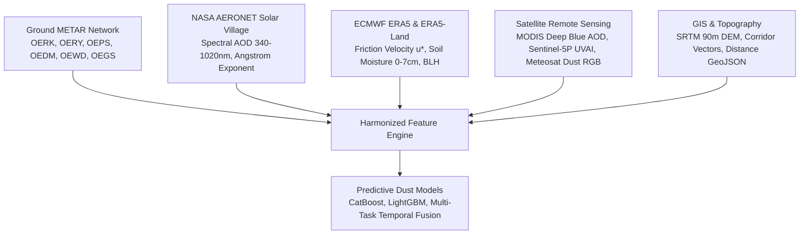

# 🏜️ Comprehensive Scientific Guide: Riyadh & Connected Desert Dust Systems

This guide establishes the comprehensive dataset architecture and meteorological foundations for forecasting sand and dust storms (SDS) in **Riyadh**, accounting for its physical connection to surrounding desert source beds and provincial transport corridors.

---

## 1. Visual Geography & Spatial Framework

The spatial relationships governing sandstorm ingress into the Riyadh metropolitan area are derived from two foundational geographic models:

1. **Distance from Riyadh to Nearest Desert Areas** ([`data/figures/riyadh_desert_regions_distance_map.png`](file:///c:/Users/hp/Desktop/sandstorm_forecasting/data/figures/riyadh_desert_regions_distance_map.png)):
   - Documents radial distances, compass bearings, and transport corridors from Riyadh to the surrounding sand seas and mountains.
2. **Ar-Riyāḍ Manāṭiq (Province & Governorate) Map** ([`data/figures/riyadh_districts_map.png`](file:///c:/Users/hp/Desktop/sandstorm_forecasting/data/figures/riyadh_districts_map.png)):
   - Identifies the administrative governorates of Riyadh Province acting as direct environmental corridors (Al-Kharj, Ad-Duwadimi, Wadi Ad-Dawasir, Rumah, Al-Majmaah, Az-Zulfi).

---

## 2. Connected Desert Systems & Dust Transport Mechanisms

```
                         [Nafud al-Thuwairat]
                             (220 km NW)
                             325° Bearing
                                  \
                                   \ (Shamal Corridor via Zulfi/Majmaah)
                                    \
 [Tuwayq Escarpment] ------------> [RIYADH] <------------- [Al-Thumamah Dunes]
    (180 km SW)                  (Receptor)                     (50 km E/NE)
    235° Bearing                     / \                        60° Bearing
   (Haboob & Tunneling)             /   \                           |
                                   /     \                          v
                                  /       \               [Ad-Dahna Desert]
                                 /         \                 (120 km NE)
                                /           \                45° Bearing
                               v             \
                     [Wadi Ad-Dawasir]        \
                        (Gateway)              v
                                        [Rub' al-Khali]
                                          (350 km SE)
                                         145° Bearing
```

### Detailed Desert Characteristics

| Desert / Region | Distance from Riyadh | Inflow Bearing | Geological Morphology | Sand Storm Generation Mechanism |
| :--- | :---: | :---: | :--- | :--- |
| **Al-Thumamah Dunes** | **50 km** | **60° (E/NE)** | Longitudinal dunes, active sand sheets | **Immediate Local Trigger:** High-energy microbursts and thermal turbulence mobilize fine sand sheets, causing rapid visibility collapses (<1 km) with lead times under 1 hour. |
| **Ad-Dahna Desert** *(Eastern Sand Sea)* | **120 km** | **45° (NE)** | Reddish barchans, star dunes ($z_0 \approx 0.003\text{m}$) | **Regional Red Sand Conveyor:** 1,000-km arc connecting Nafud to Rub' al-Khali; funnels iron-rich red dust into eastern Riyadh under easterly synoptic winds. |
| **Nafud al-Thuwairat** *(Northern Sand Sea)* | **220 km** | **325° (NW)** | Unconsolidated fine silts, transverse dunes | **Major High-Frequency Source:** Officially classified by the Saudi Regional SDS Center as a persistent dust-generation zone; strong northwesterly *Shamal* winds mobilize extensive particulate fronts into Riyadh. |
| **Tuwayq Escarpment** | **180 km** | **235° (SW)** | 800-km limestone cliff ridge ($800\text{--}1100\text{m}$) | **Orographic Haboob Generator:** Steep topography triggers aerodynamic wind tunneling, gravity currents, and deep convective downdrafts that produce wall-like sandstorms. |
| **Rub' al-Khali** *(The Empty Quarter)* | **350 km** | **145° (SE)** | Mega-dunes, transverse sand seas, sabkhas | **Mega-Basin Source:** Deep thermal low-pressure systems and pre-frontal Khasif winds drive massive regional dust plumes northwards through Wadi Ad-Dawasir and Al-Kharj. |

---

## 3. Riyadh Province Governorates & Meteorological Stations

The administrative districts of Ar-Riyāḍ Region host ground observation stations configured to monitor upwind dust fronts before they hit the capital:

| Station Code | Station Name / Location | Coordinates | Elevation | Role in Forecasting System |
| :---: | :--- | :---: | :---: | :--- |
| **`OERK`** | **King Khalid International Airport, Riyadh** | $24.93^\circ\text{N}, 46.72^\circ\text{E}$ | 614 m | **Primary Target Receptor:** Ground-truth METAR/ASOS records with calibrated $\text{PM}_{10}$ and visibility. |
| **`OERY`** | **Riyadh Air Base (Urban Core)** | $24.71^\circ\text{N}, 46.73^\circ\text{E}$ | 635 m | **Urban Center Monitor:** Street-level visibility and urban canopy heat-island interactions. |
| **`OEPS` / `OEKJ`** | **Prince Sultan Air Base / Al-Kharj** | $24.06^\circ\text{N}, 47.58^\circ\text{E}$ | 503 m | **Southern Gateway:** Monitors intrusions from the southern Dahna and Empty Quarter. |
| **`OEDM`** | **Prince Salman Airport, Ad-Duwadimi** | $24.45^\circ\text{N}, 44.12^\circ\text{E}$ | 922 m | **Western Plateau Gateway:** Early warning for Tuwayq downdrafts and western desert storms. |
| **`OEWD`** | **Wadi Al-Dawasir Regional Airport** | $20.50^\circ\text{N}, 45.20^\circ\text{E}$ | 628 m | **Rub' al-Khali Gateway:** Upstream sensor for long-range southerly dust advection. |
| **`OEGS`** | **Gassim Regional Airport (Buraidah)** | $26.30^\circ\text{N}, 43.77^\circ\text{E}$ | 648 m | **Nafud al-Thuwairat Corridor:** Directly measures dust generation at the northwest entrance. |

---

## 4. Multi-Modal Data Specifications



### 1. Ground Aerosol Optical Depth (NASA AERONET)
- **Station:** `Solar_Village` ($24.91^\circ\text{N}, 46.40^\circ\text{E}$, Elev 650m — ~35 km NW of Riyadh).
- **Critical Diagnostics:**
  - $\text{AOD}_{500\text{nm}}$: Surges from background $0.25\text{--}0.35$ up to $1.5\text{--}4.2$ during sandstorms.
  - $\alpha_{440/870}$ (Ångström Exponent): Drops below $0.35$ during severe mineral dust episodes, confirming coarse desert quartz sand rather than urban pollution.

### 2. Desert Surface & Atmospheric Reanalysis (ERA5)
- **Top-Layer Soil Moisture ($SM_{0-7\text{cm}}$):** When $SM < 0.04\,\text{m}^3/\text{m}^3$, sand beds become susceptible to wind deflation.
- **Friction Velocity ($u_*$):** Saltation threshold $u_{*t} \approx 0.28\,\text{m/s}$ for Riyadh desert quartz sand.
- **Owen Saltation Sand Flux:**
  $$Q = c \cdot u_*^3 \left(1 - \frac{u_{*t}^2}{u_*^2}\right) \cdot \exp(-15 \cdot SM_{0-7\text{cm}})$$

### 3. Directional Desert Inflow Projections
For each desert corridor $d \in \{\text{Thumamah}, \text{Dahna}, \text{Thuwairat}, \text{Tuwayq}, \text{Rub' al-Khali}\}$ with bearing $\theta_d$:
$$\text{Alignment}_d = \max\left(0, \cos(\theta_{\text{wind}} - \theta_d)\right)$$
$$\text{Transport\_Proxy}_d = \text{Alignment}_d \times u_{\text{wind}} \times Q_{\text{saltation}} \times \exp\left(-\frac{\text{Distance}_d}{300\,\text{km}}\right)$$

---

## 5. Local File Manifest

| File / Artifact | Path | Description |
| :--- | :--- | :--- |
| **Connected Deserts GeoJSON** | [`data/raw/gis/riyadh_connected_deserts_geometry.geojson`](file:///c:/Users/hp/Desktop/sandstorm_forecasting/data/raw/gis/riyadh_connected_deserts_geometry.geojson) | Polygon boundaries, bearings, and distances for all 5 deserts. |
| **Corridor Physics Metadata** | [`data/raw/gis/riyadh_connected_deserts_metadata.json`](file:///c:/Users/hp/Desktop/sandstorm_forecasting/data/raw/gis/riyadh_connected_deserts_metadata.json) | Transport lead times, angles, and station coordinates. |
| **Desert Telemetry Acquisition** | [`scripts/data_acquisition/download_connected_deserts_data.py`](file:///c:/Users/hp/Desktop/sandstorm_forecasting/scripts/data_acquisition/download_connected_deserts_data.py) | Downloads OERK, OERY, OEPS, OEDM, OEWD, OEGS telemetry. |
| **AERONET Optical Acquisition**| [`scripts/data_acquisition/download_aeronet_solar_village.py`](file:///c:/Users/hp/Desktop/sandstorm_forecasting/scripts/data_acquisition/download_aeronet_solar_village.py) | Downloads/compiles NASA AERONET ground truth optical depth. |
| **Desert Map Figures** | [`data/figures/riyadh_desert_regions_distance_map.png`](file:///c:/Users/hp/Desktop/sandstorm_forecasting/data/figures/riyadh_desert_regions_distance_map.png) | Distance and compass layout figure from Riyadh. |
| **Governorate Map Figures** | [`data/figures/riyadh_districts_map.png`](file:///c:/Users/hp/Desktop/sandstorm_forecasting/data/figures/riyadh_districts_map.png) | Riyadh Province administrative districts map. |
